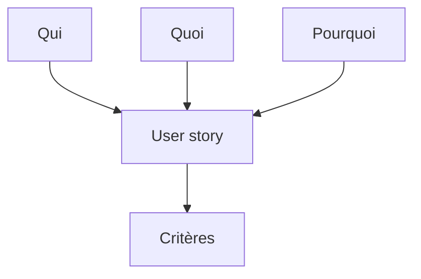

# User story

> [!info] En une phrase
> Une user story (récit utilisateur) est une **demande courte, écrite du point de vue de l'utilisateur**, qui dit qui veut quoi et pourquoi : « En tant que…, je veux…, afin de… ». C'est l'unité de travail des méthodes agiles.

```dataviewjs
await dv.view("10 — Templates/Scripts/learning", { view: "concept" })
```

## 1 · Comprendre
### Définition
**Le format** : *En tant que* &lt;type d'utilisateur&gt;, *je veux* &lt;action&gt;, *afin de* &lt;bénéfice&gt;.

**Le « afin de » est le plus important** : il donne la raison, ce qui permet de proposer une meilleure solution que celle demandée.

**Toujours accompagnée** de [[Critères d'acceptation|critères d'acceptation]] qui disent quand elle est réussie.

**Les qualités d'une bonne story (INVEST)** : *Indépendante*, *Négociable* (on peut en discuter), *de Valeur* pour l'utilisateur, *Estimable*, *Petite* (faisable en quelques jours), *Testable*.

**Une grosse story** (une *épopée*, *epic*) se découpe en plusieurs petites.

### Pourquoi ça existe
Les demandes écrites comme des tâches techniques (« ajouter un endpoint ») font perdre de vue pour qui et pour quoi on travaille.

### Le problème résolu
Garder l'utilisateur au centre, découper le travail en morceaux livrables, et permettre de prioriser par la valeur.

## 2 · Explorer
### Comment ça fonctionne


### Exemple concret
```text
Epic : Exporter les annotations en image

Story 1
En tant qu'annotateur,
je veux exporter une tâche en PNG,
afin de joindre mes annotations à un rapport.

Story 2
En tant que responsable,
je veux que seuls les membres d'un projet puissent exporter ses tâches,
afin de protéger les plans confidentiels.
```

### Cas d'utilisation
- Écrire les tickets GitLab de ton projet CVAT
- Découper un gros besoin en petites livraisons

> [!warning] À ne pas confondre
> Une user story n'est pas une spécification complète : c'est un **rappel de conversation**. Les détails viennent dans la discussion et les critères d'acceptation. Et « En tant que développeur, je veux une base de données » n'est pas une vraie story : il n'y a pas d'utilisateur ni de valeur.

## 3 · Pratiquer
- Écris trois user stories pour ton projet CVAT, avec un vrai « afin de »

## 4 · Expliquer
> [!quote] Mon résumé, avec mes mots
> _À écrire sans regarder la fiche. Si je bloque, je ne l'ai pas encore compris._

## 5 · Relier
- **Prérequis** : [[Spécification (specs)]]
- **Complémentaires** : [[Critères d'acceptation]] · [[Backlog et priorisation]] · [[Méthode agile (Scrum et Kanban)]] · [[Définition de terminé]]

## 6 · Réviser
> [!question] Me faire interroger
> Je demande à Claude de m'interroger sur cette notion pour vérifier que je l'ai comprise.

### Validation de la maîtrise
La notion est maîtrisée quand j'ai réussi **tous les exercices** qui l'utilisent (statut `reussi` dans l'exercice).

```dataviewjs
await dv.view("10 — Templates/Scripts/learning", { view: "maitrise" })
```
