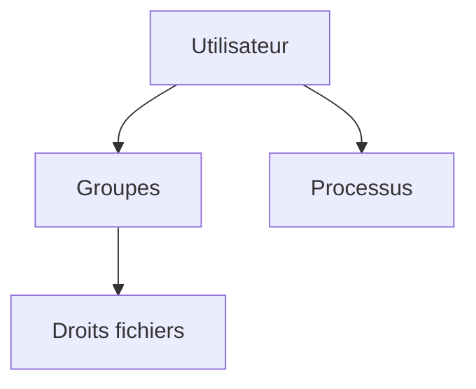

# Utilisateur et groupe

> [!info] En une phrase
> Sous Linux, chaque programme tourne au nom d'un utilisateur, et les groupes donnent des droits à plusieurs utilisateurs à la fois.

```dataviewjs
await dv.view("10 — Templates/Scripts/learning", { view: "concept" })
```

## 1 · Comprendre
### Définition
Chaque **utilisateur** a un identifiant (UID), un dossier personnel et un shell. Chaque **groupe** (GID) rassemble des utilisateurs : un fichier appartient à un utilisateur **et** à un groupe. Les services ont souvent leur propre utilisateur (`www-data`, `postgres`) pour limiter les dégâts en cas de faille.

Fichiers clés : `/etc/passwd` (utilisateurs), `/etc/group` (groupes).

### Pourquoi ça existe
Séparer les personnes et les services, et ne donner que les droits nécessaires.

### Le problème résolu
Un service piraté qui tournerait en root aurait accès à tout.

## 2 · Explorer
### Comment ça fonctionne


### Exemple concret
```bash
whoami ; id                        # moi et mes groupes
sudo adduser deploy                # créer un utilisateur
sudo usermod -aG docker oumar      # ajouter au groupe docker (se reconnecter ensuite)
sudo chown -R deploy:deploy /opt/app
sudo -u deploy whoami              # agir en tant qu'un autre utilisateur
```

### Cas d'utilisation
- `permission denied while trying to connect to the Docker daemon socket` : l'utilisateur n'est pas dans le groupe `docker`
- Faire tourner une application sous un compte dédié
- Dans un Dockerfile : `USER app` pour ne pas tourner en root

> [!warning] À ne pas confondre
> Ajouter quelqu'un à un groupe ne prend effet qu'**à la prochaine connexion** (ou `newgrp docker`). Et le groupe `docker` donne en pratique les droits root : à ne pas distribuer à la légère.

## 3 · Pratiquer

### Exercice visuel

Sur Excalidraw, **sans regarder la fiche**. Puis je compare avec la fiche, je corrige en rouge ce qui était faux, et j'explique mon dessin à voix haute ou à Claude dans le chat.

> [!example] 🧠 Dessine de mémoire
> Dessine trois utilisateurs (toi, root, www-data) et deux groupes (docker, sudo). Montre qui peut faire quoi.

> [!example] 🛣️ Suis le trajet
> Dessine pourquoi `docker ps` marche sans `sudo` une fois que tu es dans le groupe `docker` : la commande, la socket, ses droits.

### Mon schéma

> [!tip] Mon dessin Excalidraw
> _Je crée le dessin « Schéma - Utilisateur et groupe » et je l'intègre ici avec `![[Schéma - Utilisateur et groupe.excalidraw]]`, puis je coche `schema`._

### Appliquer dans le fil rouge
- [[Dépenses 11 - Sauvegarder ses données]]
- [[MesDépenses 11 - Installer l'API sur un serveur]]

## 4 · Relier
- **Prérequis** : [[Permissions Linux]]
- **Complémentaires** : [[Service (systemd)]]
- **Commandes** : [[chown]] · [[sudo]]

## 5 · Réviser
> [!question] Me faire interroger
> Je demande à Claude de m'interroger sur cette notion pour vérifier que je l'ai comprise.

### Validation (compris, puis maîtrisé)
Trois cases à cocher dans les propriétés de la fiche :
- `schema` : mon dessin du concept est dans « Mon schéma » ;
- `exercice_visuel` : j'ai fait et corrigé les exercices visuels de la section 3 ;
- `fil_rouge` : je l'ai appliqué dans le fil rouge (coché tout seul quand une étape qui l'utilise est réussie).

Les trois cochées : la notion compte comme **comprise**. **Maîtrisé** : c'est moi qui le mets dans `status`, quand je le sens.

```dataviewjs
await dv.view("10 — Templates/Scripts/learning", { view: "maitrise" })
```
