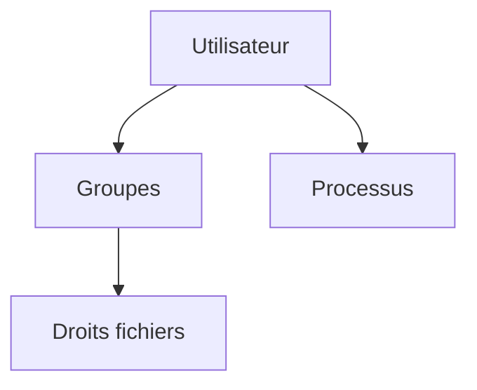

# Utilisateur et groupe

> [!info] En une phrase
> Sous Linux, chaque programme tourne au nom d'un utilisateur, et les groupes donnent des droits à plusieurs utilisateurs à la fois.

```dataviewjs
await dv.view("10 — Templates/Scripts/learning", { view: "concept" })
```

## 1 · Comprendre
### Définition
Chaque **utilisateur** a un identifiant (UID), un dossier personnel et un shell. Chaque **groupe** (GID) rassemble des utilisateurs : un fichier appartient à un utilisateur **et** à un groupe. Les services ont souvent leur propre utilisateur (`www-data`, `postgres`) pour limiter les dégâts en cas de faille.

Fichiers clés : `/etc/passwd` (utilisateurs), `/etc/group` (groupes).

### Pourquoi ça existe
Séparer les personnes et les services, et ne donner que les droits nécessaires.

### Le problème résolu
Un service piraté qui tournerait en root aurait accès à tout.

## 2 · Explorer
### Comment ça fonctionne


### Exemple concret
```bash
whoami ; id                        # moi et mes groupes
sudo adduser deploy                # créer un utilisateur
sudo usermod -aG docker oumar      # ajouter au groupe docker (se reconnecter ensuite)
sudo chown -R deploy:deploy /opt/app
sudo -u deploy whoami              # agir en tant qu'un autre utilisateur
```

### Cas d'utilisation
- `permission denied while trying to connect to the Docker daemon socket` : l'utilisateur n'est pas dans le groupe `docker`
- Faire tourner une application sous un compte dédié
- Dans un Dockerfile : `USER app` pour ne pas tourner en root

> [!warning] À ne pas confondre
> Ajouter quelqu'un à un groupe ne prend effet qu'**à la prochaine connexion** (ou `newgrp docker`). Et le groupe `docker` donne en pratique les droits root : à ne pas distribuer à la légère.

## 3 · Pratiquer
- Crée un utilisateur de test, un dossier qui lui appartient, et vérifie que ton utilisateur ne peut pas y écrire.

## 4 · Expliquer
> [!quote] Mon résumé, avec mes mots
> _À écrire sans regarder la fiche. Si je bloque, je ne l'ai pas encore compris._

## 5 · Relier
- **Prérequis** : [[Permissions Linux]]
- **Complémentaires** : [[Service (systemd)]]
- **Commandes** : [[chown]] · [[sudo]]

## 6 · Réviser
> [!question] Me faire interroger
> Je demande à Claude de m'interroger sur cette notion pour vérifier que je l'ai comprise.

### Validation de la maîtrise
- [ ] Je l'explique sans notes, en 3 phrases, à quelqu'un qui ne connaît pas
- [ ] J'ai réussi un exercice qui l'utilise
- [ ] Je l'ai utilisé dans un projet
- [ ] Je sais dire quand ne pas l'utiliser (ou ce qu'il ne faut pas confondre)
