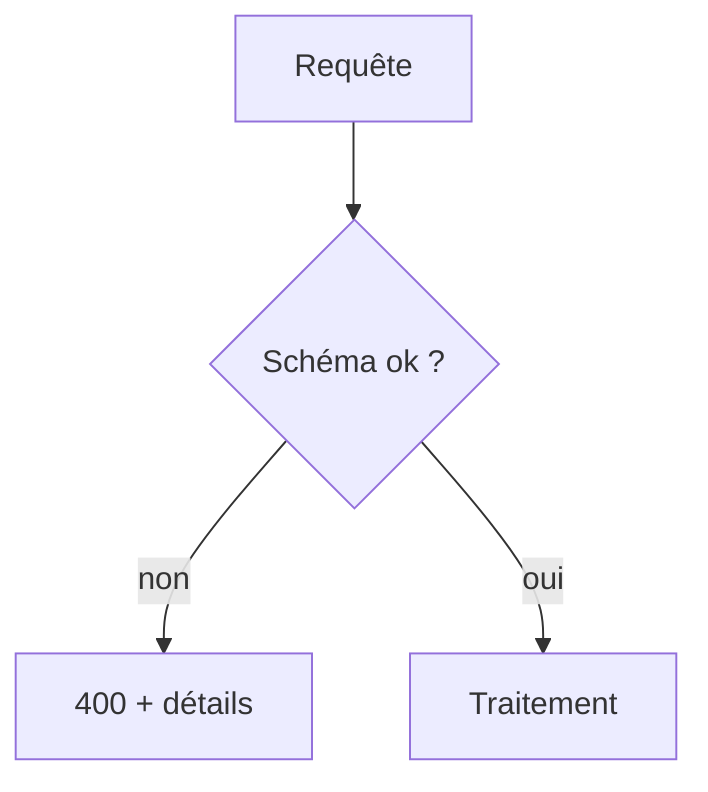

# Validation des données

> [!info] En une phrase
> Vérifier que les données reçues (corps, paramètres, fichiers) ont la bonne forme et des valeurs acceptables avant de les utiliser, et répondre 400 sinon.

```dataviewjs
await dv.view("10 — Templates/Scripts/learning", { view: "concept" })
```

## 1 · Comprendre
### Définition
**Règle d'or : ne jamais faire confiance à ce qui vient de l'extérieur** (client, formulaire, fichier, autre API). La validation du navigateur (`required`) ou les types [[TypeScript]] ne protègent pas : n'importe qui peut envoyer une requête avec curl.
On vérifie :
- la **présence** et le **type** des champs (`nom` est une chaîne non vide) ;
- les **valeurs** (longueur, plage, liste autorisée, format d'e-mail) ;
- l'**absence** de champs inattendus.
On utilise une bibliothèque de **schéma** : **Zod** (TypeScript), **Joi**, **Pydantic** (Python).

### Pourquoi ça existe
Des données inattendues provoquent des plantages, des données corrompues en base, et des failles (injection).

### Le problème résolu
Refuser tôt, avec un message clair, plutôt que d'échouer plus loin de façon incompréhensible.

## 2 · Explorer
### Comment ça fonctionne


### Exemple concret
```js
import { z } from "zod";
const NouvelleTache = z.object({
  nom: z.string().min(1).max(100),
  priorite: z.enum(["basse", "normale", "haute"]).default("normale"),
  echeance: z.string().date().optional(),
});
app.post("/taches", (req, res) => {
  const r = NouvelleTache.safeParse(req.body);
  if (!r.success) return res.status(400).json({ erreurs: r.error.issues });
  const tache = r.data;           // propre et typé
  // …
  res.status(201).json(tache);
});
```
En Python, Pydantic fait la même chose (et FastAPI l'utilise automatiquement).

### Cas d'utilisation
- Toute route qui reçoit un corps
- Les paramètres de requête (`?page=abc`)
- La lecture d'un fichier de configuration

> [!warning] À ne pas confondre
> **Valider** (refuser ce qui ne va pas) et **assainir / échapper** (rendre une valeur sûre pour un contexte, comme le HTML ou le SQL). Les deux sont nécessaires.

## 3 · Pratiquer

### Exercice visuel

Sur Excalidraw, **sans regarder la fiche**. Puis je compare avec la fiche, je corrige en rouge ce qui était faux, et j'explique mon dessin avec mes mots (section 4).

> [!example] 🛣️ Suis le trajet
> Dessine le trajet d'une dépense avec un montant négatif : elle arrive, Pydantic la vérifie, l'API répond. Marque l'endroit où elle est arrêtée.

> [!example] 🔄 Change de contexte
> Redessine la même vérification côté front Vue. Pourquoi faut-il quand même garder celle de l'API ?

### Mon schéma

> [!tip] Mon dessin Excalidraw
> _Je crée le dessin « Schéma - Validation des données » et je l'intègre ici avec `![[Schéma - Validation des données.excalidraw]]`._

### Appliquer dans le fil rouge
- Pas encore d'étape du fil rouge pour cette notion : je l'applique dans mon travail (CVAT, Nuclio) ou je demande une étape à Claude.

## 4 · Expliquer
> [!quote] Mon résumé, avec mes mots
> _J'explique mon schéma avec mes mots, sans regarder la fiche. Si je bloque, je ne l'ai pas encore compris._

## 5 · Relier
- **Prérequis** : [[JSON]] · [[Endpoint]]
- **Complémentaires** : [[Code de statut HTTP]] · [[Injection SQL]]

## 6 · Réviser
> [!question] Me faire interroger
> Je demande à Claude de m'interroger sur cette notion pour vérifier que je l'ai comprise.

### Validation de la maîtrise
La notion est maîtrisée quand je sais :
1. **l'expliquer** de façon fluide, à partir de mon schéma (section 4) ;
2. **l'adapter** à un autre contexte (consigne « Change de contexte », ou Claude m'interroge sur un autre cas) ;
3. **l'appliquer** pour de vrai dans le fil rouge (section 3).

Réussir un exercice ne suffit pas. C'est moi qui passe le statut en `maitrise`.

```dataviewjs
await dv.view("10 — Templates/Scripts/learning", { view: "maitrise" })
```
