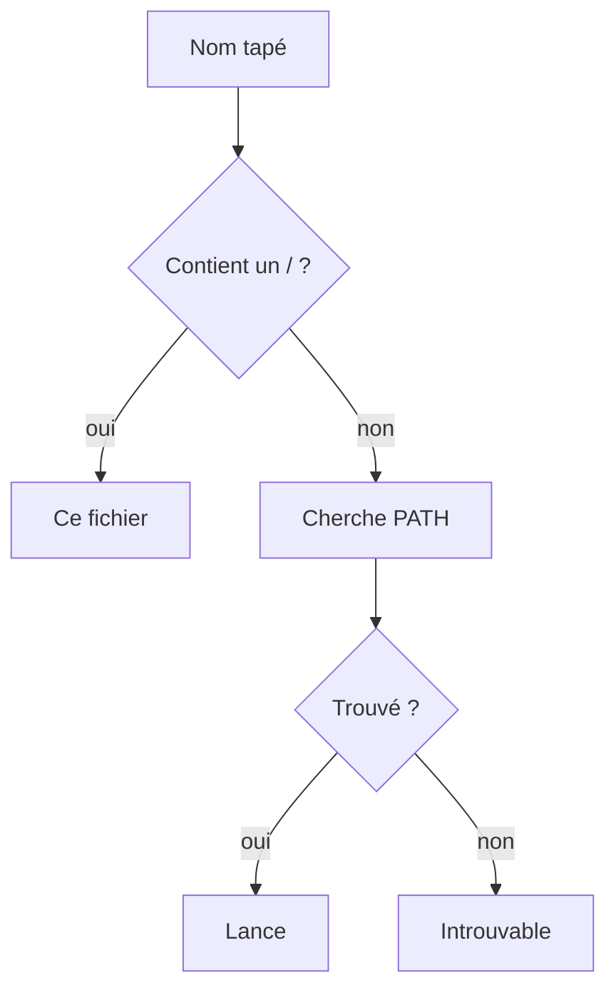

# Variable PATH

> [!info] En une phrase
> Le PATH est une variable d'environnement qui contient la liste des dossiers où le shell cherche un programme quand tu tapes son nom seul.

```dataviewjs
await dv.view("10 — Templates/Scripts/learning", { view: "concept" })
```

## 1 · Comprendre
### Définition
Quand tu tapes `git`, le shell ne sait pas ce que c'est. Il regarde chaque dossier du PATH, **dans l'ordre**, et lance le premier fichier nommé `git` qu'il trouve. S'il n'en trouve aucun : `command not found` (Bash) ou « n'est pas reconnu » (PowerShell).

- Sous Linux, les dossiers sont séparés par `:` → `/usr/local/bin:/usr/bin:/bin`
- Sous Windows, par `;` → `C:\Windows\system32;C:\Program Files\Git\cmd`

**Le dossier courant n'est pas dans le PATH** (sous Linux) : c'est pour ça qu'il faut taper `./archiver.sh` et pas `archiver.sh`.

Deux façons de lancer un programme :
1. **par son nom** → le shell cherche dans le PATH ;
2. **par son chemin** (dès que le nom contient un `/`) → le shell lance exactement ce fichier, sans chercher.

### Pourquoi ça existe
Sans PATH, il faudrait taper le chemin complet de chaque programme : `/usr/bin/git status` au lieu de `git status`.

### Le problème résolu
Lancer les programmes par leur nom depuis n'importe quel dossier, et choisir quelle version est prioritaire.

## 2 · Explorer
### Comment ça fonctionne


### Exemple concret
```bash
echo $PATH                        # la liste, séparée par :
which git                         # quel git sera lancé : /usr/bin/git
type ls                           # alias, commande du shell ou programme ?
./archiver.sh                     # par chemin : pas de recherche
export PATH="$HOME/outils:$PATH"  # ajoute un dossier en tête, pour ce terminal
```
Pour que l'ajout soit permanent, mets la ligne `export` à la fin de `~/.bashrc`, puis rouvre le terminal.
```powershell
$env:Path                         # la liste, séparée par ;
Get-Command git                   # quel git sera lancé
$env:Path = "C:\outils;" + $env:Path   # pour ce terminal
```
Sous Windows, la modification permanente se fait dans « Modifier les variables d'environnement système ».

### Cas d'utilisation
- `command not found` après une installation : le dossier du programme n'est pas dans le PATH, ou le terminal n'a pas été rouvert
- Deux versions de Python : `which python3` dit laquelle est lancée ; un environnement virtuel activé met son dossier en tête du PATH
- Une tâche cron ou un job de CI ne trouve pas un outil : son PATH est plus court que celui de ton terminal

> [!warning] À ne pas confondre
> Le **PATH** (où chercher les programmes) n'est pas un **chemin** (l'adresse d'un fichier). Et l'ordre compte : si deux dossiers contiennent `python`, c'est le premier de la liste qui gagne.

## 3 · Pratiquer
- Fais l'[[Exercice - Explorer son PATH]]

## 4 · Expliquer
> [!quote] Mon résumé, avec mes mots
> _À écrire sans regarder la fiche. Si je bloque, je ne l'ai pas encore compris._

## 5 · Relier
- **Prérequis** : [[Variable d'environnement]] · [[Shell]]
- **Complémentaires** : [[Système de fichiers]] · [[Code de sortie]]

## 6 · Réviser
> [!question] Me faire interroger
> Je demande à Claude de m'interroger sur cette notion pour vérifier que je l'ai comprise.

### Validation de la maîtrise
La notion est maîtrisée quand j'ai réussi **tous les exercices** qui l'utilisent (statut `reussi` dans l'exercice).

```dataviewjs
await dv.view("10 — Templates/Scripts/learning", { view: "maitrise" })
```
