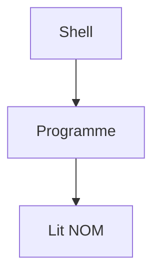

# Variable d'environnement

> [!info] En une phrase
> Une valeur nommée que le système donne à chaque programme au démarrage, pour le configurer sans toucher à son code.

```dataviewjs
await dv.view("10 — Templates/Scripts/learning", { view: "concept" })
```

## 1 · Comprendre
### Définition
Une **variable d'environnement** est un couple `NOM=valeur` attaché à un processus. Chaque programme lancé hérite des variables de celui qui l'a lancé (le shell, Docker, le runner de CI).

### Pourquoi ça existe
Le même programme doit tourner sur ton poste, dans la CI et en production avec des réglages différents (adresse d'un serveur, mot de passe, proxy). On change la variable, pas le code.

### Le problème résolu
Sans elles, on écrit les adresses et les mots de passe en dur dans le code : il faut le modifier à chaque machine, et les secrets finissent dans Git.

## 2 · Explorer
### Comment ça fonctionne

- Elles se transmettent **du parent à l'enfant**, jamais dans l'autre sens.
- Par convention, les noms sont en MAJUSCULES : `PATH`, `HOME`, `HTTP_PROXY`.
- `PATH` est spéciale : la liste des dossiers où le shell cherche les programmes. « commande introuvable » veut souvent dire « pas dans le PATH ». Voir [[Variable PATH]].

### Exemple concret
```bash
# Bash (Linux, Git Bash, conteneur)
export NOM="Oumar"
echo $NOM
```
```powershell
# PowerShell (Windows)
$env:NOM = "Oumar"
echo $env:NOM
```
```python
import os
nom = os.environ.get("NOM", "inconnu")   # "inconnu" si la variable n'existe pas
```
```bash
docker run -e NOM=Oumar mon-image   # la donner à un conteneur
```

### Cas d'utilisation
- Configurer un script Python ou un conteneur (`-e` avec Docker)
- Les variables d'une pipeline : [[Variables CI-CD GitLab]]
- Passer par le proxy de l'entreprise : `HTTP_PROXY`, `HTTPS_PROXY`, `NO_PROXY` (voir [[Proxy]])

> [!warning] À ne pas confondre
> Une variable d'environnement (visible par les programmes lancés ensuite) et une simple variable du shell ou du code Python (qui reste dans ce programme). En Bash, sans `export`, la variable n'est pas transmise.

## 3 · Pratiquer

### Exercice visuel

Sur Excalidraw, **sans regarder la fiche**. Puis je compare avec la fiche, je corrige en rouge ce qui était faux, et j'explique mon dessin à voix haute ou à Claude dans le chat.

> [!example] 🛣️ Suis le trajet
> Dessine comment `DATABASE_URL` arrive jusqu'à ton API : où tu l'écris, qui la donne au programme, où le code la lit.

> [!example] 🔄 Change de contexte
> Même chose dans un conteneur Docker lancé par compose : redessine le trajet de la variable. Qui la donne cette fois ?

### Mon schéma

> [!tip] Mon dessin Excalidraw
> _Je crée le dessin « Schéma - Variable d'environnement » et je l'intègre ici avec `![[Schéma - Variable d'environnement.excalidraw]]`, puis je coche `schema`._

### Appliquer dans le fil rouge
- [[Dépenses 09 - Un vrai outil en ligne de commande]]
- [[MesDépenses 07 - Tout lancer avec compose]]

## 4 · Relier
- **Prérequis** : [[Terminal]]
- **Complémentaires** : [[Code de sortie]]
- **Utilisé par** : [[Variables CI-CD GitLab]] · [[Proxy]] · [[Conteneur]]

## 5 · Réviser
> [!question] Me faire interroger
> Je demande à Claude de m'interroger sur cette notion pour vérifier que je l'ai comprise.

### Validation (compris, puis maîtrisé)
Trois cases à cocher dans les propriétés de la fiche :
- `schema` : mon dessin du concept est dans « Mon schéma » ;
- `exercice_visuel` : j'ai fait et corrigé les exercices visuels de la section 3 ;
- `fil_rouge` : je l'ai appliqué dans le fil rouge (coché tout seul quand une étape qui l'utilise est réussie).

Les trois cochées : la notion compte comme **comprise**. **Maîtrisé** : c'est moi qui le mets dans `status`, quand je le sens.

```dataviewjs
await dv.view("10 — Templates/Scripts/learning", { view: "maitrise" })
```
