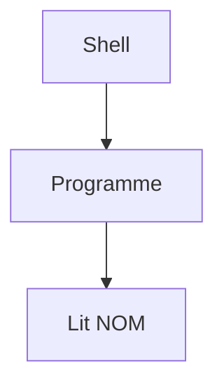

# Variable d'environnement

> [!info] En une phrase
> Une valeur nommée que le système donne à chaque programme au démarrage, pour le configurer sans toucher à son code.

```dataviewjs
await dv.view("10 — Templates/Scripts/learning", { view: "concept" })
```

## 1 · Comprendre
### Définition
Une **variable d'environnement** est un couple `NOM=valeur` attaché à un processus. Chaque programme lancé hérite des variables de celui qui l'a lancé (le shell, Docker, le runner de CI).

### Pourquoi ça existe
Le même programme doit tourner sur ton poste, dans la CI et en production avec des réglages différents (adresse d'un serveur, mot de passe, proxy). On change la variable, pas le code.

### Le problème résolu
Sans elles, on écrit les adresses et les mots de passe en dur dans le code : il faut le modifier à chaque machine, et les secrets finissent dans Git.

## 2 · Explorer
### Comment ça fonctionne

- Elles se transmettent **du parent à l'enfant**, jamais dans l'autre sens.
- Par convention, les noms sont en MAJUSCULES : `PATH`, `HOME`, `HTTP_PROXY`.
- `PATH` est spéciale : la liste des dossiers où le shell cherche les programmes. « commande introuvable » veut souvent dire « pas dans le PATH ».

### Exemple concret
```bash
# Bash (Linux, Git Bash, conteneur)
export NOM="Oumar"
echo $NOM
```
```powershell
# PowerShell (Windows)
$env:NOM = "Oumar"
echo $env:NOM
```
```python
import os
nom = os.environ.get("NOM", "inconnu")   # "inconnu" si la variable n'existe pas
```
```bash
docker run -e NOM=Oumar mon-image   # la donner à un conteneur
```

### Cas d'utilisation
- Configurer un script Python ou un conteneur (`-e` avec Docker)
- Les variables d'une pipeline : [[Variables CI-CD GitLab]]
- Passer par le proxy de l'entreprise : `HTTP_PROXY`, `HTTPS_PROXY`, `NO_PROXY` (voir [[Proxy]])

> [!warning] À ne pas confondre
> Une variable d'environnement (visible par les programmes lancés ensuite) et une simple variable du shell ou du code Python (qui reste dans ce programme). En Bash, sans `export`, la variable n'est pas transmise.

## 3 · Pratiquer
- Affiche ta variable `PATH` dans ton terminal, puis repère le dossier où se trouve `python` ou `git`.
- Crée une variable `NOM`, lance un petit script Python qui l'affiche, puis ferme le terminal : existe-t-elle encore ?

## 4 · Expliquer
> [!quote] Mon résumé, avec mes mots
> _À écrire sans regarder la fiche. Si je bloque, je ne l'ai pas encore compris._

## 5 · Relier
- **Prérequis** : [[Terminal]]
- **Complémentaires** : [[Code de sortie]]
- **Utilisé par** : [[Variables CI-CD GitLab]] · [[Proxy]] · [[Conteneur]]

## 6 · Réviser
> [!question] Me faire interroger
> Je demande à Claude de m'interroger sur cette notion pour vérifier que je l'ai comprise.

### Validation de la maîtrise
- [ ] Je l'explique sans notes, en 3 phrases, à quelqu'un qui ne connaît pas
- [ ] J'ai réussi un exercice qui l'utilise
- [ ] Je l'ai utilisé dans un projet
- [ ] Je sais dire quand ne pas l'utiliser (ou ce qu'il ne faut pas confondre)
