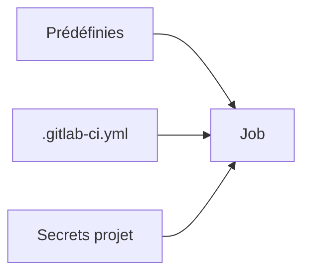

# Variables CI-CD GitLab

> [!info] En une phrase
> Des valeurs que GitLab injecte dans les jobs : certaines sont fournies par GitLab, les secrets se rangent dans les paramètres du projet, jamais dans le .gitlab-ci.yml.

## 1 · Comprendre
### Définition
Dans un `script:`, une variable se lit comme en shell : `$NOM`. Il y en a trois sortes : **prédéfinies** par GitLab, déclarées dans le fichier (`variables:`), et déclarées dans le projet (*Settings > CI/CD > Variables*).

### Pourquoi ça existe
Donner à la pipeline des informations qui changent (commit, branche) ou secrètes (mots de passe, jetons) sans les écrire dans le code.

### Le problème résolu
Les mots de passe écrits dans le fichier de CI étaient lisibles par tous et restaient pour toujours dans l'historique Git.

## 2 · Explorer
### Comment ça fonctionne


### Exemple concret
| Variable prédéfinie | Contient |
| --- | --- |
| `$CI_COMMIT_SHORT_SHA` | l'identifiant court du commit (pratique comme tag) |
| `$CI_COMMIT_BRANCH` | la branche |
| `$CI_DEFAULT_BRANCH` | la branche par défaut |
| `$CI_PROJECT_DIR` | le dossier du dépôt dans le job |
| `$CI_REGISTRY_IMAGE` | l'adresse de l'image dans le registre GitLab du projet |

| Option d'une variable de projet | Effet |
| --- | --- |
| **Masked** | remplacée par `[MASKED]` dans les logs |
| **Protected** | existe seulement sur les branches et tags protégés |
| **Type File** | la valeur est écrite dans un fichier, la variable contient son chemin |

```yaml
variables:
  IMAGE_NAME: mon-app        # pas secret : dans le fichier
before_script:               # NEXUS_USER et NEXUS_PASSWORD : dans les paramètres du projet
  - echo "$NEXUS_PASSWORD" | docker login -u "$NEXUS_USER" --password-stdin "$NEXUS_URL"
```
La variable spéciale **`DOCKER_AUTH_CONFIG`** permet au runner de récupérer l'`image:` d'un job depuis un registre privé.

### Cas d'utilisation
- Tagger les images avec le commit
- Se connecter à un registre sans exposer le mot de passe

> [!warning] À ne pas confondre
> **Protected** et **Masked** : une variable protégée est **vide** sur une branche non protégée, d'où un job qui échoue sur ta branche et marche sur `main`.

## 3 · Relier
- **Au travail** : [Variables CI-CD GitLab au travail](obsidian://open?vault=Travail&file=Variables%20CI-CD%20GitLab%20au%20travail)
- **Prérequis** : [[Pipeline GitLab CI]]
- **Notion parente** : [[Pipeline GitLab CI]]
- **Utilisé par** : [[Construire une image dans la CI]] · [[Kaniko]]
- **Commandes** : [[docker login]]
