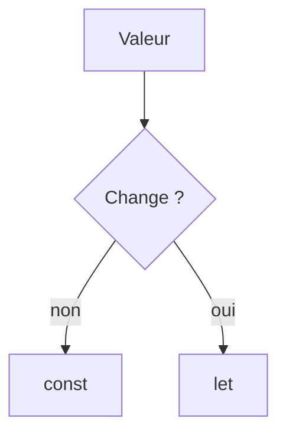

# Variables et types en JavaScript

> [!info] En une phrase
> On déclare une valeur avec const (ne sera pas réaffectée) ou let (pourra changer) ; les types de base sont nombre, chaîne, booléen, null, undefined, objet.

```dataviewjs
await dv.view("10 — Templates/Scripts/learning", { view: "concept" })
```

## 1 · Comprendre
### Définition
```js
const nom = "export";      // chaîne (string)
let total = 0;              // nombre (number) : entiers et décimaux
const actif = true;         // booléen (boolean)
let resultat = null;        // « pas de valeur » volontaire
let x;                      // undefined : déclaré, jamais rempli
```
- **`const`** par défaut ; **`let`** si la variable doit être réaffectée. **`var`** est l'ancienne façon : à éviter.
- `typeof total` donne le type.
- Gabarit de chaîne avec des **backticks** : `` `Total : ${total} fichiers` ``.
- Comparaison : toujours **`===`** et **`!==`** (stricts). `==` convertit les types et donne des surprises (`"0" == 0` vaut `true`).

### Pourquoi ça existe
Nommer les valeurs pour les réutiliser, et dire clairement si elles changent.

### Le problème résolu
`const` empêche de réaffecter par erreur ; `===` évite les conversions cachées qui créent des bugs.

## 2 · Explorer
### Comment ça fonctionne


### Exemple concret
```js
const fichiers = 3;
let message = `Il y a ${fichiers} fichiers`;
if (fichiers === 0) {
  message = "Rien à zipper";
}
console.log(message, typeof fichiers); // Il y a 3 fichiers number
```
Les **valeurs « fausses »** (*falsy*) : `false`, `0`, `""`, `null`, `undefined`, `NaN`. Tout le reste est « vrai » dans un `if`.

### Cas d'utilisation
- Toute ligne de code JS
- Lire des paramètres et des réponses d'API
- Les conditions des composants React

> [!warning] À ne pas confondre
> `const` ne rend pas l'objet **figé** : `const liste = []` puis `liste.push(1)` fonctionne ; seule la réaffectation `liste = …` est interdite. Et `null` (vide volontaire) n'est pas `undefined` (jamais rempli).

## 3 · Pratiquer
- Dans la console, teste `"0" == 0` puis `"0" === 0` et explique la différence
- Déclare une constante tableau et ajoute-lui un élément : pourquoi est-ce permis ?

## 4 · Expliquer
> [!quote] Mon résumé, avec mes mots
> _À écrire sans regarder la fiche. Si je bloque, je ne l'ai pas encore compris._

## 5 · Relier
- **Prérequis** : [[JavaScript]] · [[Variables et types en Python]]
- **Complémentaires** : [[Tableau et objet JavaScript]]

## 6 · Réviser
> [!question] Me faire interroger
> Je demande à Claude de m'interroger sur cette notion pour vérifier que je l'ai comprise.

### Validation de la maîtrise
La notion est maîtrisée quand j'ai réussi **tous les exercices** qui l'utilisent (statut `reussi` dans l'exercice).

```dataviewjs
await dv.view("10 — Templates/Scripts/learning", { view: "maitrise" })
```
