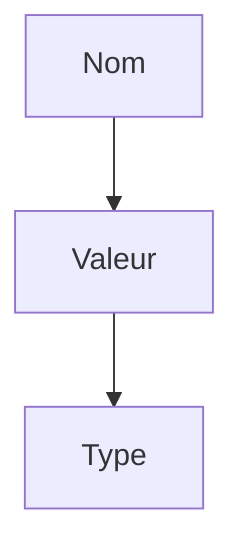

# Variables et types en Python

> [!info] En une phrase
> Une variable est un nom posé sur une valeur ; le type de la valeur (texte, nombre, booléen…) dit ce qu'on peut en faire.

```dataviewjs
await dv.view("10 — Templates/Scripts/learning", { view: "concept" })
```

## 1 · Comprendre
### Définition
Une **variable** se crée en lui donnant une valeur : `taille = 42`. Pas de mot-clé comme `let` en JavaScript. Chaque valeur a un **type** :

| Type | Exemple | Sert à |
| --- | --- | --- |
| `str` (texte) | `"rapport.pdf"` | noms, chemins, messages |
| `int` (entier) | `42` | compter |
| `float` (décimal) | `3.5` | mesures |
| `bool` | `True`, `False` | oui ou non |
| `None` | `None` | « pas de valeur » |

### Pourquoi ça existe
Le programme doit retenir des informations (un nom de fichier, un compteur) et savoir quelles opérations ont un sens : on additionne des nombres, on met des textes bout à bout.

### Le problème résolu
Sans type, `"2" + 2` serait ambigu. Python refuse et t'oblige à dire ce que tu veux : `int("2") + 2` ou `"2" + str(2)`.

## 2 · Explorer
### Comment ça fonctionne

- `type(x)` affiche le type d'une valeur.
- Conversions : `int("42")`, `str(42)`, `float("3.5")`.
- **f-string** pour construire un texte : `f"{nb} fichiers dans {dossier}"`.

### Exemple concret
```python
dossier = "photos"          # str
nb_fichiers = 12            # int
compresser = True           # bool

print(f"{nb_fichiers} fichiers dans {dossier}")
print(type(nb_fichiers))    # <class 'int'>

nom = "rapport.PDF"
print(nom.lower())          # rapport.pdf
print(nom.endswith(".PDF")) # True
print(len(nom))             # 11
```

### Cas d'utilisation
- Retenir le dossier à traiter, le nom de l'archive, un compteur
- Construire des noms de fichiers : `f"export_{date}.zip"`

> [!warning] À ne pas confondre
> `=` (je range une valeur) et `==` (je compare deux valeurs). Et `"42"` (texte) ≠ `42` (nombre) : ce que tu lis dans un fichier ou une variable d'environnement est **toujours du texte**.

## 3 · Pratiquer
Dans le mini-projet [[Projet - Faire le ménage dans ses conteneurs Docker]] : [[Ménage 01 - Lire la liste des conteneurs]].

## 4 · Expliquer
> [!quote] Mon résumé, avec mes mots
> _À écrire sans regarder la fiche. Si je bloque, je ne l'ai pas encore compris._

## 5 · Relier
- **Prérequis** : [[Python]]
- **Complémentaires** : [[Liste et dictionnaire]]
- **Utilisé par** : [[Condition (if)]] · [[Boucle (for, while)]] · [[Fonction]]

## 6 · Réviser
> [!question] Me faire interroger
> Je demande à Claude de m'interroger sur cette notion pour vérifier que je l'ai comprise.

### Validation de la maîtrise
La notion est maîtrisée quand j'ai réussi **tous les exercices** qui l'utilisent (statut `reussi` dans l'exercice).

```dataviewjs
await dv.view("10 — Templates/Scripts/learning", { view: "maitrise" })
```
