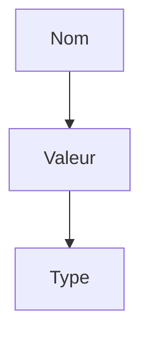

# Variables et types

> [!info] En une phrase
> Une variable est un nom posé sur une valeur ; le type de la valeur (texte, nombre, booléen…) dit ce qu'on peut en faire.

## 1 · Comprendre
### Définition
Une **variable** se crée en lui donnant une valeur : `taille = 42`. Pas de mot-clé comme `let` en JavaScript. Chaque valeur a un **type** :

| Type | Exemple | Sert à |
| --- | --- | --- |
| `str` (texte) | `"rapport.pdf"` | noms, chemins, messages |
| `int` (entier) | `42` | compter |
| `float` (décimal) | `3.5` | mesures |
| `bool` | `True`, `False` | oui ou non |
| `None` | `None` | « pas de valeur » |

### Pourquoi ça existe
Le programme doit retenir des informations (un nom de fichier, un compteur) et savoir quelles opérations ont un sens : on additionne des nombres, on met des textes bout à bout.

### Le problème résolu
Sans type, `"2" + 2` serait ambigu. Python refuse et t'oblige à dire ce que tu veux : `int("2") + 2` ou `"2" + str(2)`.

## 2 · Explorer
### Comment ça fonctionne

- `type(x)` affiche le type d'une valeur.
- Conversions : `int("42")`, `str(42)`, `float("3.5")`.
- **f-string** pour construire un texte : `f"{nb} fichiers dans {dossier}"`.

### Exemple concret
```python
dossier = "photos"          # str
nb_fichiers = 12            # int
compresser = True           # bool

print(f"{nb_fichiers} fichiers dans {dossier}")
print(type(nb_fichiers))    # <class 'int'>

nom = "rapport.PDF"
print(nom.lower())          # rapport.pdf
print(nom.endswith(".PDF")) # True
print(len(nom))             # 11
```

> [!abstract]- Comment ça s'écrit (référence à chercher, pas à apprendre par cœur)
> L'idée est la même partout ; seule l'écriture change.
>
> **Python**
> ```python
> nom = "photos"     # str
> total = 0          # int
> actif = True       # bool
> rien = None
> ```
> Pas de mot-clé. `type(x)` donne le type, `==` compare.
>
> **JavaScript / TypeScript**
> ```js
> const nom = "photos";   // ne sera pas réaffectée
> let total = 0;           // pourra changer
> const actif = true;
> let rien = null;         // undefined = jamais rempli
> // TypeScript : let total: number = 0;
> ```
> `const` par défaut, `let` si la valeur change, jamais `var`. Compare avec `===` (strict) : `==` convertit les types (`"0" == 0` vaut `true`). `const liste = []` peut quand même recevoir `push` : seule la réaffectation est interdite.
>
> **Bash**
> ```bash
> NOM="photos"        # pas d'espace autour du =
> echo "$NOM"         # $ pour lire la valeur
> TOTAL=$((TOTAL + 1)) # calcul entier
> ```
> En Bash tout est du texte ; les guillemets autour de `"$NOM"` évitent les surprises avec les espaces.
>
> **C# (.NET)**
> ```csharp
> string nom = "photos";
> int total = 0;
> decimal montant = 12.50m;   // m : un decimal, pour l'argent
> bool actif = true;
> var date = DateTime.Now;    // var : type deviné, mais fixé pour toujours
> string? rien = null;        // ? : cette variable a le droit d'être null
> const int Max = 100;
> ```
> Typage **statique** : le type est vérifié à la compilation, `total = "abc"` ne compile pas. Compare avec `==`.

### Cas d'utilisation
- Retenir le dossier à traiter, le nom de l'archive, un compteur
- Construire des noms de fichiers : `f"export_{date}.zip"`

> [!warning] À ne pas confondre
> `=` (je range une valeur) et `==` (je compare deux valeurs). Et `"42"` (texte) ≠ `42` (nombre) : ce que tu lis dans un fichier ou une variable d'environnement est **toujours du texte**.

## 3 · Relier
- **Prérequis** : [[Python]]
- **Complémentaires** : [[Liste et dictionnaire]]
- **Utilisé par** : [[Condition (if)]] · [[Boucle (for, while)]] · [[Fonction]]
