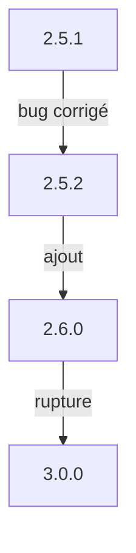

# Version sémantique (semver)

> [!info] En une phrase
> Une version s'écrit MAJEURE.MINEURE.CORRECTIF (2.5.1) : la majeure change quand on casse la compatibilité, la mineure pour un ajout, le correctif pour une réparation.

```dataviewjs
await dv.view("10 — Templates/Scripts/learning", { view: "concept" })
```

## 1 · Comprendre
### Définition
**SemVer** : `MAJEURE.MINEURE.CORRECTIF`
- **Correctif** (2.5.**1** → 2.5.**2**) : corrige un bug, rien ne casse.
- **Mineure** (2.**5**.2 → 2.**6**.0) : ajoute une fonctionnalité, compatible.
- **Majeure** (**2**.6.0 → **3**.0.0) : change ou retire quelque chose, **peut casser** ton code.

Plages dans `package.json` :
| Écriture | Accepte |
| --- | --- |
| `4.19.2` | exactement cette version |
| `^4.19.2` | `>=4.19.2 <5.0.0` (mineures et correctifs) : la valeur par défaut de npm |
| `~4.19.2` | `>=4.19.2 <4.20.0` (correctifs seulement) |
| `*` ou `latest` | n'importe laquelle (à éviter) |
Une version `0.x` est considérée instable : `^0.3.1` n'accepte que `0.3.x`.

### Pourquoi ça existe
Avec des centaines de dépendances, il faut savoir si une mise à jour est sans risque.

### Le problème résolu
Recevoir les correctifs automatiquement sans risquer une rupture majeure.

## 2 · Explorer
### Comment ça fonctionne


### Exemple concret
```bash
npm outdated
# Package  Current  Wanted  Latest
# express   4.18.2  4.21.1  5.0.1
```
*Wanted* : la plus récente permise par la plage ; *Latest* : la dernière publiée (ici une majeure, à lire avant de passer). Le même schéma sert aux images Docker (`node:20.11`), aux tags Git et aux versions de ton propre projet (voir [[Changelog]]).

### Cas d'utilisation
- Mettre à jour des dépendances
- Choisir le tag d'une image Docker
- Versionner ta fonction Nuclio ou tes images dans Nexus

> [!warning] À ne pas confondre
> `^` et `~` : `^` accepte les nouvelles mineures, `~` seulement les correctifs. Et la promesse SemVer est tenue par les humains : un correctif peut quand même casser, d'où le lock et les tests.

## 3 · Pratiquer
- Pour cinq plages données, écris quelles versions elles acceptent
- Lance `npm outdated` sur un projet et explique chaque colonne

## 4 · Expliquer
> [!quote] Mon résumé, avec mes mots
> _À écrire sans regarder la fiche. Si je bloque, je ne l'ai pas encore compris._

## 5 · Relier
- **Prérequis** : [[package.json]]
- **Complémentaires** : [[Tag Git]] · [[Changelog]]

## 6 · Réviser
> [!question] Me faire interroger
> Je demande à Claude de m'interroger sur cette notion pour vérifier que je l'ai comprise.

### Validation de la maîtrise
La notion est maîtrisée quand j'ai réussi **tous les exercices** qui l'utilisent (statut `reussi` dans l'exercice).

```dataviewjs
await dv.view("10 — Templates/Scripts/learning", { view: "maitrise" })
```
