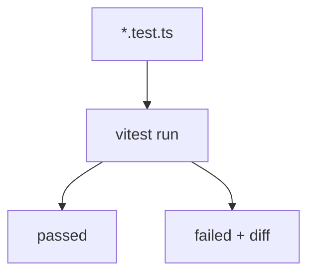

# Vitest et Jest

> [!info] En une phrase
> Vitest et Jest sont les outils de test les plus utilisés en JavaScript et TypeScript : ils trouvent les fichiers .test.js, exécutent les tests et affichent ce qui échoue.

```dataviewjs
await dv.view("10 — Templates/Scripts/learning", { view: "concept" })
```

## 1 · Comprendre
### Définition
**Vitest** (moderne, rapide, intégré à [[Outil de build front (Vite)|Vite]]) et **Jest** (plus ancien, très répandu) ont presque la même syntaxe :
```js
import { describe, it, expect, beforeEach, vi } from "vitest";   // Jest : globaux, pas d'import
describe("groupe", () => {
  beforeEach(() => { /* avant chaque test */ });
  it("fait quelque chose", () => {
    expect(2 + 2).toBe(4);                 // égalité stricte
    expect({ a: 1 }).toEqual({ a: 1 });    // égalité de contenu
    expect([1, 2]).toContain(2);
    expect(() => f()).toThrow();
  });
  it("asynchrone", async () => { await expect(charger()).resolves.toHaveLength(3); });
});
```
Commandes : `npx vitest` (surveille), `npx vitest run` (une fois, pour la CI), `--coverage` ([[Couverture de code]]).
Pour les composants : **Testing Library** (`render`, `screen.getByRole`, `userEvent.click`).
Angular utilise par défaut Jasmine et Karma, de plus en plus remplacés par Jest ou Vitest.

### Pourquoi ça existe
Il faut un outil qui découvre, lance et rapporte les tests, avec des assertions lisibles.

### Le problème résolu
Écrire et lancer les tests JavaScript avec la même facilité que pytest en Python.

## 2 · Explorer
### Comment ça fonctionne


### Exemple concret
```bash
npm install -D vitest
# package.json : "test": "vitest run"
npm test
#  ✓ taille.test.js (3)
#  Test Files  1 passed (1)
#       Tests  3 passed (3)
```
En cas d'échec, Vitest affiche la différence entre l'attendu et l'obtenu.

### Cas d'utilisation
- Tests de fonctions et de composants React ou Vue
- Le job de tests d'une pipeline front ou Node

> [!warning] À ne pas confondre
> `toBe` (même valeur ou même objet) et `toEqual` (même contenu) : `expect({a:1}).toBe({a:1})` échoue. Et oublier `await` dans un test asynchrone : le test passe avant d'avoir vérifié.

## 3 · Pratiquer
- Ajoute Vitest à un projet, écris trois tests et provoque un échec pour lire le message

## 4 · Expliquer
> [!quote] Mon résumé, avec mes mots
> _À écrire sans regarder la fiche. Si je bloque, je ne l'ai pas encore compris._

## 5 · Relier
- **Prérequis** : [[Test automatisé]] · [[npm]]
- **Complémentaires** : [[pytest]]

## 6 · Réviser
> [!question] Me faire interroger
> Je demande à Claude de m'interroger sur cette notion pour vérifier que je l'ai comprise.

### Validation de la maîtrise
La notion est maîtrisée quand j'ai réussi **tous les exercices** qui l'utilisent (statut `reussi` dans l'exercice).

```dataviewjs
await dv.view("10 — Templates/Scripts/learning", { view: "maitrise" })
```
