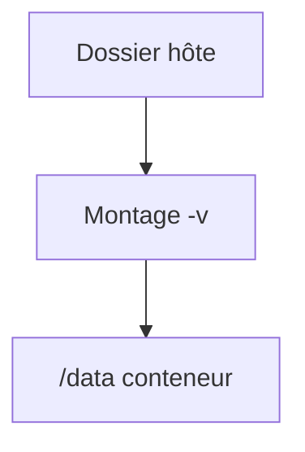

# Volume Docker

> [!info] En une phrase
> Un moyen de brancher un dossier dans un conteneur, pour qu'il lise tes fichiers ou garde ses données après sa suppression.

```dataviewjs
await dv.view("10 — Templates/Scripts/learning", { view: "concept" })
```

## 1 · Comprendre
### Définition
Deux sortes de montages :
- **bind mount** : un dossier **de ta machine** apparaît dans le conteneur (`-v "$PWD/donnees:/data"`). Les deux voient les mêmes fichiers en direct.
- **volume nommé** : un espace géré par Docker (`-v pg-data:/var/lib/postgresql/data`), pour les données d'un service.

### Pourquoi ça existe
Un conteneur est jetable et isolé : sans montage, il ne voit pas tes fichiers et perd ce qu'il écrit.

### Le problème résolu
Copier les fichiers dans l'image à chaque fois (lent, et l'image change à chaque donnée), ou perdre la base de données quand on supprime le conteneur.

## 2 · Explorer
### Comment ça fonctionne

Syntaxe : `-v <hôte>:<conteneur>[:ro]`. Le chemin conteneur est **toujours absolu** (`/data`). `:ro` = lecture seule.

### Exemple concret
```bash
# Bash / Git Bash
docker run --rm -v "$PWD/donnees:/data" -v "$PWD/sortie:/out" mon-zipper /data --sortie /out/export.zip
```
```powershell
# PowerShell
docker run --rm -v "${PWD}\donnees:/data" -v "${PWD}\sortie:/out" mon-zipper /data --sortie /out/export.zip
```
Le script dans le conteneur ne connaît que `/data` et `/out` : il ne sait rien de `C:\Users\...`.

```bash
docker volume ls          # volumes nommés
docker volume rm pg-data  # supprime (définitif)
```

### Cas d'utilisation
- Donner un dossier à traiter à ton script Python, et récupérer l'archive produite

> [!warning] À ne pas confondre
> `COPY` dans le Dockerfile (fichiers figés **dans l'image** au build) et `-v` (fichiers branchés **au lancement**). Et sous Linux, les fichiers créés par le conteneur dans un bind mount appartiennent souvent à `root`.

> [!tip] Ce que j'ai vu en pratique (fil rouge, 7 novembre)
> - `-v "$PWD/sortie:/sortie"` s'écrit **côté PC : côté conteneur**.
> - Le dossier n'a **pas besoin d'exister dans l'image** : Docker le crée au lancement. S'il existe, le volume se pose **par-dessus** et cache son contenu (ne jamais monter sur `/app`, là où est le code).
> - Le chemin côté conteneur doit être **celui où le programme écrit** (`SORTIE=/sortie`). Sinon, rien n'apparaît sur le PC, et avec `--rm` le fichier disparaît avec le conteneur.
> - Côté PC, créer les dossiers soi-même (`mkdir`) pour qu'ils ne soient pas à `root`.

## 3 · Pratiquer

### Exercice visuel

Sur Excalidraw, **sans regarder la fiche**. Puis je compare avec la fiche, je corrige en rouge ce qui était faux, et j'explique mon dessin à voix haute ou à Claude dans le chat.

> [!example] ⚖️ Avant / après
> Avant / après : ton API avec sa base SQLite dans le conteneur, puis dans un volume. Dessine ce qui arrive à tes dépenses après `docker compose down` puis `up`.

> [!example] 🔄 Change de contexte
> Redessine la même idée avec un dossier monté (bind mount) pour développer : où est le fichier réel ?

### Mon schéma

> [!tip] Mon dessin Excalidraw
> _Je crée le dessin « Schéma - Volume Docker » et je l'intègre ici avec `![[Schéma - Volume Docker.excalidraw]]`, puis je coche `schema`._

### Appliquer dans le fil rouge
- [[MesDépenses 02 - L'API dans Docker]]
- [[MesDépenses 07 - Tout lancer avec compose]]
- [[Fil rouge 01 - Lancer l'application dans un conteneur]]

## 4 · Relier
- **Au travail** : [[Volume Docker au travail]]
- **Prérequis** : [[Conteneur]] · [[Système de fichiers]]
- **Utilisé par** : [[Python dans Docker]] · [[Docker Compose]]
- **Commandes** : [[docker run]]

## 5 · Réviser
> [!question] Me faire interroger
> Je demande à Claude de m'interroger sur cette notion pour vérifier que je l'ai comprise.

### Validation (compris, puis maîtrisé)
Trois cases à cocher dans les propriétés de la fiche :
- `schema` : mon dessin du concept est dans « Mon schéma » ;
- `exercice_visuel` : j'ai fait et corrigé les exercices visuels de la section 3 ;
- `fil_rouge` : je l'ai appliqué dans le fil rouge (coché tout seul quand une étape qui l'utilise est réussie).

Les trois cochées : la notion compte comme **comprise**. **Maîtrisé** : c'est moi qui le mets dans `status`, quand je le sens.

```dataviewjs
await dv.view("10 — Templates/Scripts/learning", { view: "maitrise" })
```
