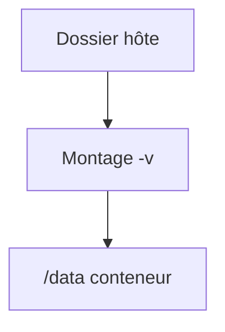

# Volume Docker

> [!info] En une phrase
> Un moyen de brancher un dossier dans un conteneur, pour qu'il lise tes fichiers ou garde ses données après sa suppression.

## 1 · Comprendre
### Définition
Deux sortes de montages :
- **bind mount** : un dossier **de ta machine** apparaît dans le conteneur (`-v "$PWD/donnees:/data"`). Les deux voient les mêmes fichiers en direct.
- **volume nommé** : un espace géré par Docker (`-v pg-data:/var/lib/postgresql/data`), pour les données d'un service.

### Pourquoi ça existe
Un conteneur est jetable et isolé : sans montage, il ne voit pas tes fichiers et perd ce qu'il écrit.

### Le problème résolu
Copier les fichiers dans l'image à chaque fois (lent, et l'image change à chaque donnée), ou perdre la base de données quand on supprime le conteneur.

## 2 · Explorer
### Comment ça fonctionne

Syntaxe : `-v <hôte>:<conteneur>[:ro]`. Le chemin conteneur est **toujours absolu** (`/data`). `:ro` = lecture seule.

### Exemple concret
```bash
# Bash / Git Bash
docker run --rm -v "$PWD/donnees:/data" -v "$PWD/sortie:/out" mon-zipper /data --sortie /out/export.zip
```
```powershell
# PowerShell
docker run --rm -v "${PWD}\donnees:/data" -v "${PWD}\sortie:/out" mon-zipper /data --sortie /out/export.zip
```
Le script dans le conteneur ne connaît que `/data` et `/out` : il ne sait rien de `C:\Users\...`.

```bash
docker volume ls          # volumes nommés
docker volume rm pg-data  # supprime (définitif)
```

### Cas d'utilisation
- Donner un dossier à traiter à ton script Python, et récupérer l'archive produite

> [!warning] À ne pas confondre
> `COPY` dans le Dockerfile (fichiers figés **dans l'image** au build) et `-v` (fichiers branchés **au lancement**). Et sous Linux, les fichiers créés par le conteneur dans un bind mount appartiennent souvent à `root`.

> [!tip] Ce que j'ai vu en pratique (fil rouge, 7 novembre)
> - `-v "$PWD/sortie:/sortie"` s'écrit **côté PC : côté conteneur**.
> - Le dossier n'a **pas besoin d'exister dans l'image** : Docker le crée au lancement. S'il existe, le volume se pose **par-dessus** et cache son contenu (ne jamais monter sur `/app`, là où est le code).
> - Le chemin côté conteneur doit être **celui où le programme écrit** (`SORTIE=/sortie`). Sinon, rien n'apparaît sur le PC, et avec `--rm` le fichier disparaît avec le conteneur.
> - Côté PC, créer les dossiers soi-même (`mkdir`) pour qu'ils ne soient pas à `root`.

## 3 · Relier
- **Au travail** : [Volume Docker au travail](obsidian://open?vault=Travail&file=Volume%20Docker%20au%20travail)
- **Prérequis** : [[Conteneur]] · [[Système de fichiers]]
- **Utilisé par** : [[Python dans Docker]] · [[Docker Compose]]
- **Commandes** : [[docker run]]
