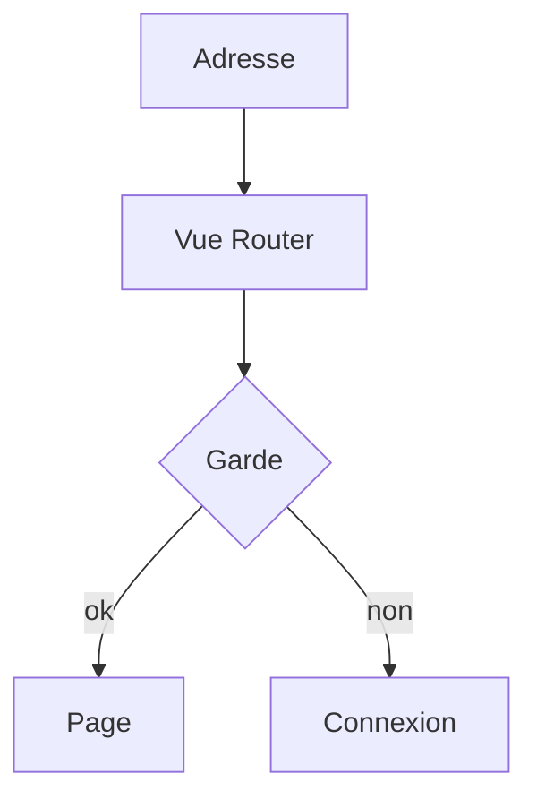

# Vue Router

> [!info] En une phrase
> Vue Router est le routeur officiel de Vue : il associe des adresses à des composants et permet de naviguer dans une application monopage.

```dataviewjs
await dv.view("10 — Templates/Scripts/learning", { view: "concept" })
```

## 1 · Comprendre
### Définition
```ts
// router/index.ts
import { createRouter, createWebHistory } from "vue-router";
export default createRouter({
  history: createWebHistory(),
  routes: [
    { path: "/", component: () => import("../pages/Accueil.vue") },
    { path: "/taches", component: () => import("../pages/Taches.vue") },
    { path: "/taches/:id", component: () => import("../pages/DetailTache.vue"), props: true },
    { path: "/:chemin(.*)*", component: () => import("../pages/Introuvable.vue") },
  ],
});
```
- `<RouterLink to="/taches">` pour naviguer, `<RouterView />` là où la page s'affiche.
- `useRoute().params.id` pour lire un paramètre, `useRouter().push("/")` pour naviguer en code.
- **Gardes de navigation** (`router.beforeEach`) : rediriger vers `/connexion` si l'utilisateur n'est pas connecté.
- `() => import(...)` : la page est chargée seulement quand on y va (*lazy loading*).

### Pourquoi ça existe
Une application Vue a plusieurs écrans qui doivent avoir leur propre adresse.

### Le problème résolu
Navigation instantanée, adresses partageables, protection de pages.

## 2 · Explorer
### Comment ça fonctionne


### Exemple concret
```ts
router.beforeEach((to) => {
  const auth = useAuthStore();
  if (to.path !== "/connexion" && !auth.connecte) return "/connexion";
});
```
Comme pour toute [[Application monopage et routage|SPA]], le serveur doit renvoyer `index.html` pour toutes les adresses.

### Cas d'utilisation
- Toute application Vue à plusieurs écrans
- Pages réservées aux utilisateurs connectés

> [!warning] À ne pas confondre
> Une garde de navigation n'est **pas** une sécurité : elle améliore l'expérience, mais l'[[Autorisation et rôles|autorisation]] doit être vérifiée par l'API.

## 3 · Pratiquer
- Ajoute à une application Vue une page liste, une page détail avec paramètre, une 404, et une garde qui redirige

## 4 · Expliquer
> [!quote] Mon résumé, avec mes mots
> _À écrire sans regarder la fiche. Si je bloque, je ne l'ai pas encore compris._

## 5 · Relier
- **Prérequis** : [[Application monopage et routage]] · [[Composant monofichier Vue (SFC)]]
- **Complémentaires** : [[Pinia]]

## 6 · Réviser
> [!question] Me faire interroger
> Je demande à Claude de m'interroger sur cette notion pour vérifier que je l'ai comprise.

### Validation de la maîtrise
La notion est maîtrisée quand j'ai réussi **tous les exercices** qui l'utilisent (statut `reussi` dans l'exercice).

```dataviewjs
await dv.view("10 — Templates/Scripts/learning", { view: "maitrise" })
```
