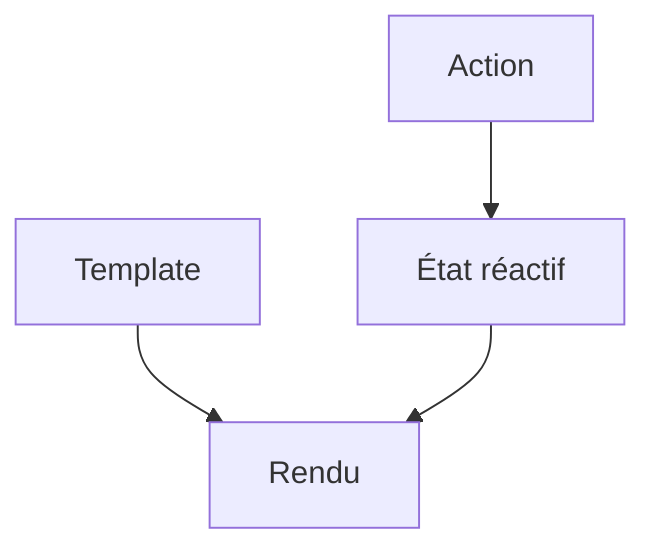

# Vue.js

> [!info] En une phrase
> Vue.js est un framework JavaScript progressif pour construire des interfaces en composants, avec des templates proches du HTML et une réactivité automatique.

```dataviewjs
await dv.view("10 — Templates/Scripts/learning", { view: "concept" })
```

## 1 · Comprendre
### Définition
Comme [[React]], Vue construit l'interface en composants et met le DOM à jour quand les données changent. Les différences principales :
- Les composants s'écrivent dans des **fichiers `.vue`** qui réunissent template HTML, script et style ([[Composant monofichier Vue (SFC)|SFC]]).
- Le template utilise des **directives** (`v-if`, `v-for`, `v-model`) plutôt que du JSX.
- La **réactivité** est automatique : on modifie une valeur (`compteur.value++`) et l'affichage suit, sans fonction `set…`.
- L'écosystème officiel fournit le routeur ([[Vue Router]]) et le store ([[Pinia]]).
Vue 3 avec la **Composition API** (`<script setup>`) est la façon actuelle d'écrire ; tu croiseras aussi l'ancienne **Options API** (`data()`, `methods`).

### Pourquoi ça existe
Avoir un outil d'interface facile à prendre en main, qu'on peut ajouter à une page existante ou utiliser pour une grosse application.

### Le problème résolu
Construire des interfaces réactives avec une syntaxe proche du HTML, souvent jugée plus accessible que React.

## 2 · Explorer
### Comment ça fonctionne


### Exemple concret
```vue
<script setup lang="ts">
import { ref } from "vue";
const n = ref(0);
</script>

<template>
  <button @click="n++">Cliqué {{ n }} fois</button>
</template>
```
```bash
npm create vue@latest     # projet Vite + Vue, avec options TypeScript, Router, Pinia, tests
```

### Cas d'utilisation
- Frontends d'entreprise et tableaux de bord
- Ajouter de l'interactivité à une page serveur
- Nuxt (framework Vue avec rendu serveur)

> [!warning] À ne pas confondre
> **Vue 2** et **Vue 3** : beaucoup de tutoriels datent de Vue 2 (Options API, Vuex). Pour un nouveau projet : Vue 3, `<script setup>`, Pinia.

## 3 · Pratiquer
- Crée un projet avec `npm create vue@latest` (TypeScript, Router, Pinia), lance-le et repère chaque dossier

## 4 · Expliquer
> [!quote] Mon résumé, avec mes mots
> _À écrire sans regarder la fiche. Si je bloque, je ne l'ai pas encore compris._

## 5 · Relier
- **Prérequis** : [[JavaScript]] · [[HTML]] · [[Module JavaScript (import et export)]]
- **Complémentaires** : [[React]] · [[Angular]]
- **Utilisé par** : [[Composant monofichier Vue (SFC)]]

## 6 · Réviser
> [!question] Me faire interroger
> Je demande à Claude de m'interroger sur cette notion pour vérifier que je l'ai comprise.

### Validation de la maîtrise
La notion est maîtrisée quand j'ai réussi **tous les exercices** qui l'utilisent (statut `reussi` dans l'exercice).

```dataviewjs
await dv.view("10 — Templates/Scripts/learning", { view: "maitrise" })
```
