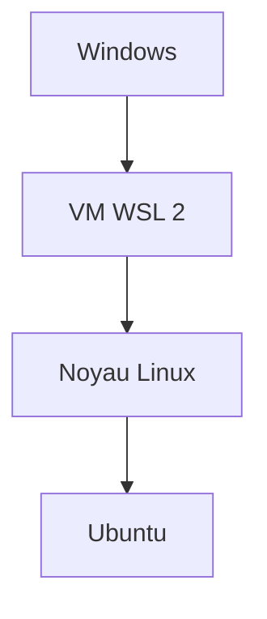

# WSL

> [!info] En une phrase
> Windows Subsystem for Linux : un vrai Linux (Ubuntu par défaut) qui tourne dans Windows, dans une petite machine virtuelle intégrée.

```dataviewjs
await dv.view("10 — Templates/Scripts/learning", { view: "concept" })
```

## 1 · Comprendre
### Définition
**WSL 2** fait tourner un **vrai noyau Linux** dans une machine virtuelle légère, gérée par Windows. Tu y installes une **distribution** (Ubuntu par défaut) qui a son **propre système de fichiers**, ses utilisateurs, ses paquets. Depuis le terminal, tu entres dans Linux avec `wsl`.

Ce n'est **pas** une émulation ni un simple shell : c'est un Linux complet, à côté de Windows.

### Pourquoi ça existe
Le développement web, Docker, les serveurs et la CI vivent sous Linux. WSL permet de travailler dans le même environnement que la production, sans quitter Windows ni installer une machine virtuelle à la main.

### Le problème résolu
Les commandes, scripts et outils Linux qui ne marchent pas (ou mal) sous Windows ; le « ça marche dans la CI mais pas sur mon poste ».

## 2 · Explorer
### Comment ça fonctionne

**Deux systèmes de fichiers, qui se voient l'un l'autre :**
| Depuis | Pour aller dans | Chemin |
| --- | --- | --- |
| Linux (WSL) | le disque Windows | `/mnt/c/Users/oumar/...` |
| Windows (Explorateur) | le Linux | `\\wsl$\Ubuntu\home\oumar` (ou `\\wsl.localhost\Ubuntu\...`) |

- **Range tes projets côté Linux** (`~/projets`) si tu travailles dans WSL : accéder à `/mnt/c` depuis Linux est **beaucoup plus lent** et pose des problèmes de droits et de fins de ligne.
- Depuis WSL, `explorer.exe .` ouvre le dossier courant dans l'Explorateur, `code .` l'ouvre dans VS Code (extension WSL).
- **Docker Desktop** utilise WSL 2 comme moteur : la commande `docker` marche dans PowerShell **et** dans Ubuntu (option *WSL integration*).
- WSL a **son propre Git, son propre Python** : ceux de Windows ne sont pas ceux de Linux.

### Exemple concret
```powershell
# Dans PowerShell
wsl --install            # installe WSL et Ubuntu (une fois, redémarrage)
wsl -l -v                # distributions installées et version (doit être 2)
wsl                      # entrer dans la distribution par défaut
wsl --shutdown           # arrêter WSL (libère la mémoire)
```
```bash
# Dans Ubuntu (WSL)
sudo apt update && sudo apt upgrade
mkdir -p ~/projets && cd ~/projets
git clone https://gitlab.exemple.com/equipe/projet.git
code .
```

### Cas d'utilisation
- Travailler sur CVAT et ses scripts dans le même environnement que la CI
- Lancer des scripts `.sh` sans les problèmes de [[Fichiers entre Windows et Linux]]
- Moteur de Docker Desktop

> [!warning] À ne pas confondre
> **WSL** (un vrai Linux) et **Git Bash** (quelques outils Linux compilés pour Windows, sur le disque Windows). Et un projet ouvert depuis `C:\` dans VS Code Windows avec le **même** projet dans `~/projets` : ce sont deux copies différentes.

## 3 · Pratiquer
- Vérifie avec `wsl -l -v` que ta distribution est en version 2.
- Crée un fichier depuis Ubuntu dans `~`, puis retrouve-le depuis l'Explorateur Windows via `\wsl$`.
- Compare `which git` dans Ubuntu et `Get-Command git` dans PowerShell.

## 4 · Expliquer
> [!quote] Mon résumé, avec mes mots
> _À écrire sans regarder la fiche. Si je bloque, je ne l'ai pas encore compris._

## 5 · Relier
- **Prérequis** : [[Système d'exploitation et noyau]] · [[Shell]]
- **Complémentaires** : [[Bash]] · [[Fichiers entre Windows et Linux]]
- **Utilisé par** : [[Docker]]
- **Commandes** : [[wsl.exe]]

## 6 · Réviser
> [!question] Me faire interroger
> Je demande à Claude de m'interroger sur cette notion pour vérifier que je l'ai comprise.

### Validation de la maîtrise
La notion est maîtrisée quand j'ai réussi **tous les exercices** qui l'utilisent (statut `reussi` dans l'exercice).

```dataviewjs
await dv.view("10 — Templates/Scripts/learning", { view: "maitrise" })
```
