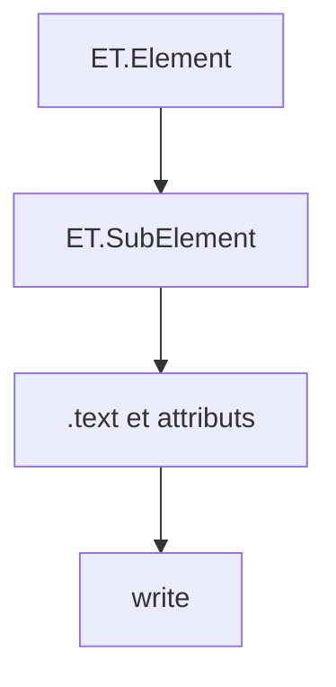

# XML en Python (ElementTree)

> [!info] En une phrase
> Le module standard `xml.etree.ElementTree` construit, lit et écrit un fichier XML comme un arbre d'objets Python, sans rien installer.

## 1 · Comprendre
### Définition
`ElementTree` (importé en `ET`) représente chaque balise par un objet **Element** qui a :
- `.tag` : son nom ;
- `.attrib` : un dictionnaire de ses attributs ;
- `.text` : le texte à l'intérieur ;
- ses enfants, qu'on parcourt comme une liste.

### Pourquoi ça existe
- Écrire du XML « à la main » avec des f-strings est fragile : on oublie une balise fermante, un `&` ou un `"` dans une valeur casse le fichier. ElementTree s'occupe de l'échappement et de la structure.

### Le problème résolu
- Passer d'une structure Python (dict, list) à un fichier XML valide, et inversement.

## 2 · Explorer
### Comment ça fonctionne


### Exemple concret
**Écrire**
```python
import xml.etree.ElementTree as ET

racine = ET.Element("bibliotheque")
livre = ET.SubElement(racine, "livre", {"isbn": "978-2"})
livre.set("pages", str(320))            # ajouter un attribut après coup
ET.SubElement(livre, "titre").text = "Dune"

ET.indent(racine, space="  ")            # retraits, Python 3.9+
arbre = ET.ElementTree(racine)
arbre.write("biblio.xml", encoding="utf-8", xml_declaration=True)

octets = ET.tostring(racine, encoding="utf-8", xml_declaration=True)  # sans fichier
```

**Lire**
```python
arbre = ET.parse("biblio.xml")           # ou ET.fromstring(texte)
racine = arbre.getroot()
for livre in racine.iter("livre"):       # tous les <livre>, à toute profondeur
    print(livre.get("isbn"), livre.find("titre").text)
```

| Fonction | Rôle |
| --- | --- |
| `ET.Element(tag, attrib)` | crée un élément seul (souvent la racine) |
| `ET.SubElement(parent, tag, attrib)` | crée un enfant **accroché** au parent, et le renvoie |
| `el.set(nom, valeur)` / `el.get(nom)` | écrire / lire un attribut |
| `el.find(tag)` / `el.findall(tag)` / `el.iter(tag)` | chercher des enfants |
| `ET.indent(el)` | ajouter les retraits pour la lecture |
| `ET.ElementTree(el).write(...)` | écrire dans un fichier |
| `ET.tostring(el, ...)` | obtenir les octets (utile pour renvoyer le XML dans une réponse HTTP) |

### Cas d'utilisation

> [!warning] À ne pas confondre
> - `ET.Element` crée un élément **orphelin** ; `ET.SubElement` l'accroche au parent. Un `Element` créé puis jamais ajouté n'apparaît pas dans le fichier.
> - Attributs et `.text` doivent être des **chaînes** : `{"width": 800}` → `TypeError: cannot serialize 800 (type int)` au moment de l'écriture, pas au moment où tu l'as mis.
> - `write()` sans `encoding="utf-8"` écrit en ASCII avec des `&#233;` à la place des accents.
> - Python écrit la déclaration avec des apostrophes `<?xml version='1.0' ...?>` et les éléments vides en `<values />` : c'est du XML équivalent.

## 3 · Relier
- **Au travail** : [XML en Python (ElementTree) au travail](obsidian://open?vault=Travail&file=XML%20en%20Python%20%28ElementTree%29%20au%20travail)
- **Prérequis** : [[XML]], [[Liste et dictionnaire]]
- **Notion parente** :
- **Complémentaires** : [[JSON]], [[Lire et écrire un fichier]]
- **Au travail** : [Format CVAT for images 1.1](obsidian://open?vault=Travail&file=API%20CVAT%20-%20format%20CVAT%20for%20images%201.1)
- **Commandes** :
