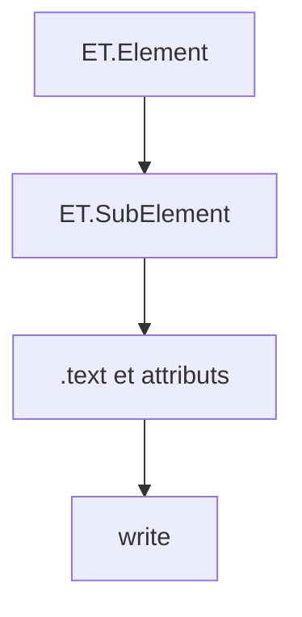

# XML en Python (ElementTree)

> [!info] En une phrase
> Le module standard `xml.etree.ElementTree` construit, lit et écrit un fichier XML comme un arbre d'objets Python, sans rien installer.

```dataviewjs
await dv.view("10 — Templates/Scripts/learning", { view: "concept" })
```

## 1 · Comprendre
### Définition
`ElementTree` (importé en `ET`) représente chaque balise par un objet **Element** qui a :
- `.tag` : son nom ;
- `.attrib` : un dictionnaire de ses attributs ;
- `.text` : le texte à l'intérieur ;
- ses enfants, qu'on parcourt comme une liste.

### Pourquoi ça existe
- Écrire du XML « à la main » avec des f-strings est fragile : on oublie une balise fermante, un `&` ou un `"` dans une valeur casse le fichier. ElementTree s'occupe de l'échappement et de la structure.

### Le problème résolu
- Passer d'une structure Python (dict, list) à un fichier XML valide, et inversement.

## 2 · Explorer
### Comment ça fonctionne


### Exemple concret
**Écrire**
```python
import xml.etree.ElementTree as ET

racine = ET.Element("bibliotheque")
livre = ET.SubElement(racine, "livre", {"isbn": "978-2"})
livre.set("pages", str(320))            # ajouter un attribut après coup
ET.SubElement(livre, "titre").text = "Dune"

ET.indent(racine, space="  ")            # retraits, Python 3.9+
arbre = ET.ElementTree(racine)
arbre.write("biblio.xml", encoding="utf-8", xml_declaration=True)

octets = ET.tostring(racine, encoding="utf-8", xml_declaration=True)  # sans fichier
```

**Lire**
```python
arbre = ET.parse("biblio.xml")           # ou ET.fromstring(texte)
racine = arbre.getroot()
for livre in racine.iter("livre"):       # tous les <livre>, à toute profondeur
    print(livre.get("isbn"), livre.find("titre").text)
```

| Fonction | Rôle |
| --- | --- |
| `ET.Element(tag, attrib)` | crée un élément seul (souvent la racine) |
| `ET.SubElement(parent, tag, attrib)` | crée un enfant **accroché** au parent, et le renvoie |
| `el.set(nom, valeur)` / `el.get(nom)` | écrire / lire un attribut |
| `el.find(tag)` / `el.findall(tag)` / `el.iter(tag)` | chercher des enfants |
| `ET.indent(el)` | ajouter les retraits pour la lecture |
| `ET.ElementTree(el).write(...)` | écrire dans un fichier |
| `ET.tostring(el, ...)` | obtenir les octets (utile dans une fonction Nuclio) |

### Cas d'utilisation
- Fabriquer un XML d'annotations CVAT depuis un autre format.
- Lire un export CVAT pour en extraire les formes.

> [!warning] À ne pas confondre
> - `ET.Element` crée un élément **orphelin** ; `ET.SubElement` l'accroche au parent. Un `Element` créé puis jamais ajouté n'apparaît pas dans le fichier.
> - Attributs et `.text` doivent être des **chaînes** : `{"width": 800}` → `TypeError: cannot serialize 800 (type int)` au moment de l'écriture, pas au moment où tu l'as mis.
> - `write()` sans `encoding="utf-8"` écrit en ASCII avec des `&#233;` à la place des accents.
> - Python écrit la déclaration avec des apostrophes `<?xml version='1.0' ...?>` et les éléments vides en `<values />` : c'est du XML équivalent.

## 3 · Pratiquer

### Exercice visuel

Sur Excalidraw, **sans regarder la fiche**. Puis je compare avec la fiche, je corrige en rouge ce qui était faux, et j'explique mon dessin avec mes mots (section 4).

> [!example] 🛣️ Suis le trajet
> Dessine un fichier XML lu par ElementTree : l'arbre, `find`, `findall`, `get` pour lire un attribut.

> [!example] 🔄 Change de contexte
> Redessine le même parcours sur le JSON des annotations. Qu'est-ce qui remplace `find` et `get` ?

### Mon schéma

> [!tip] Mon dessin Excalidraw
> _Je crée le dessin « Schéma - XML en Python (ElementTree) » et je l'intègre ici avec `![[Schéma - XML en Python (ElementTree).excalidraw]]`._

### Appliquer dans le fil rouge
- Pas encore d'étape du fil rouge pour cette notion : je l'applique dans mon travail (CVAT, Nuclio) ou je demande une étape à Claude.

## 4 · Expliquer
> [!quote] Mon résumé, avec mes mots
> _J'explique mon schéma avec mes mots, sans regarder la fiche. Si je bloque, je ne l'ai pas encore compris._

## 5 · Relier
- **Prérequis** : [[XML]], [[Liste et dictionnaire]]
- **Notion parente** :
- **Complémentaires** : [[JSON]], [[Lire et écrire un fichier]]
- **Utilisé par** : [[Format CVAT for images 1.1]]
- **Commandes** :

## 6 · Réviser
> [!question] Me faire interroger
> Je demande à Claude de m'interroger sur cette notion pour vérifier que je l'ai comprise.

### Validation de la maîtrise
La notion est maîtrisée quand je sais :
1. **l'expliquer** de façon fluide, à partir de mon schéma (section 4) ;
2. **l'adapter** à un autre contexte (consigne « Change de contexte », ou Claude m'interroge sur un autre cas) ;
3. **l'appliquer** pour de vrai dans le fil rouge (section 3).

Réussir un exercice ne suffit pas. C'est moi qui passe le statut en `maitrise`.

```dataviewjs
await dv.view("10 — Templates/Scripts/learning", { view: "maitrise" })
```
