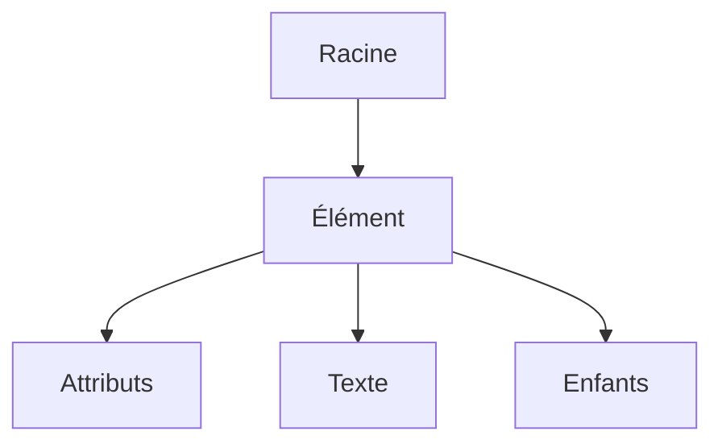

# XML

> [!info] En une phrase
> Un format texte qui range des données dans des balises imbriquées, comme du HTML, mais avec des balises que chaque outil invente pour ses besoins.

```dataviewjs
await dv.view("10 — Templates/Scripts/learning", { view: "concept" })
```

## 1 · Comprendre
### Définition
**XML** (eXtensible Markup Language) décrit un **arbre** d'**éléments**. Chaque élément a un nom (`<box>`), des **attributs** (`label="tuyau"`) et un contenu : du texte et/ou d'autres éléments. Il y a **une seule racine** qui contient tout.

### Pourquoi ça existe
- Échanger des données structurées entre programmes, avec un format lisible par un humain.
- Plus ancien que [[JSON]] : beaucoup d'outils (CVAT, Office, Maven, SVG, flux RSS) l'utilisent encore.

### Le problème résolu
- Donner une structure stricte à un fichier texte, qu'on peut valider et lire avec n'importe quel langage.

## 2 · Explorer
### Comment ça fonctionne


### Exemple concret
```xml
<?xml version="1.0" encoding="utf-8"?>
<image id="0" name="iso_080.jpg" width="800" height="600">
  <polyline label="tuyau" points="100.00,400.00;300.00,284.53">
    <attribute name="debut">true</attribute>
  </polyline>
  <polyline label="ligne de cote" points="115.00,425.98;315.00,310.51"/>
</image>
```
- La première ligne (la **déclaration**) dit la version et l'encodage. `'` ou `"` autour des valeurs : les deux sont valides.
- `<polyline .../>` est un élément **vide** : identique à `<polyline ...></polyline>`.
- Une **liste** = le même élément répété.

### Cas d'utilisation
- Les annotations CVAT ([[Format CVAT for images 1.1]]).
- Les fichiers de config Java (`pom.xml`), les images SVG, les documents Office (zip de XML).

> [!warning] À ne pas confondre
> - **JSON** a des types (nombre, booléen, `null`) ; en **XML tout est texte**, c'est le programme lecteur qui décide que `"800"` est un nombre.
> - **Attribut** (`width="800"`, dans la balise) et **élément enfant** (`<width>800</width>`) : deux façons de ranger une valeur. C'est le format choisi par l'outil qui impose laquelle.
> - XML **n'est pas** HTML : en XML, les balises sont libres, mais toute balise ouverte doit être fermée, sinon le fichier est invalide.

## 3 · Pratiquer
- [[Projet - Convertir le graphe en XML CVAT]]

## 4 · Expliquer
> [!quote] Mon résumé, avec mes mots
> _À écrire sans regarder la fiche. Si je bloque, je ne l'ai pas encore compris._

## 5 · Relier
- **Prérequis** : [[JSON]]
- **Notion parente** :
- **Complémentaires** : [[Élément et attribut HTML]]
- **Utilisé par** : [[XML en Python (ElementTree)]], [[Format CVAT for images 1.1]]
- **Commandes** :

## 6 · Réviser
> [!question] Me faire interroger
> Je demande à Claude de m'interroger sur cette notion pour vérifier que je l'ai comprise.

### Validation de la maîtrise
La notion est maîtrisée quand j'ai réussi **tous les exercices** qui l'utilisent (statut `reussi` dans l'exercice).

```dataviewjs
await dv.view("10 — Templates/Scripts/learning", { view: "maitrise" })
```
