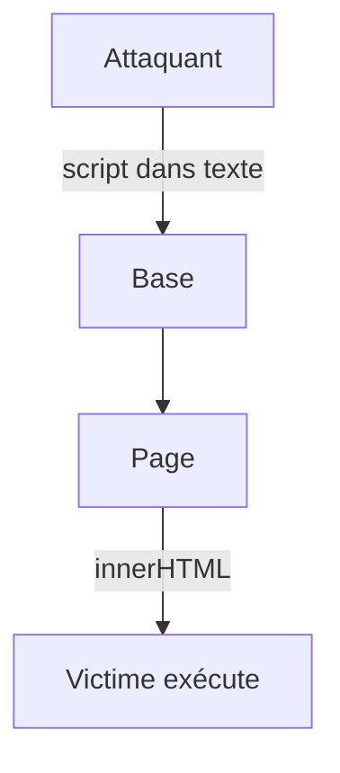

# XSS

> [!info] En une phrase
> Le XSS (cross-site scripting) arrive quand une page affiche comme du HTML un texte fourni par un utilisateur : un script malveillant s'exécute alors chez les autres visiteurs.

```dataviewjs
await dv.view("10 — Templates/Scripts/learning", { view: "concept" })
```

## 1 · Comprendre
### Définition
Un utilisateur nomme sa tâche ``. Si la page l'insère avec `innerHTML`, le code s'exécute **dans le navigateur de chaque personne** qui voit la liste, avec ses droits.
Types : **stocké** (en base, le plus grave), **réfléchi** (dans l'URL), **DOM** (le JS de la page insère un paramètre).
Protections :
- **Échapper** à l'affichage : `textContent` au lieu de `innerHTML` ; React, Vue et Angular échappent par défaut.
- Se méfier de `dangerouslySetInnerHTML` (React), `v-html` (Vue), `[innerHTML]` (Angular) ; si nécessaire, nettoyer avec **DOMPurify**.
- Cookies `HttpOnly` (le script ne peut pas les lire).
- En-tête **Content-Security-Policy** qui interdit les scripts non prévus.

### Pourquoi ça existe
Les pages affichent constamment du contenu venant des utilisateurs (noms, commentaires, labels).

### Le problème résolu
Empêcher qu'un utilisateur exécute du code chez les autres et vole leurs sessions.

## 2 · Explorer
### Comment ça fonctionne


### Exemple concret
```js
// vulnérable
li.innerHTML = tache.nom;
// sûr
li.textContent = tache.nom;
```
```jsx
// React : sûr par défaut
<li>{tache.nom}</li>
```

### Cas d'utilisation
- Tout affichage de contenu saisi
- Revue de code front
- Configuration des en-têtes de sécurité du reverse proxy

> [!warning] À ne pas confondre
> Le **XSS** (script injecté dans la page, exécuté par le navigateur) n'est pas l'[[Injection SQL]] (code injecté dans la requête, exécuté par la base). Même idée : une donnée devenue code.

## 3 · Pratiquer
- Dans une page de test, affiche un texte piégé avec `innerHTML` puis avec `textContent` et compare

## 4 · Expliquer
> [!quote] Mon résumé, avec mes mots
> _À écrire sans regarder la fiche. Si je bloque, je ne l'ai pas encore compris._

## 5 · Relier
- **Prérequis** : [[DOM]] · [[HTML]]
- **Complémentaires** : [[Session et cookie]] · [[CSRF]]

## 6 · Réviser
> [!question] Me faire interroger
> Je demande à Claude de m'interroger sur cette notion pour vérifier que je l'ai comprise.

### Validation de la maîtrise
La notion est maîtrisée quand j'ai réussi **tous les exercices** qui l'utilisent (statut `reussi` dans l'exercice).

```dataviewjs
await dv.view("10 — Templates/Scripts/learning", { view: "maitrise" })
```
