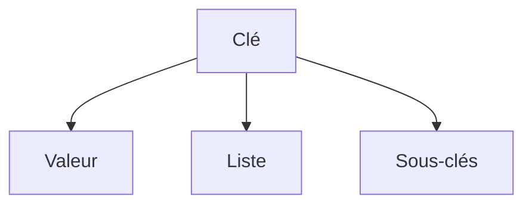

# YAML

> [!info] En une phrase
> Un format de fichier texte pour écrire de la configuration lisible, où l'indentation donne la structure.

```dataviewjs
await dv.view("10 — Templates/Scripts/learning", { view: "concept" })
```

## 1 · Comprendre
### Définition
**YAML** décrit des données avec trois briques : des **clés: valeurs**, des **listes** (lignes qui commencent par `- `) et l'**imbrication** par l'indentation (des espaces, jamais de tabulations). Fichiers `.yml` ou `.yaml`.

### Pourquoi ça existe
Écrire de la configuration que les humains lisent facilement, plus légère que [[JSON]].

### Le problème résolu
Les fichiers de configuration en JSON ou XML sont verbeux et sans commentaires ; YAML accepte les commentaires `#` et a peu de ponctuation.

## 2 · Explorer
### Comment ça fonctionne


### Exemple concret
```yaml
# un commentaire
nom: script-zip            # clé: valeur (texte)
version: 2                 # nombre
actif: true                # booléen
fichiers:                  # une liste
  - rapport.pdf
  - image.png
image:                     # un objet imbriqué (2 espaces)
  nom: python
  tag: "3.12-slim"         # guillemets : reste du texte
```
Le même contenu en JSON :
```json
{"nom": "script-zip", "version": 2, "actif": true,
 "fichiers": ["rapport.pdf", "image.png"],
 "image": {"nom": "python", "tag": "3.12-slim"}}
```

### Cas d'utilisation
- `.gitlab-ci.yml` : [[Pipeline GitLab CI]]
- `docker-compose.yml` : [[Docker Compose]]
- Fichiers de configuration de beaucoup d'outils (Traefik, Nuclio)

> [!warning] À ne pas confondre
> Un décalage d'indentation change le sens : une clé mal alignée devient enfant d'une autre ou provoque une erreur. Et `3.10` sans guillemets est lu comme le nombre 3.1 : mettre les versions entre guillemets.

## 3 · Pratiquer

### Exercice visuel

Sur Excalidraw, **sans regarder la fiche**. Puis je compare avec la fiche, je corrige en rouge ce qui était faux, et j'explique mon dessin à voix haute ou à Claude dans le chat.

> [!example] 🧠 Dessine de mémoire
> Dessine un petit `docker-compose.yml` comme un arbre : chaque niveau d'indentation est une branche. Montre où est une liste et où est un dictionnaire.

> [!example] 🔍 Trouve l'erreur
> Ce schéma est faux. Corrige-le en rouge et explique l'erreur.
>
> ```mermaid
> flowchart TD
>   S[services] --> A[api]
>   S --> P[ports au même niveau]
>   A --> I[image]
> ```

### Mon schéma

> [!tip] Mon dessin Excalidraw
> _Je crée le dessin « Schéma - YAML » et je l'intègre ici avec `![[Schéma - YAML.excalidraw]]`, puis je coche `schema`._

### Appliquer dans le fil rouge
- Pas encore d'étape du fil rouge pour cette notion : elle sera pratiquée dans le fil rouge de son niveau (voir [[Niveaux]]).

## 4 · Relier
- **Prérequis** : [[JSON]]
- **Utilisé par** : [[Pipeline GitLab CI]] · [[Docker Compose]] · [[Règles d'un job GitLab (rules)]]

## 5 · Réviser
> [!question] Me faire interroger
> Je demande à Claude de m'interroger sur cette notion pour vérifier que je l'ai comprise.

### Validation de la maîtrise
Trois cases à cocher dans les propriétés de la fiche :
- `schema` : mon dessin du concept est dans « Mon schéma » ;
- `exercice_visuel` : j'ai fait et corrigé les exercices visuels de la section 3 ;
- `fil_rouge` : je l'ai appliqué dans le fil rouge (coché tout seul quand une étape qui l'utilise est réussie).

Les trois cochées : la notion compte comme **comprise**. **Maîtrisé** : c'est moi qui le mets dans `status`, quand je le sens.

```dataviewjs
await dv.view("10 — Templates/Scripts/learning", { view: "maitrise" })
```
