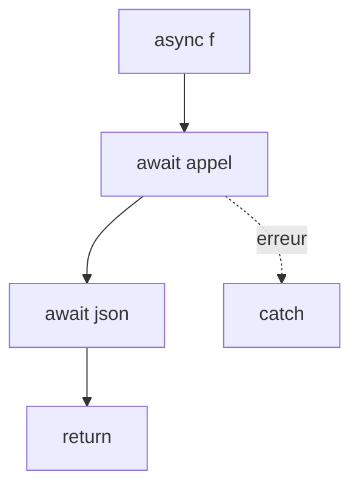

# async et await

> [!info] En une phrase
> async et await permettent d'écrire du code asynchrone qui se lit de haut en bas, comme du code normal, avec try/catch pour les erreurs.

```dataviewjs
await dv.view("10 — Templates/Scripts/learning", { view: "concept" })
```

## 1 · Comprendre
### Définition
- Une fonction **`async`** renvoie toujours une Promesse.
- **`await`** (seulement dans une fonction `async`, ou au niveau supérieur d'un module) met la fonction en pause jusqu'à ce que la Promesse soit résolue, et donne sa valeur.
- Les erreurs (Promesse rejetée) se traitent avec **`try / catch`**.
```js
async function chargerTaches() {
  try {
    const rep = await fetch("/api/taches");
    const taches = await rep.json();
    return taches;
  } catch (err) {
    console.error("Échec du chargement", err);
    return [];
  }
}
```

### Pourquoi ça existe
Les chaînes de `.then()` deviennent vite illisibles ; `await` rend l'ordre des étapes évident.

### Le problème résolu
Écrire des étapes asynchrones successives (appel, puis traitement, puis autre appel) clairement, avec une gestion d'erreurs normale.

## 2 · Explorer
### Comment ça fonctionne


### Exemple concret
```js
const attendre = (ms) => new Promise((ok) => setTimeout(ok, ms));

async function exporter(ids) {
  for (const id of ids) {
    await fetch(`/api/taches/${id}/export`, { method: "POST" }); // l'un après l'autre
  }
  // en parallèle :
  await Promise.all(ids.map((id) => fetch(`/api/taches/${id}`)));
}
```

### Cas d'utilisation
- Appels d'API dans les composants et services
- Scripts Node qui lisent des fichiers
- Tests asynchrones

> [!warning] À ne pas confondre
> `await` ne bloque pas tout le programme, seulement la fonction `async` en cours. Et oublier `await` : on récupère une Promesse au lieu de la valeur (`[object Promise]` à l'écran).

## 3 · Pratiquer
- Réécris une chaîne `.then().then().catch()` avec async/await
- Lance trois appels l'un après l'autre puis en parallèle et compare la durée

## 4 · Expliquer
> [!quote] Mon résumé, avec mes mots
> _À écrire sans regarder la fiche. Si je bloque, je ne l'ai pas encore compris._

## 5 · Relier
- **Prérequis** : [[Asynchrone et Promesse]]
- **Complémentaires** : [[Exception]]
- **Utilisé par** : [[Appeler une API avec fetch]]

## 6 · Réviser
> [!question] Me faire interroger
> Je demande à Claude de m'interroger sur cette notion pour vérifier que je l'ai comprise.

### Validation de la maîtrise
La notion est maîtrisée quand j'ai réussi **tous les exercices** qui l'utilisent (statut `reussi` dans l'exercice).

```dataviewjs
await dv.view("10 — Templates/Scripts/learning", { view: "maitrise" })
```
