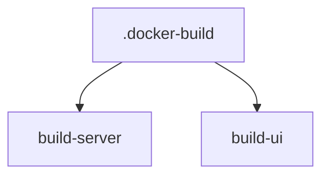

# extends GitLab CI

> [!info] En une phrase
> Faire hériter un job d'un modèle commun avec extends:, pour ne pas recopier la même configuration dans chaque job.

```dataviewjs
await dv.view("10 — Templates/Scripts/learning", { view: "concept" })
```

## 1 · Comprendre
### Définition
`extends:` copie la configuration d'un autre job (souvent un **job caché**, dont le nom commence par `.`) puis applique par-dessus ce que le job redéfinit. Un job caché n'est jamais lancé : c'est un modèle.

### Pourquoi ça existe
Plusieurs jobs partagent la même image, les mêmes services, le même `before_script` (connexion au registre).

### Le problème résolu
Le même bloc recopié dix fois : un changement (adresse du Nexus) oublié dans un des jobs.

## 2 · Explorer
### Comment ça fonctionne


### Exemple concret
```yaml
.docker-build:                     # modèle caché
  image: $NEXUS/docker:24
  services: [$NEXUS/docker:24-dind]
  before_script:
    - echo "$NEXUS_PASSWORD" | docker login -u "$NEXUS_USER" --password-stdin "$NEXUS"

build-server:
  extends: .docker-build
  script:
    - docker build -f Dockerfile -t "$NEXUS/cvat/server:$CI_COMMIT_SHORT_SHA" .

build-ui:
  extends: .docker-build
  script:
    - docker build -f Dockerfile.ui -t "$NEXUS/cvat/ui:$CI_COMMIT_SHORT_SHA" .
```
Les **dictionnaires** (`variables:`) sont fusionnés ; les **listes** (`script:`, `rules:`) sont **remplacées** entièrement. Le pipeline editor de GitLab (*Full configuration*) montre le résultat fusionné.

### Cas d'utilisation
- Un modèle commun pour tous les jobs qui construisent des images
- Lire la CI d'un gros projet qui en utilise beaucoup

> [!warning] À ne pas confondre
> `extends:` (héritage propre à GitLab, lisible) et les **ancres YAML** `&nom` / `<<: *nom` (mécanisme du YAML lui-même, qui ne marche pas entre fichiers inclus). Et redéfinir `script:` dans le job **remplace** celui du modèle, il ne s'y ajoute pas.

## 3 · Pratiquer
- Factorise deux jobs qui se ressemblent avec un job caché, puis vérifie le résultat fusionné dans le pipeline editor.

## 4 · Expliquer
> [!quote] Mon résumé, avec mes mots
> _À écrire sans regarder la fiche. Si je bloque, je ne l'ai pas encore compris._

## 5 · Relier
- **Prérequis** : [[Pipeline GitLab CI]] · [[YAML]]
- **Complémentaires** : [[Règles d'un job GitLab (rules)]] · [[Construire une image dans la CI]]

## 6 · Réviser
> [!question] Me faire interroger
> Je demande à Claude de m'interroger sur cette notion pour vérifier que je l'ai comprise.

### Validation de la maîtrise
- [ ] Je l'explique sans notes, en 3 phrases, à quelqu'un qui ne connaît pas
- [ ] J'ai réussi un exercice qui l'utilise
- [ ] Je l'ai utilisé dans un projet
- [ ] Je sais dire quand ne pas l'utiliser (ou ce qu'il ne faut pas confondre)
