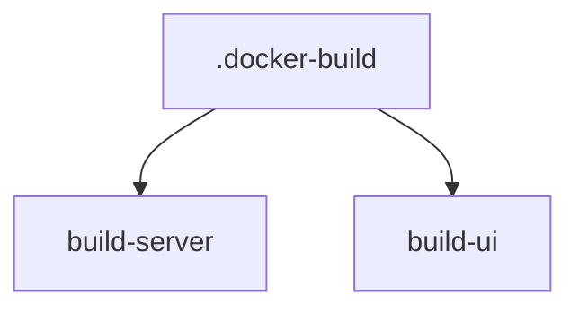

# extends GitLab CI

> [!info] En une phrase
> Faire hériter un job d'un modèle commun avec extends:, pour ne pas recopier la même configuration dans chaque job.

```dataviewjs
await dv.view("10 — Templates/Scripts/learning", { view: "concept" })
```

## 1 · Comprendre
### Définition
`extends:` copie la configuration d'un autre job (souvent un **job caché**, dont le nom commence par `.`) puis applique par-dessus ce que le job redéfinit. Un job caché n'est jamais lancé : c'est un modèle.

### Pourquoi ça existe
Plusieurs jobs partagent la même image, les mêmes services, le même `before_script` (connexion au registre).

### Le problème résolu
Le même bloc recopié dix fois : un changement (adresse du registre) oublié dans un des jobs.

## 2 · Explorer
### Comment ça fonctionne


### Exemple concret
```yaml
.docker-build:                     # modèle caché
  image: $NEXUS/docker:24
  services: [$NEXUS/docker:24-dind]
  before_script:
    - echo "$NEXUS_PASSWORD" | docker login -u "$NEXUS_USER" --password-stdin "$NEXUS"

build-server:
  extends: .docker-build
  script:
    - docker build -f Dockerfile -t "$NEXUS/cvat/server:$CI_COMMIT_SHORT_SHA" .

build-ui:
  extends: .docker-build
  script:
    - docker build -f Dockerfile.ui -t "$NEXUS/cvat/ui:$CI_COMMIT_SHORT_SHA" .
```
Les **dictionnaires** (`variables:`) sont fusionnés ; les **listes** (`script:`, `rules:`) sont **remplacées** entièrement. Le pipeline editor de GitLab (*Full configuration*) montre le résultat fusionné.

### Cas d'utilisation
- Un modèle commun pour tous les jobs qui construisent des images
- Lire la CI d'un gros projet qui en utilise beaucoup

> [!warning] À ne pas confondre
> `extends:` (héritage propre à GitLab, lisible) et les **ancres YAML** `&nom` / `<<: *nom` (mécanisme du YAML lui-même, qui ne marche pas entre fichiers inclus). Et redéfinir `script:` dans le job **remplace** celui du modèle, il ne s'y ajoute pas.

## 3 · Pratiquer

### Exercice visuel

Sur Excalidraw, **sans regarder la fiche**. Puis je compare avec la fiche, je corrige en rouge ce qui était faux, et j'explique mon dessin à voix haute ou à Claude dans le chat.

> [!example] ⚖️ Avant / après
> Avant / après : trois jobs de build qui répètent la même configuration, puis les mêmes qui héritent d'un modèle `.build`. Dessine ce qui a été factorisé.

> [!example] 🛣️ Suis le trajet
> Dessine comment GitLab fusionne `.build` et le job `build-api` : ce qui vient du modèle, ce qui est remplacé.

### Mon schéma

> [!tip] Mon dessin Excalidraw
> _Je crée le dessin « Schéma - extends GitLab CI » et je l'intègre ici avec `![[Schéma - extends GitLab CI.excalidraw]]`, puis je coche `schema`._

### Appliquer dans le fil rouge
- [[MesDépenses Front 06 - La CI du front Vue]]
- [[MesDépenses Front 11 - La CI du front Angular]]
- [[Fil rouge 07 - Tester l'image et ranger la pipeline]]

## 4 · Relier
- **Prérequis** : [[Pipeline GitLab CI]] · [[YAML]]
- **Complémentaires** : [[Règles d'un job GitLab (rules)]] · [[Construire une image dans la CI]]

## 5 · Réviser
> [!question] Me faire interroger
> Je demande à Claude de m'interroger sur cette notion pour vérifier que je l'ai comprise.

### Validation (compris, puis maîtrisé)
Trois cases à cocher dans les propriétés de la fiche :
- `schema` : mon dessin du concept est dans « Mon schéma » ;
- `exercice_visuel` : j'ai fait et corrigé les exercices visuels de la section 3 ;
- `fil_rouge` : je l'ai appliqué dans le fil rouge (coché tout seul quand une étape qui l'utilise est réussie).

Les trois cochées : la notion compte comme **comprise**. **Maîtrisé** : c'est moi qui le mets dans `status`, quand je le sens.

```dataviewjs
await dv.view("10 — Templates/Scripts/learning", { view: "maitrise" })
```
