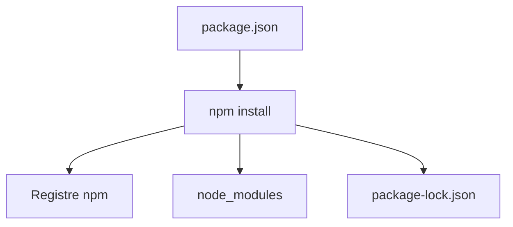

# npm

> [!info] En une phrase
> Le gestionnaire de paquets de Node.js : il installe les bibliothèques déclarées dans package.json et lance les scripts du projet.

```dataviewjs
await dv.view("10 — Templates/Scripts/learning", { view: "concept" })
```

## 1 · Comprendre
### Définition
**npm** lit [[package.json]], télécharge les paquets depuis le registre npmjs.com dans le dossier `node_modules`, et écrit les versions exactes dans `package-lock.json`.
| Commande | Rôle |
| --- | --- |
| `npm install` | installe tout ce que déclare `package.json` |
| `npm install express` | ajoute une dépendance |
| `npm install -D vitest` | ajoute une dépendance de développement |
| `npm ci` | installe **exactement** le lock (CI, Docker) |
| `npm run build` | lance le script `build` |
| `npx outil` | exécute l'outil installé dans le projet |
| `npm outdated` / `npm update` | versions périmées / mise à jour dans les limites |
| `npm audit` | failles connues dans les dépendances |
Ce que npm fait pour Node, [[pip]] le fait pour Python : c'est un [[Gestionnaire de paquets]].

### Pourquoi ça existe
Personne n'écrit tout : un projet web utilise des dizaines de bibliothèques, qui ont elles-mêmes des dépendances.

### Le problème résolu
Installer, mettre à jour et reproduire le même ensemble de bibliothèques sur chaque machine et dans la CI.

## 2 · Explorer
### Comment ça fonctionne


### Exemple concret
```bash
npm init -y
npm install express
npm install -D nodemon
npm run dev              # lance "dev" défini dans package.json
rm -rf node_modules && npm ci   # réinstallation propre, comme la CI
```
`node_modules` ne se versionne **jamais** (il est dans `.gitignore`) ; `package-lock.json` **se versionne**.

### Cas d'utilisation
- Installer les dépendances d'un projet cloné
- L'étape `npm ci` puis `npm run build` d'un Dockerfile ou d'une pipeline
- Lancer les outils (tests, lint, build)

> [!warning] À ne pas confondre
> **npm** (installe, lance les scripts) et **npx** (exécute un outil). Et `npm install` (peut mettre à jour le lock) contre `npm ci` (respecte le lock à la lettre, échoue s'il ne correspond pas).

## 3 · Pratiquer
- Clone un projet Node, installe avec `npm ci`, liste ses scripts avec `npm run`
- Ajoute et retire une dépendance et regarde ce qui change dans `package.json` et le lock

## 4 · Expliquer
> [!quote] Mon résumé, avec mes mots
> _À écrire sans regarder la fiche. Si je bloque, je ne l'ai pas encore compris._

## 5 · Relier
- **Prérequis** : [[Node.js]] · [[Gestionnaire de paquets]]
- **Complémentaires** : [[package.json]] · [[Version sémantique (semver)]]
- **Utilisé par** : [[Express]]

## 6 · Réviser
> [!question] Me faire interroger
> Je demande à Claude de m'interroger sur cette notion pour vérifier que je l'ai comprise.

### Validation de la maîtrise
La notion est maîtrisée quand j'ai réussi **tous les exercices** qui l'utilisent (statut `reussi` dans l'exercice).

```dataviewjs
await dv.view("10 — Templates/Scripts/learning", { view: "maitrise" })
```
