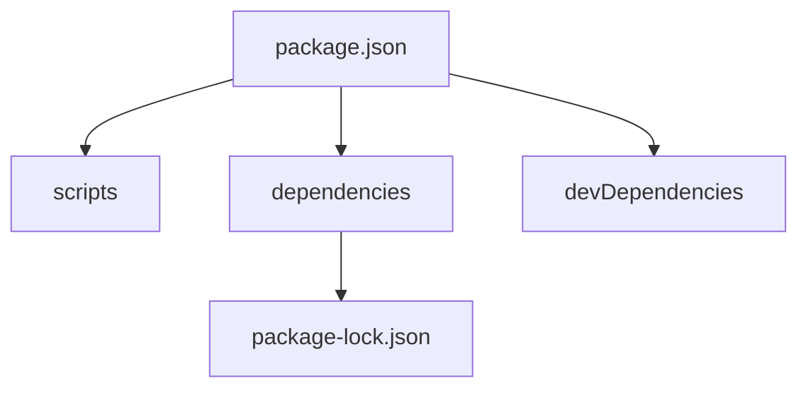

# package.json

> [!info] En une phrase
> Le fichier de description d'un projet Node : son nom, ses scripts, ses dépendances et leurs versions autorisées.

```dataviewjs
await dv.view("10 — Templates/Scripts/learning", { view: "concept" })
```

## 1 · Comprendre
### Définition
```json
{
  "name": "export-annotations",
  "version": "1.2.0",
  "type": "module",
  "scripts": {
    "dev": "node --watch src/index.js",
    "test": "vitest run",
    "build": "tsc"
  },
  "dependencies": { "express": "^4.19.2" },
  "devDependencies": { "vitest": "^2.1.0", "typescript": "~5.6.0" },
  "engines": { "node": ">=20" }
}
```
- **`scripts`** : commandes lancées avec `npm run <nom>` (`npm test` et `npm start` sans `run`). Elles voient les outils de `node_modules/.bin`.
- **`dependencies`** : nécessaires pour faire tourner l'application ; **`devDependencies`** : seulement pour développer, tester, construire.
- **`package-lock.json`** : l'arbre exact installé, à versionner.

### Pourquoi ça existe
Il faut un endroit unique qui dise de quoi le projet a besoin et comment le lancer.

### Le problème résolu
N'importe qui (ou la CI) peut cloner, faire `npm ci`, puis `npm test` sans rien deviner.

## 2 · Explorer
### Comment ça fonctionne


### Exemple concret
```bash
npm pkg get scripts       # affiche les scripts
npm run                   # liste les scripts disponibles
npm run build -- --watch  # passe --watch au script
```
Le `requirements.txt` ou `pyproject.toml` de Python joue le même rôle.

### Cas d'utilisation
- Comprendre comment se lance un projet inconnu (lire les `scripts`)
- Configurer la CI
- Fixer la version de Node

> [!warning] À ne pas confondre
> Les **versions** dans `package.json` sont des **plages** (`^4.19.2`), pas des versions exactes : la version exacte est dans le lock. Voir [[Version sémantique (semver)]].

## 3 · Pratiquer

### Exercice visuel

Sur Excalidraw, **sans regarder la fiche**. Puis je compare avec la fiche, je corrige en rouge ce qui était faux, et j'explique mon dessin à voix haute ou à Claude dans le chat.

> [!example] 🧠 Dessine de mémoire
> Dessine le package.json du front Vue comme une fiche d'identité : nom, scripts, dépendances. Relie `npm run dev` au script qu'il lance.

> [!example] ⚖️ Avant / après
> Avant / après : `dependencies` et `devDependencies`. Dessine ce qui finit dans l'image Docker de production et ce qui n'y va pas.

### Mon schéma

> [!tip] Mon dessin Excalidraw
> _Je crée le dessin « Schéma - package.json » et je l'intègre ici avec `![[Schéma - package.json.excalidraw]]`, puis je coche `schema`._

### Appliquer dans le fil rouge
- Pas encore d'étape du fil rouge pour cette notion : elle sera pratiquée dans le fil rouge de son niveau (voir [[Niveaux]]).

## 4 · Relier
- **Prérequis** : [[JSON]] · [[Gestionnaire de paquets]]
- **Complémentaires** : [[Version sémantique (semver)]]

## 5 · Réviser
> [!question] Me faire interroger
> Je demande à Claude de m'interroger sur cette notion pour vérifier que je l'ai comprise.

### Validation (compris, puis maîtrisé)
Trois cases à cocher dans les propriétés de la fiche :
- `schema` : mon dessin du concept est dans « Mon schéma » ;
- `exercice_visuel` : j'ai fait et corrigé les exercices visuels de la section 3 ;
- `fil_rouge` : je l'ai appliqué dans le fil rouge (coché tout seul quand une étape qui l'utilise est réussie).

Les trois cochées : la notion compte comme **comprise**. **Maîtrisé** : c'est moi qui le mets dans `status`, quand je le sens.

```dataviewjs
await dv.view("10 — Templates/Scripts/learning", { view: "maitrise" })
```
