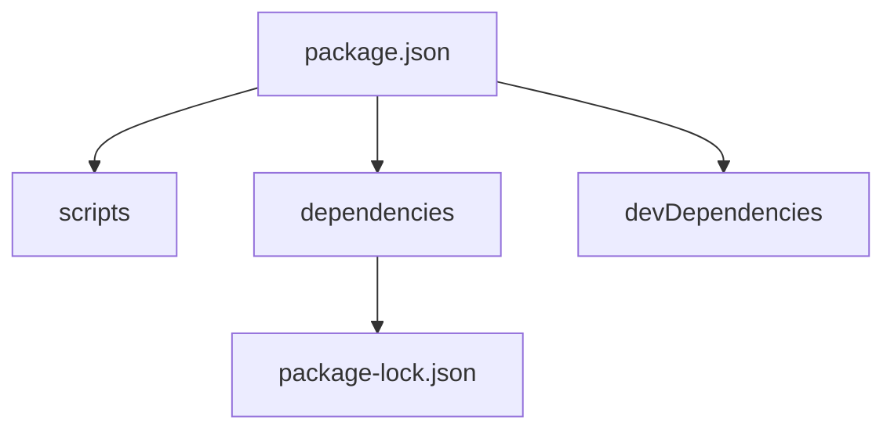

# package.json

> [!info] En une phrase
> Le fichier de description d'un projet Node : son nom, ses scripts, ses dépendances et leurs versions autorisées.

```dataviewjs
await dv.view("10 — Templates/Scripts/learning", { view: "concept" })
```

## 1 · Comprendre
### Définition
```json
{
  "name": "export-annotations",
  "version": "1.2.0",
  "type": "module",
  "scripts": {
    "dev": "node --watch src/index.js",
    "test": "vitest run",
    "build": "tsc"
  },
  "dependencies": { "express": "^4.19.2" },
  "devDependencies": { "vitest": "^2.1.0", "typescript": "~5.6.0" },
  "engines": { "node": ">=20" }
}
```
- **`scripts`** : commandes lancées avec `npm run <nom>` (`npm test` et `npm start` sans `run`). Elles voient les outils de `node_modules/.bin`.
- **`dependencies`** : nécessaires pour faire tourner l'application ; **`devDependencies`** : seulement pour développer, tester, construire.
- **`package-lock.json`** : l'arbre exact installé, à versionner.

### Pourquoi ça existe
Il faut un endroit unique qui dise de quoi le projet a besoin et comment le lancer.

### Le problème résolu
N'importe qui (ou la CI) peut cloner, faire `npm ci`, puis `npm test` sans rien deviner.

## 2 · Explorer
### Comment ça fonctionne


### Exemple concret
```bash
npm pkg get scripts       # affiche les scripts
npm run                   # liste les scripts disponibles
npm run build -- --watch  # passe --watch au script
```
Le `requirements.txt` ou `pyproject.toml` de Python joue le même rôle.

### Cas d'utilisation
- Comprendre comment se lance un projet inconnu (lire les `scripts`)
- Configurer la CI
- Fixer la version de Node

> [!warning] À ne pas confondre
> Les **versions** dans `package.json` sont des **plages** (`^4.19.2`), pas des versions exactes : la version exacte est dans le lock. Voir [[Version sémantique (semver)]].

## 3 · Pratiquer
- Ouvre le `package.json` d'un vrai projet (CVAT a un frontend) et explique chaque script

## 4 · Expliquer
> [!quote] Mon résumé, avec mes mots
> _À écrire sans regarder la fiche. Si je bloque, je ne l'ai pas encore compris._

## 5 · Relier
- **Prérequis** : [[JSON]] · [[npm]]
- **Complémentaires** : [[Version sémantique (semver)]]

## 6 · Réviser
> [!question] Me faire interroger
> Je demande à Claude de m'interroger sur cette notion pour vérifier que je l'ai comprise.

### Validation de la maîtrise
La notion est maîtrisée quand j'ai réussi **tous les exercices** qui l'utilisent (statut `reussi` dans l'exercice).

```dataviewjs
await dv.view("10 — Templates/Scripts/learning", { view: "maitrise" })
```
