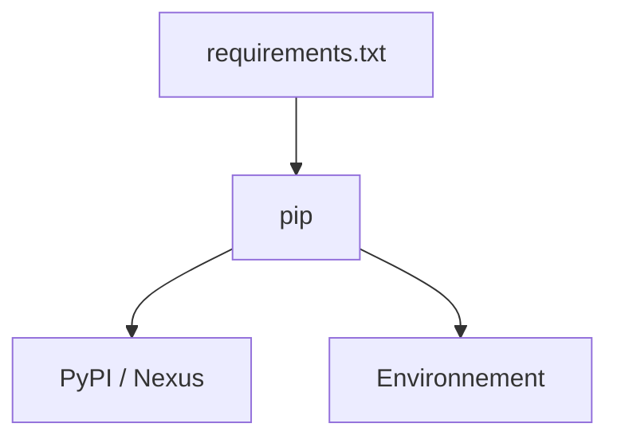

# pip

> [!info] En une phrase
> Le gestionnaire de paquets de Python : il installe les bibliothèques externes depuis PyPI (ou le Nexus de l'entreprise).

```dataviewjs
await dv.view("10 — Templates/Scripts/learning", { view: "concept" })
```

## 1 · Comprendre
### Définition
**pip** télécharge et installe des paquets depuis **PyPI**, le dépôt public de Python. Le fichier `requirements.txt` liste les paquets d'un projet, un par ligne, avec leur version. C'est l'équivalent de [[npm]] et `package.json` pour Node.

### Pourquoi ça existe
Réutiliser des bibliothèques écrites par d'autres (requests, pytest) au lieu de tout coder.

### Le problème résolu
Télécharger et installer les bibliothèques à la main, sans savoir quelles versions utilisent les collègues.

## 2 · Explorer
### Comment ça fonctionne


### Exemple concret
```text
# requirements.txt
requests==2.32.3
requests>=2.32,<3
```
```bash
python -m pip install requests        # installer un paquet
pip install -r requirements.txt      # tout installer
pip list                             # ce qui est installé
pip freeze > requirements.txt        # figer les versions actuelles
```
En entreprise, pip passe souvent par le [[Nexus]] :
```bash
pip install -r requirements.txt --index-url https://nexus.mon-entreprise.com/repository/pypi-proxy/simple
```
(ou la variable d'environnement `PIP_INDEX_URL`).

### Cas d'utilisation
- Installer requests pour appeler des API, pytest pour tester
- Ligne `RUN pip install -r requirements.txt` d'un [[Dockerfile]]

> [!warning] À ne pas confondre
> `pip` peut viser un autre Python que celui que tu crois. `python -m pip` garantit que c'est celui de la commande `python`. Et un paquet sans version fixée peut changer du jour au lendemain : fixe les versions dans `requirements.txt`.

## 3 · Pratiquer
- Dans un venv, installe `requests`, puis génère un `requirements.txt` avec `pip freeze` et lis-le.
- Supprime le venv, recrée-le, et réinstalle tout avec `-r requirements.txt`.

## 4 · Expliquer
> [!quote] Mon résumé, avec mes mots
> _À écrire sans regarder la fiche. Si je bloque, je ne l'ai pas encore compris._

## 5 · Relier
- **Prérequis** : [[Environnement virtuel Python]]
- **Complémentaires** : [[npm]] · [[Nexus]] · [[Proxy]]
- **Utilisé par** : [[Appeler une API HTTP (requests)]] · [[pytest]] · [[Python dans Docker]]
- **Commandes** : [[pip install]]

## 6 · Réviser
> [!question] Me faire interroger
> Je demande à Claude de m'interroger sur cette notion pour vérifier que je l'ai comprise.

### Validation de la maîtrise
La notion est maîtrisée quand j'ai réussi **tous les exercices** qui l'utilisent (statut `reussi` dans l'exercice).

```dataviewjs
await dv.view("10 — Templates/Scripts/learning", { view: "maitrise" })
```
