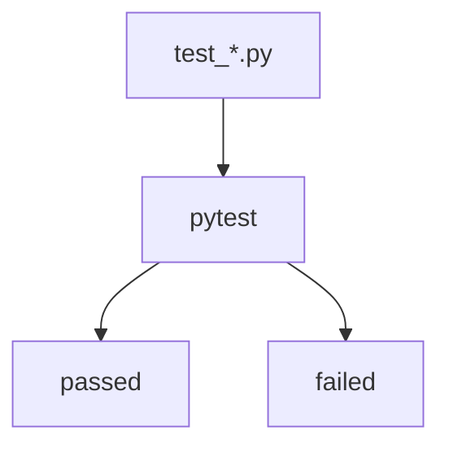

# pytest

> [!info] En une phrase
> L'outil de test le plus utilisé en Python : il trouve les fonctions test_… et vérifie leurs assert.

```dataviewjs
await dv.view("10 — Templates/Scripts/learning", { view: "concept" })
```

## 1 · Comprendre
### Définition
**pytest** cherche les fichiers `test_*.py`, y exécute chaque fonction `test_…`, et signale celles dont un `assert` est faux. Il sort avec un code non nul si un test échoue, ce qui fait échouer la CI.

### Pourquoi ça existe
Vérifier automatiquement, à chaque modification, que le code fait toujours ce qu'on attend.

### Le problème résolu
Tester à la main après chaque changement est long, et on oublie toujours un cas.

## 2 · Explorer
### Comment ça fonctionne


### Exemple concret
```python
# outils.py
def extension(nom: str) -> str:
    return nom.rsplit(".", 1)[-1].lower()
```
```python
# test_outils.py
from outils import extension

def test_extension_en_minuscules():
    assert extension("Photo.PNG") == "png"

def test_plusieurs_points():
    assert extension("archive.tar.gz") == "gz"
```
```bash
pip install pytest
pytest            # tous les tests
pytest -v         # détail de chaque test
pytest -k zip     # seulement ceux dont le nom contient "zip"
pytest -x         # s'arrêter au premier échec
```
La fixture `tmp_path` donne un dossier temporaire neuf à chaque test, idéal pour tester un script qui crée des fichiers.

### Cas d'utilisation
- Tester les fonctions de ton script de zip
- Les tests de CVAT tournent avec pytest **dans l'image** (voir [[Tester l'image, pas le dépôt]])

> [!warning] À ne pas confondre
> Un test qui passe vérifie seulement **ce qu'il teste**. Avant de modifier ou débloquer un test, lis ce qu'il vérifie vraiment. Et `skipped` (test non lancé) n'est pas `passed`.

## 3 · Pratiquer
- Écris deux tests pour une de tes fonctions, fais-en échouer un exprès et lis le rapport.
- Écris un test qui utilise `tmp_path` pour créer deux fichiers, les zipper et vérifier `namelist()`.

## 4 · Expliquer
> [!quote] Mon résumé, avec mes mots
> _À écrire sans regarder la fiche. Si je bloque, je ne l'ai pas encore compris._

## 5 · Relier
- **Prérequis** : [[Fonction]] · [[Module et import Python]]
- **Complémentaires** : [[Code de sortie]]
- **Utilisé par** : [[Pipeline GitLab CI]] · [[Tester l'image, pas le dépôt]]

## 6 · Réviser
> [!question] Me faire interroger
> Je demande à Claude de m'interroger sur cette notion pour vérifier que je l'ai comprise.

### Validation de la maîtrise
La notion est maîtrisée quand j'ai réussi **tous les exercices** qui l'utilisent (statut `reussi` dans l'exercice).

```dataviewjs
await dv.view("10 — Templates/Scripts/learning", { view: "maitrise" })
```
