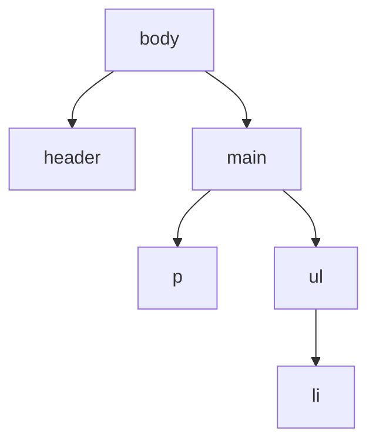

# Élément et attribut HTML

> [!info] En une phrase
> Un élément HTML est une balise ouvrante, un contenu et une balise fermante ; ses attributs le précisent (lien, identifiant, classe).

```dataviewjs
await dv.view("10 — Templates/Scripts/learning", { view: "concept" })
```

## 1 · Comprendre
### Définition
```html
<a href="https://gitlab.com" class="lien externe" id="lien-gitlab" target="_blank">GitLab</a>
└┬┘ └──────── attributs ─────────────────────────────────────────┘ └ contenu ┘ └┬┘
 ouvrante                                                                       fermante
```
Les éléments s'**imbriquent** et forment un arbre. Certains n'ont pas de contenu (``, `<input>`, `<br>`).

| Attribut | Rôle |
| --- | --- |
| `id` | identifiant **unique** dans la page |
| `class` | une ou plusieurs classes, pour le CSS et le JS |
| `href` / `src` | adresse d'un lien / d'une ressource |
| `alt` | texte de remplacement d'une image (obligatoire) |
| `data-*` | données personnalisées (`data-id="12"`) |

**Bloc** (`div`, `p`, `h1`, `section` : prend toute la largeur) et **en ligne** (`span`, `a`, `strong` : dans le texte).

### Pourquoi ça existe
Décrire précisément chaque morceau de contenu et le rendre ciblable par le CSS et le JavaScript.

### Le problème résolu
Sans attributs, impossible de dire où mène un lien, quelle image charger, ou quel élément styliser.

## 2 · Explorer
### Comment ça fonctionne


### Exemple concret
```html
<section class="carte" data-id="12">
  <h2>Tâche 12</h2>
  <p>Statut : <span class="badge ok">terminée</span></p>
  <button type="button" id="exporter">Exporter en PNG</button>
</section>
```

### Cas d'utilisation
- Donner une classe à un élément pour le styliser
- Donner un `id` ou un `data-*` pour le retrouver en JavaScript

> [!warning] À ne pas confondre
> `id` (un seul par page) et `class` (réutilisable). Et oublier de fermer une balise : le navigateur « répare » à sa façon et la page s'affiche bizarrement.

## 3 · Pratiquer
- Ouvre les outils de développement (F12) sur une page et explore l'arbre des éléments ; modifie un attribut en direct.

## 4 · Expliquer
> [!quote] Mon résumé, avec mes mots
> _À écrire sans regarder la fiche. Si je bloque, je ne l'ai pas encore compris._

## 5 · Relier
- **Prérequis** : [[HTML]]
- **Complémentaires** : [[Sélecteur CSS]] · [[DOM]]

## 6 · Réviser
> [!question] Me faire interroger
> Je demande à Claude de m'interroger sur cette notion pour vérifier que je l'ai comprise.

### Validation de la maîtrise
- [ ] Je l'explique sans notes, en 3 phrases, à quelqu'un qui ne connaît pas
- [ ] J'ai réussi un exercice qui l'utilise
- [ ] Je l'ai utilisé dans un projet
- [ ] Je sais dire quand ne pas l'utiliser (ou ce qu'il ne faut pas confondre)
