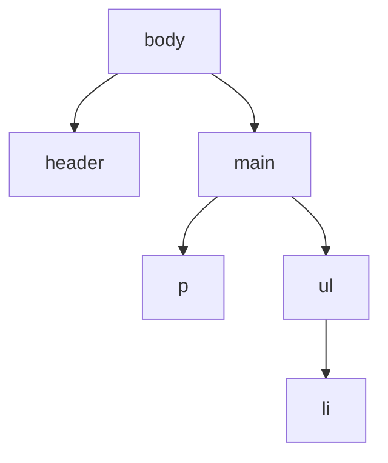

# Élément et attribut HTML

> [!info] En une phrase
> Un élément HTML est une balise ouvrante, un contenu et une balise fermante ; ses attributs le précisent (lien, identifiant, classe).

```dataviewjs
await dv.view("10 — Templates/Scripts/learning", { view: "concept" })
```

## 1 · Comprendre
### Définition
```html
<a href="https://gitlab.com" class="lien externe" id="lien-gitlab" target="_blank">GitLab</a>
└┬┘ └──────── attributs ─────────────────────────────────────────┘ └ contenu ┘ └┬┘
 ouvrante                                                                       fermante
```
Les éléments s'**imbriquent** et forment un arbre. Certains n'ont pas de contenu (``, `<input>`, `<br>`).

| Attribut | Rôle |
| --- | --- |
| `id` | identifiant **unique** dans la page |
| `class` | une ou plusieurs classes, pour le CSS et le JS |
| `href` / `src` | adresse d'un lien / d'une ressource |
| `alt` | texte de remplacement d'une image (obligatoire) |
| `data-*` | données personnalisées (`data-id="12"`) |

**Bloc** (`div`, `p`, `h1`, `section` : prend toute la largeur) et **en ligne** (`span`, `a`, `strong` : dans le texte).

### Pourquoi ça existe
Décrire précisément chaque morceau de contenu et le rendre ciblable par le CSS et le JavaScript.

### Le problème résolu
Sans attributs, impossible de dire où mène un lien, quelle image charger, ou quel élément styliser.

## 2 · Explorer
### Comment ça fonctionne


### Exemple concret
```html
<section class="carte" data-id="12">
  <h2>Tâche 12</h2>
  <p>Statut : <span class="badge ok">terminée</span></p>
  <button type="button" id="exporter">Exporter en PNG</button>
</section>
```

### Cas d'utilisation
- Donner une classe à un élément pour le styliser
- Donner un `id` ou un `data-*` pour le retrouver en JavaScript

> [!warning] À ne pas confondre
> `id` (un seul par page) et `class` (réutilisable). Et oublier de fermer une balise : le navigateur « répare » à sa façon et la page s'affiche bizarrement.

## 3 · Pratiquer

### Exercice visuel

Sur Excalidraw, **sans regarder la fiche**. Puis je compare avec la fiche, je corrige en rouge ce qui était faux, et j'explique mon dessin à voix haute ou à Claude dans le chat.

> [!example] 🧠 Dessine de mémoire
> Dessine un élément `<input>` du formulaire en pièces détachées : la balise, ses attributs (type, name, required), sa valeur.

> [!example] 🔄 Change de contexte
> Redessine un élément `<a>` et un élément ``. Quels attributs sont indispensables pour chacun ?

### Mon schéma

> [!tip] Mon dessin Excalidraw
> _Je crée le dessin « Schéma - Élément et attribut HTML » et je l'intègre ici avec `![[Schéma - Élément et attribut HTML.excalidraw]]`, puis je coche `schema`._

### Appliquer dans le fil rouge
- Pas encore d'étape du fil rouge pour cette notion : elle sera pratiquée dans le fil rouge de son niveau (voir [[Niveaux]]).

## 4 · Relier
- **Prérequis** : [[HTML]]
- **Complémentaires** : [[Sélecteur CSS]] · [[DOM]]

## 5 · Réviser
> [!question] Me faire interroger
> Je demande à Claude de m'interroger sur cette notion pour vérifier que je l'ai comprise.

### Validation (compris, puis maîtrisé)
Trois cases à cocher dans les propriétés de la fiche :
- `schema` : mon dessin du concept est dans « Mon schéma » ;
- `exercice_visuel` : j'ai fait et corrigé les exercices visuels de la section 3 ;
- `fil_rouge` : je l'ai appliqué dans le fil rouge (coché tout seul quand une étape qui l'utilise est réussie).

Les trois cochées : la notion compte comme **comprise**. **Maîtrisé** : c'est moi qui le mets dans `status`, quand je le sens.

```dataviewjs
await dv.view("10 — Templates/Scripts/learning", { view: "maitrise" })
```
