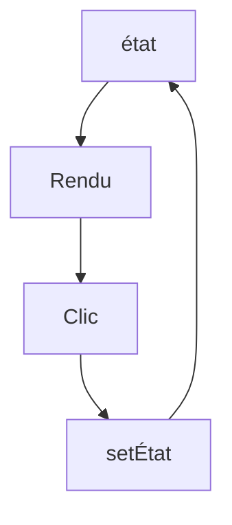

# État React (useState)

> [!info] En une phrase
> L'état est une donnée qui appartient à un composant et peut changer ; quand on la change avec la fonction fournie par useState, React réaffiche le composant.

```dataviewjs
await dv.view("10 — Templates/Scripts/learning", { view: "concept" })
```

## 1 · Comprendre
### Définition
```tsx
const [taches, setTaches] = useState<Tache[]>([]);
const [chargement, setChargement] = useState(false);
```
`useState(valeurInitiale)` renvoie la valeur **actuelle** et une fonction pour la **remplacer**.
Règles :
- **Ne jamais modifier** l'état directement (`taches.push(x)` ne réaffiche rien) : crée une **nouvelle** valeur.
```tsx
setTaches([...taches, nouvelle]);                       // ajouter
setTaches(taches.filter((t) => t.id !== id));           // retirer
setTaches(taches.map((t) => t.id === id ? { ...t, fini: true } : t));   // modifier
setN((ancien) => ancien + 1);                           // à partir de l'ancienne valeur
```
- La nouvelle valeur n'est visible **qu'au rendu suivant**.
- Garde l'état au plus près de ceux qui l'utilisent ; s'il est partagé par deux enfants, remonte-le dans leur parent.

### Pourquoi ça existe
Une interface a des choses qui changent : saisie, liste chargée, fenêtre ouverte. React doit savoir quand réafficher.

### Le problème résolu
Lier l'affichage aux données : on change la donnée, l'écran suit tout seul.

## 2 · Explorer
### Comment ça fonctionne


### Exemple concret
```tsx
function Taches() {
  const [texte, setTexte] = useState("");
  const [liste, setListe] = useState<string[]>([]);
  return (
    <form onSubmit={(e) => { e.preventDefault(); if (texte) { setListe([...liste, texte]); setTexte(""); } }}>
      <input value={texte} onChange={(e) => setTexte(e.target.value)} />
      <button>Ajouter</button>
      <ul>{liste.map((t, i) => <li key={i}>{t}</li>)}</ul>
    </form>
  );
}
```
Un champ dont la valeur vient de l'état est un **champ contrôlé**.

### Cas d'utilisation
- Formulaires
- Chargement et erreurs
- Fenêtres, onglets, filtres

> [!warning] À ne pas confondre
> Modifier l'objet en place (`tache.fini = true; setTache(tache)`) : React voit le même objet et ne réaffiche pas. Et une valeur **calculable** à partir d'un autre état (un total, une liste filtrée) ne doit pas être un état : calcule-la au rendu.

## 3 · Pratiquer
- Écris un composant panier : ajouter, retirer, changer une quantité, total calculé

## 4 · Expliquer
> [!quote] Mon résumé, avec mes mots
> _À écrire sans regarder la fiche. Si je bloque, je ne l'ai pas encore compris._

## 5 · Relier
- **Prérequis** : [[Props React]] · [[Tableau et objet JavaScript]]
- **Complémentaires** : [[Effet React (useEffect)]]

## 6 · Réviser
> [!question] Me faire interroger
> Je demande à Claude de m'interroger sur cette notion pour vérifier que je l'ai comprise.

### Validation de la maîtrise
La notion est maîtrisée quand j'ai réussi **tous les exercices** qui l'utilisent (statut `reussi` dans l'exercice).

```dataviewjs
await dv.view("10 — Templates/Scripts/learning", { view: "maitrise" })
```
