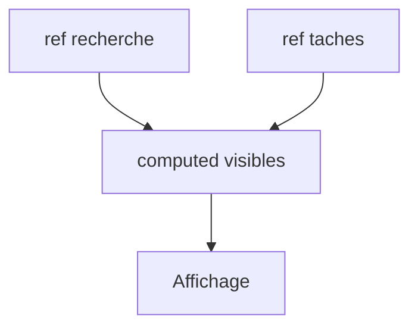

# État et réactivité

> [!info] En une phrase
> L'état est une donnée qui appartient à l'interface et peut changer ; quand elle change, tout ce qui en dépend se réaffiche tout seul (ref en Vue, useState en React, signal ou propriété en Angular).

## 1 · Comprendre
### Définition
```ts
import { ref, reactive, computed, watch, onMounted } from "vue";
const recherche = ref("");                 // une valeur : recherche.value (dans le script)
const taches = ref<Tache[]>([]);
const filtre = reactive({ statut: "toutes" });   // un objet réactif, sans .value
const visibles = computed(() =>              // valeur dérivée, recalculée seulement si besoin
  taches.value.filter((t) => t.nom.includes(recherche.value)));
watch(recherche, (nouv, anc) => console.log(anc, "→", nouv));   // réagir à un changement
onMounted(async () => { taches.value = await charger(); });     // à l'apparition
```
- Dans le **template**, pas de `.value` : `{{ recherche }}`.
- On peut **modifier directement** : `taches.value.push(t)` fonctionne (contrairement à React).
- `computed` pour ce qui se calcule ; `watch` pour une action à faire quand une valeur change (appel d'API, stockage).

### Pourquoi ça existe
L'affichage doit suivre les données sans que le développeur ait à dire quand réafficher.

### Le problème résolu
Moins de code de mise à jour, et des valeurs dérivées toujours justes.

## 2 · Explorer
### Comment ça fonctionne


### Exemple concret
```vue
<script setup lang="ts">
import { ref, computed } from "vue";
const prix = ref(10), quantite = ref(3);
const total = computed(() => prix.value * quantite.value);
</script>
<template>
  <input v-model.number="quantite" type="number" /> Total : {{ total }} €
</template>
```

> [!abstract]- Comment ça s'écrit (référence à chercher, pas à apprendre par cœur)
> L'idée est la même partout ; seule l'écriture change.
>
> **Vue**
> ```js
> const depenses = ref([]);
> const total = computed(() => depenses.value.reduce((s, d) => s + d.montant, 0));
> depenses.value.push(nouvelle);   // l'affichage et le total se mettent à jour
> ```
>
> **React**
> ```jsx
> const [depenses, setDepenses] = useState([]);
> const total = depenses.reduce((s, d) => s + d.montant, 0);
> setDepenses([...depenses, nouvelle]);  // toujours un NOUVEAU tableau
> ```
> En React, on ne modifie jamais l'état en place : on le remplace.
>
> **Angular**
> ```ts
> depenses = signal<Depense[]>([]);
> total = computed(() => this.depenses().reduce((s, d) => s + d.montant, 0));
> this.depenses.update((l) => [...l, nouvelle]);
> ```

### Cas d'utilisation
- Formulaires et filtres
- Valeurs calculées (totaux, listes filtrées)
- Charger des données au montage

> [!warning] À ne pas confondre
> Oublier `.value` dans le script (`recherche === ""` compare l'objet ref, toujours faux). Et déstructurer un `reactive` (`const { statut } = filtre`) perd la réactivité.

## 3 · Relier
- **Prérequis** : [[Composant d'interface]] · [[Liste et dictionnaire]]
- **Complémentaires** : [[État et réactivité]] · [[Template et liaison de données]]
