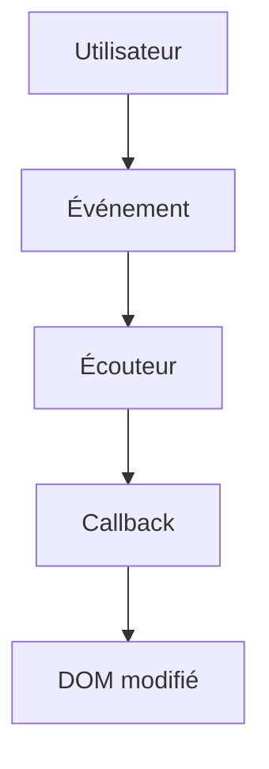

# Événement JavaScript

> [!info] En une phrase
> Un événement est quelque chose qui se passe dans la page (clic, saisie, envoi de formulaire) ; on y attache une fonction avec addEventListener.

```dataviewjs
await dv.view("10 — Templates/Scripts/learning", { view: "concept" })
```

## 1 · Comprendre
### Définition
```js
bouton.addEventListener("click", (event) => {
  console.log("cliqué", event.target);
});
```
Événements courants : `click`, `input` (à chaque frappe), `change`, `submit` (formulaire), `keydown`, `DOMContentLoaded` (page prête).
- `event.target` : l'élément concerné.
- `event.preventDefault()` : empêche le comportement par défaut (par exemple, le rechargement à l'envoi d'un formulaire).
- **Propagation** : l'événement « remonte » aux parents ; on peut donc écouter sur un parent (*délégation*).

### Pourquoi ça existe
Une interface attend l'utilisateur : le code doit réagir au moment où il agit, pas tourner en boucle.

### Le problème résolu
Brancher le comportement sur les actions de l'utilisateur sans mélanger HTML et JavaScript (pas de `onclick="…"`).

## 2 · Explorer
### Comment ça fonctionne


### Exemple concret
```html
<form id="f"><input name="nom" required><button>Créer</button></form>
<p id="msg"></p>
<script>
  document.querySelector("#f").addEventListener("submit", (e) => {
    e.preventDefault();                       // pas de rechargement
    const nom = new FormData(e.target).get("nom");
    document.querySelector("#msg").textContent = `Créé : ${nom}`;
  });
</script>
```

### Cas d'utilisation
- Le bouton « Exporter en PNG » dans CVAT
- Valider un formulaire pendant la saisie
- Raccourcis clavier

> [!warning] À ne pas confondre
> `click` sur le bouton et `submit` sur le formulaire : pour un formulaire, écoute `submit` (il couvre aussi la touche Entrée). Et oublier `preventDefault()` : la page se recharge et tout ce qui a été affiché disparaît.

## 3 · Pratiquer

### Exercice visuel

Sur Excalidraw, **sans regarder la fiche**. Puis je compare avec la fiche, je corrige en rouge ce qui était faux, et j'explique mon dessin à voix haute ou à Claude dans le chat.

> [!example] 🛣️ Suis le trajet
> Dessine le trajet d'un clic sur « Supprimer » : l'élément, l'écouteur, la fonction appelée, la requête DELETE.

> [!example] 🔄 Change de contexte
> Redessine le même trajet pour l'envoi du formulaire (`submit`). Pourquoi faut-il souvent `preventDefault()` ?

### Mon schéma

> [!tip] Mon dessin Excalidraw
> _Je crée le dessin « Schéma - Événement JavaScript » et je l'intègre ici avec `![[Schéma - Événement JavaScript.excalidraw]]`, puis je coche `schema`._

### Appliquer dans le fil rouge
- Pas encore d'étape du fil rouge pour cette notion : elle sera pratiquée dans le fil rouge de son niveau (voir [[Niveaux]]).

## 4 · Relier
- **Prérequis** : [[DOM]] · [[Fonction fléchée et callback]]
- **Complémentaires** : [[Formulaire HTML]]
- **Utilisé par** : [[React]]

## 5 · Réviser
> [!question] Me faire interroger
> Je demande à Claude de m'interroger sur cette notion pour vérifier que je l'ai comprise.

### Validation de la maîtrise
Trois cases à cocher dans les propriétés de la fiche :
- `schema` : mon dessin du concept est dans « Mon schéma » ;
- `exercice_visuel` : j'ai fait et corrigé les exercices visuels de la section 3 ;
- `fil_rouge` : je l'ai appliqué dans le fil rouge (coché tout seul quand une étape qui l'utilise est réussie).

Les trois cochées : la notion compte comme **comprise**. **Maîtrisé** : c'est moi qui le mets dans `status`, quand je le sens.

```dataviewjs
await dv.view("10 — Templates/Scripts/learning", { view: "maitrise" })
```
