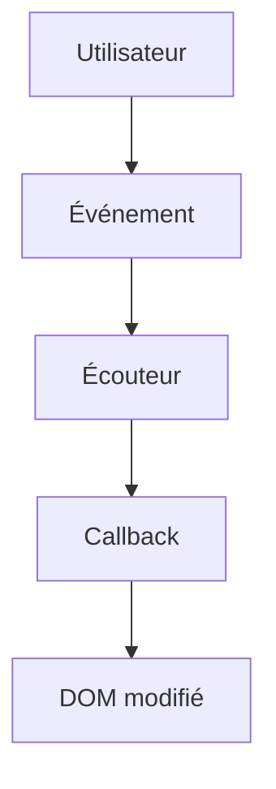

# Événement JavaScript

> [!info] En une phrase
> Un événement est quelque chose qui se passe dans la page (clic, saisie, envoi de formulaire) ; on y attache une fonction avec addEventListener.

```dataviewjs
await dv.view("10 — Templates/Scripts/learning", { view: "concept" })
```

## 1 · Comprendre
### Définition
```js
bouton.addEventListener("click", (event) => {
  console.log("cliqué", event.target);
});
```
Événements courants : `click`, `input` (à chaque frappe), `change`, `submit` (formulaire), `keydown`, `DOMContentLoaded` (page prête).
- `event.target` : l'élément concerné.
- `event.preventDefault()` : empêche le comportement par défaut (par exemple, le rechargement à l'envoi d'un formulaire).
- **Propagation** : l'événement « remonte » aux parents ; on peut donc écouter sur un parent (*délégation*).

### Pourquoi ça existe
Une interface attend l'utilisateur : le code doit réagir au moment où il agit, pas tourner en boucle.

### Le problème résolu
Brancher le comportement sur les actions de l'utilisateur sans mélanger HTML et JavaScript (pas de `onclick="…"`).

## 2 · Explorer
### Comment ça fonctionne


### Exemple concret
```html
<form id="f"><input name="nom" required><button>Créer</button></form>
<p id="msg"></p>
<script>
  document.querySelector("#f").addEventListener("submit", (e) => {
    e.preventDefault();                       // pas de rechargement
    const nom = new FormData(e.target).get("nom");
    document.querySelector("#msg").textContent = `Créé : ${nom}`;
  });
</script>
```

### Cas d'utilisation
- Le bouton « Exporter en PNG » dans CVAT
- Valider un formulaire pendant la saisie
- Raccourcis clavier

> [!warning] À ne pas confondre
> `click` sur le bouton et `submit` sur le formulaire : pour un formulaire, écoute `submit` (il couvre aussi la touche Entrée). Et oublier `preventDefault()` : la page se recharge et tout ce qui a été affiché disparaît.

## 3 · Pratiquer
- Fais un champ qui affiche en direct le nombre de caractères saisis
- Intercepte l'envoi d'un formulaire et affiche les valeurs sans recharger

## 4 · Expliquer
> [!quote] Mon résumé, avec mes mots
> _À écrire sans regarder la fiche. Si je bloque, je ne l'ai pas encore compris._

## 5 · Relier
- **Prérequis** : [[DOM]] · [[Fonction fléchée et callback]]
- **Complémentaires** : [[Formulaire HTML]]
- **Utilisé par** : [[React]]

## 6 · Réviser
> [!question] Me faire interroger
> Je demande à Claude de m'interroger sur cette notion pour vérifier que je l'ai comprise.

### Validation de la maîtrise
La notion est maîtrisée quand j'ai réussi **tous les exercices** qui l'utilisent (statut `reussi` dans l'exercice).

```dataviewjs
await dv.view("10 — Templates/Scripts/learning", { view: "maitrise" })
```
