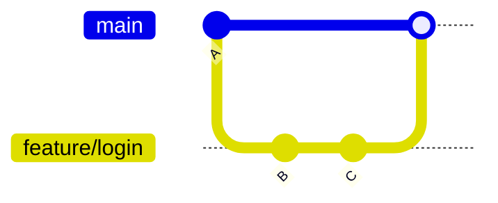

# git merge

> [!info] Git
> Fusionne une autre branche dans la branche courante.

## Pourquoi l'utiliser
- Intégrer une fonctionnalité terminée dans `main`.
- Récupérer dans ta branche les nouveautés de `main`.
- Garder un historique qui montre quand les travaux ont été réunis.

## Dans quel contexte
On se place **d'abord** sur la branche qui doit **recevoir** les changements, puis on fusionne l'autre dans celle-ci.

## Syntaxe
```bash
git merge <branche>
```

## Paramètres
| Élément | Rôle |
| --- | --- |
| `branche` | La branche dont on veut récupérer le travail |
| `--no-ff` | Force un commit de fusion même si un fast-forward est possible (historique plus lisible) |
| `--abort` | Annule un merge en cours (pendant un conflit) |
| `-m` | Message du commit de fusion |

## Exemple concret
```bash
# 1. Se placer sur la branche qui reçoit
git switch main
# 2. Fusionner la fonctionnalité
git merge feature/login
# 3. Supprimer la branche devenue inutile
git branch -d feature/login
```

## Résultat attendu
Deux cas possibles :
```text
Updating a1b2c3d..e4f5a6b
Fast-forward
 login.js | 20 ++++
```
ou, si `main` avait aussi avancé : `Merge made by the 'ort' strategy.`
## Variantes utiles
```bash
git merge --no-ff feature/login   # garder une trace explicite de la fusion
git merge --abort                 # renoncer pendant un conflit
```

> [!warning] Erreurs fréquentes
> - **Fusionner dans le mauvais sens** : `git merge main` depuis ta branche n'intègre pas ta branche dans `main`. Vérifie la branche courante avec `git status`.
> - **`CONFLICT (content)`** : voir [[Erreur - CONFLICT lors d'un git merge]].
> - **Modifications non commitées** : Git refuse de fusionner ; commite ou mets de côté d'abord.



**Pour pratiquer** : [[Exercice - Branches et merge avec Git]] · **Cours** : [[Cours - Branches et fusion]]

## Relier
- **Commandes complémentaires** : [[git switch]] · [[git branch]] · [[git status]]
- **Concepts associés** : [[Merge]] · [[Branche Git]] · [[Conflit de merge]]
