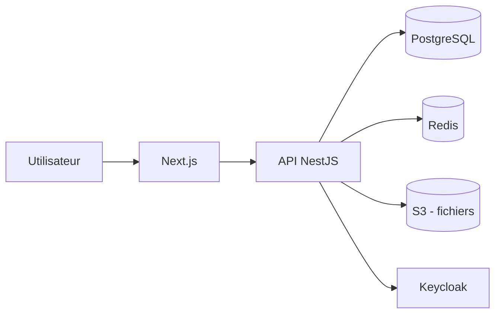

# Architecture — Application SaaS

> [!info] Vue d'ensemble
> Un front Next.js, une API NestJS, PostgreSQL pour les données, Redis pour le cache, S3 pour les fichiers.

## Schéma

## Composants
| Composant | Technologie | Rôle |
| --- | --- | --- |
| Frontend | Next.js | Interface |
| API | NestJS | Logique métier, auth |
| Base de données | PostgreSQL | Données |
| Cache | Redis | Sessions |
| Stockage | S3 | Fichiers |

## Décisions liées
- [[ADR-001 Stockage des fichiers sur S3]]
- [[ADR-002 Authentification JWT avec Keycloak]]
