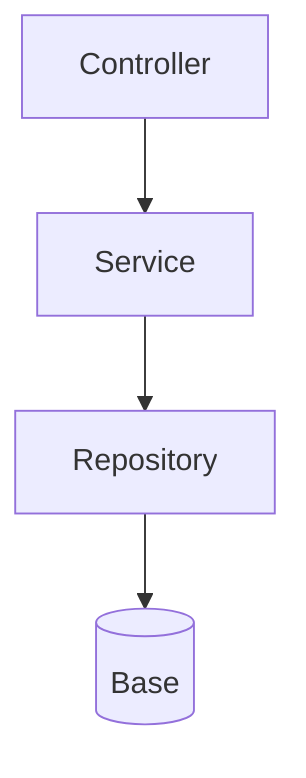

# Bonnes pratiques - .NET

## À faire

| Règle | Sinon… |
| --- | --- |
| Utiliser une version LTS (8, 10…) et l'écrire dans `global.json` | Ton collègue ou la CI utilisent une autre version, et ça ne compile pas pareil |
| Nommer comme tout le monde : `PascalCase` pour les classes et méthodes, `camelCase` pour les variables | Ton code est plus dur à lire pour les autres |
| Lancer `dotnet format` avant de commiter | La relecture de ta merge request parle d'espaces au lieu du vrai code |
| Corriger les avertissements jaunes du compilateur | L'avertissement d'aujourd'hui devient un plantage en production |
| Mettre le code métier, l'API et les tests dans 3 projets séparés | Pour tester une petite règle, tu dois lancer toute l'API |
| Demander ce dont une classe a besoin dans son constructeur, au lieu de le créer avec `new` | Impossible de remplacer une pièce (la base, un service) par une fausse dans un test |
| Si une méthode appelle du `…Async`, la marquer `async` et mettre `await` | L'application peut se figer |
| Utiliser `decimal` pour l'argent | `0.1 + 0.2` ne donne pas exactement `0.3`, les totaux sont faux |
| Mettre les réglages dans `appsettings.json` et les mots de passe hors du dépôt | Un mot de passe se retrouve dans Git, visible par tous |
| Écrire les logs avec `ILogger`, pas `Console.WriteLine` | Impossible de filtrer les erreurs dans les logs du serveur |

## À éviter

| Au lieu de… | Fais plutôt |
| --- | --- |
| Un `catch` vide qui avale l'erreur | Attraper seulement l'erreur que tu sais gérer, laisser remonter les autres |
| Commiter les dossiers `bin/` et `obj/` | `dotnet new gitignore` dès le début du projet |
| Modifier le fichier `.csproj` à la main | `dotnet add package NomDuPaquet` |
| Suivre un tuto « .NET Framework » (vieux) | Chercher un tuto « .NET 8 » ou « ASP.NET Core » |
| Une énorme classe qui fait tout | Plusieurs petites classes, chacune avec un seul rôle |
| `.ToList().Where(...)` (charge toute la table puis filtre) | `.Where(...).ToList()` (la base filtre avant d'envoyer) |

## Architecture en couches

Chaque couche n'appelle **que celle juste en dessous**.

| Règle | Sinon… |
| --- | --- |
| Le controller ne fait que recevoir, valider, appeler le service, renvoyer le code HTTP | La règle métier est coincée dans HTTP : impossible de la réutiliser ou de la tester seule |
| Toute la logique métier va dans le service | La même règle est recopiée dans 3 controllers, et un jour elles ne disent plus la même chose |
| Seul le repository parle à la base (`DbContext`) | Des requêtes SQL partout : changer une table oblige à fouiller tout le code |
| Le controller n'appelle jamais le repository directement | On saute la logique métier : une donnée invalide arrive en base |
| Chaque couche reçoit la suivante par une **interface** dans son constructeur | Impossible de remplacer la base par une fausse dans un test |
| Le controller renvoie un **DTO**, pas l'entité de la base | Un champ interne (mot de passe, id technique) part dans la réponse JSON |
| Une nouvelle fonctionnalité suit le même chemin qu'une existante | Chacun range à sa façon, plus personne ne s'y retrouve |

| Au lieu de… | Fais plutôt |
| --- | --- |
| `new MonService()` dans le controller | le demander dans le constructeur, l'enregistrer dans `Program.cs` |
| `_context.Users.Where(...)` dans le controller | une méthode du repository, appelée par le service |
| `return StatusCode(...)` dans le service | le service lève une exception ou renvoie un résultat ; le controller choisit le code |
| un service « fourre-tout » | un service par sujet (`OrderService`, `InvoiceService`) |

Le détail : [[Architecture en couches]] · [[Patron Dépôt (Repository)]] · [[Cours - .NET 12 - Les couches, controller, service, repository]]

## Avant de valider
- [ ] `dotnet build -warnaserror` passe
- [ ] `dotnet test` passe
- [ ] `dotnet format --verify-no-changes` ne trouve rien
- [ ] Aucun secret dans le code ni dans `appsettings.json`
- [ ] Les erreurs renvoient 400 ou 404, pas 500
- [ ] Pas de `DbContext` dans un controller, pas de code HTTP dans un service

## Voir aussi
[[Plateforme .NET]] · [[Projet et solution .NET]] · [[Service et injection de dépendances]] · [[async et await]] · [[Exception]]
