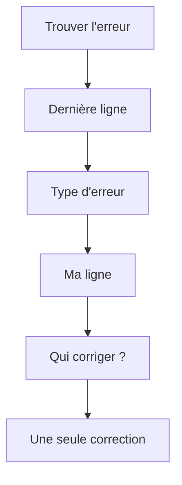

# Fiche - Lire un message d'erreur

> [!info] Objectif
> Devant un gros bloc rouge, trouver en moins d'une minute **quoi** a cassé, **où** dans ton code, et **qui** doit être corrigé (ton code, une bibliothèque, l'outil ou l'environnement).

## L'idée en une phrase
Un message d'erreur n'est pas un mur de texte : c'est presque toujours **une seule phrase utile** entourée de bruit. Le travail consiste à trouver cette phrase, puis la ligne de **ton** code qui y mène.



## Étapes

### 1. Isoler l'erreur dans le bruit
Un log contient beaucoup de lignes normales. Repère le **niveau** au début de chaque ligne :

| Marque | Sens | À lire ? |
|---|---|---|
| `(D)` / `DEBUG` | détail technique | non |
| `(I)` / `INFO` | tout va bien | non |
| `(W)` / `WARNING` | attention, pas forcément grave | parfois |
| `(E)` / `ERROR`, `Traceback`, `panic`, `Error -` | **ça a cassé** | **oui** |

S'il y a **plusieurs** erreurs à la suite, la **première** est souvent la cause, les suivantes en sont les conséquences. Exemple Nuclio : `ModuleNotFoundError` (la cause) puis `panic: Wrapper process … exited unexpectedly` (la conséquence : Nuclio constate que Python est mort).

> [!tip] Filtrer au lieu de tout lire
> ```bash
> docker logs --tail 100 <conteneur> 2>&1 | grep -iE "error|traceback|panic"
> ```
> `2>&1` : les erreurs partent sur la sortie d'erreur (stderr), on la renvoie dans le pipe pour que `grep` la voie. Voir [[Redirection et pipe]].

### 2. Dans une erreur, lire la **dernière** ligne d'abord
Un traceback Python se lit **de bas en haut** : il est écrit dans l'ordre des appels (`most recent call last` = l'appel le plus récent est en dernier). La dernière ligne donne :

```text
KeyError: 'ACCESS_TOKEN'
└──┬───┘  └──────┬─────┘
  type        message
```

> [!warning] « Première » ou « dernière » ?
> Pas de contradiction : **première erreur** dans un log qui en contient plusieurs (étape 1), puis **dernière ligne** à l'intérieur de cette erreur (étape 2).

### 3. Comprendre le **type**
Le type dit la famille du problème, avant même de lire le message. Les plus fréquents sont dans l'[[Fiche - Aide-mémoire des erreurs fréquentes|aide-mémoire]]. Trois exemples vécus :
- `ModuleNotFoundError` → un paquet n'est pas installé **là où le code tourne** ;
- `KeyError` → une clé absente d'un dictionnaire (ici `os.environ`) ;
- `NameError` → un mot que Python ne connaît pas (souvent une faute de frappe ou un collage).

### 4. Trouver la ligne de **ton** code
Remonte le traceback depuis le bas et arrête-toi au **premier fichier qui est à toi**. Chaque étage ressemble à :

```text
  File "/opt/nuclio/config.py", line 9, in <module>
    ACCESS_TOKEN = os.environ["ACCESS_TOKEN"]
```
→ fichier `config.py`, **ligne 9**, et la ligne de code elle-même juste en dessous. Les `^^^^` ou `~~~~` montrent le morceau exact qui a cassé.

Comment reconnaître ce qui est à toi :

| Chemin dans la trace | À qui c'est |
|---|---|
| tes fichiers (`main.py`, `config.py`, `sdk_cvat.py`) | **ton code** : c'est là qu'on regarde |
| `site-packages/…`, `cvat_sdk/…`, `requests/…` | une **bibliothèque** |
| `<frozen os>`, `/usr/lib/python3…` | **Python lui-même** |
| `_nuclio_wrapper.py`, `wrapper_common.py`, `/nuclio/pkg/…go` | l'**outil** (Nuclio) |

Dans l'exemple `KeyError`, la toute dernière ligne est `<frozen os>` : ce n'est pas là qu'il faut corriger. La dernière ligne **à toi** est `config.py`, ligne 9.

### 5. Décider **qui** corriger
L'endroit où l'erreur **apparaît** n'est pas toujours l'endroit où il faut **corriger**. Pose-toi la question :

| Situation | Où corriger | Exemple vécu |
|---|---|---|
| Ton code a une faute | ton fichier `.py` | [[Erreur - NameError après un collage dans un .py]] |
| Ton code est juste, mais l'environnement n'a pas ce qu'il attend | `requirements.txt`, image Docker, `--env` | [[Erreur - ModuleNotFoundError dans une fonction Nuclio]], [[Erreur - KeyError sur une variable d'environnement]] |
| Le message vient d'une bibliothèque | souvent ta **façon de l'utiliser**, ou sa **version** | [[Erreur - SDK CVAT, RqId attendu mais str reçu]] |
| Le message vient de l'outil (bash, nuctl, docker) | la **commande** que tu as tapée | [[Erreur - bash read, not a valid identifier]], [[Erreur - nuctl, Project label not found]] |

### 6. Reformuler, puis une seule correction
Avant de toucher au code, dis-toi la phrase : « **[fichier:ligne]** a cassé parce que **[cause]**, je corrige **[où]** ». Puis **une** correction, et on relance. Si une nouvelle erreur apparaît, c'est souvent un progrès : on est allé plus loin.

> [!tip] Gagner du temps avant un déploiement
> Une erreur à l'import (`ModuleNotFoundError`, `NameError`, `KeyError` au chargement) se voit en une seconde sur ton PC :
> ```bash
> python -c "import main"
> ```
> au lieu d'attendre deux minutes de `nuctl deploy`.

### 7. Lire les formats d'erreur selon l'outil

| Outil | Forme | Ce qu'il faut lire |
|---|---|---|
| **Python** | `Traceback … File "x.py", line N … Type: message` | la dernière ligne, puis ton fichier le plus bas |
| **Python dans Nuclio** | le même traceback, mais **dans du JSON** avec des `\n` | le champ `"err"` (résumé) puis le `"traceback"` ; chaque `\n` est un retour à la ligne |
| **Bash** | `-bash: read: 'xxx': not a valid identifier` | `programme: commande: ce qui gêne: pourquoi` |
| **nuctl (Go)** | `Error - …` puis `Call stack:` avec des `.go:N` | la ligne `Error - …` ; la pile Go est pour les développeurs de Nuclio |
| **Docker** | `Error response from daemon: …` | tout ce qui suit les deux-points |
| **HTTP** | un code (`401`, `404`, `502`…) | le code d'abord, puis le corps de la réponse |

> [!success] Vérifier que ça marche
> Pour une erreur donnée, tu sais dire en une phrase : **le type**, **le fichier et la ligne de ton code**, **qui** doit être corrigé (code, environnement, version, commande), et **la** correction que tu vas essayer.

## Avec mes mots

> [!quote] Mon résumé, avec mes mots
>

## Liens
- [[Fiche - Aide-mémoire des erreurs fréquentes]] · [[Exercice - Provoquer et lire des erreurs]]
- [[Fiche - Réflexes pour déboguer une pipeline]] · [[Bonnes pratiques - Résoudre un problème et déboguer]]
- [[Exception]] · [[Code de sortie]] · [[Redirection et pipe]] · [[docker logs]]
- [[Erreurs et solutions]] : les erreurs déjà rencontrées
