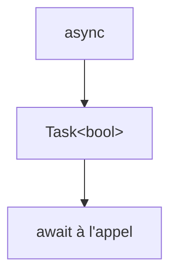

# Fiche - Syntaxe CSharp en un coup d'œil

> [!info] En deux phrases
> La syntaxe C# dont on a besoin pour lire et écrire une méthode, en tableaux « je veux → ça s'écrit ». Les exemples sont volontairement génériques (des fruits, des prix) : à toi de les transposer.

## Une méthode

| Je veux… | Ça s'écrit |
|---|---|
| utiliser les outils d'un paquet | `using System.Linq;` (en haut du fichier) |
| une méthode privée qui renvoie vrai/faux | `private bool EstCher(decimal prix) { … }` |
| une méthode qui ne renvoie rien | `private void Afficher(string texte) { … }` |
| renvoyer une valeur | `return prix > 100;` |
| une méthode asynchrone | `private async Task<bool> VerifierAsync(string url) { … }` |
| attendre un résultat asynchrone | `bool ok = await VerifierAsync(url);` |
| une asynchrone qui ne renvoie rien | `private async Task EnvoyerAsync() { … }` |

Chaque instruction finit par `;`. Les blocs sont entre `{ }`.



## Variables et texte

| Je veux… | Ça s'écrit |
|---|---|
| une variable (type deviné) | `var nom = "pomme";` |
| une variable qui peut être vide | `string? commentaire = null;` |
| tester « vide ou que des espaces » | `string.IsNullOrWhiteSpace(texte)` |
| tester `null` | `if (texte == null)` ou `if (texte is null)` |
| une valeur par défaut si `null` | `var nom = texte ?? "inconnu";` |
| accéder sans planter si `null` | `objet?.Propriete` |
| mettre en minuscules | `texte.ToLower()` |
| insérer une variable dans un texte | `$"Prix : {prix} €"` |
| l'extension d'un fichier | `Path.GetExtension("a.docx")` → `".docx"` |

## Conditions

| Je veux… | Ça s'écrit |
|---|---|
| si / sinon | `if (prix > 100) { … } else { … }` |
| et / ou / non | `a && b` · `a \|\| b` · `!a` |
| choisir une **valeur** selon un cas | voir `switch` expression ci-dessous |
| choisir des **actions** selon un cas | voir `switch` classique ci-dessous |

```csharp
// switch expression : renvoie une valeur
var rayon = fruit switch
{
    "pomme" => "Fruits",
    "carotte" => "Légumes",
    _ => "Autre",          // _ = tous les autres cas
};

// switch classique : exécute des actions
switch (fruit)
{
    case "pomme":
        Console.WriteLine("Fruit");
        break;             // obligatoire à la fin de chaque cas
    default:
        Console.WriteLine("Autre");
        break;
}
```

## Listes et boucles

| Je veux… | Ça s'écrit |
|---|---|
| un tableau tout fait | `var fruits = new[] { "pomme", "poire" };` |
| une liste qu'on remplit | `var fruits = new List<string>(); fruits.Add("pomme");` |
| un paramètre « n'importe quelle liste » | `IEnumerable<string> fruits` |
| parcourir | `foreach (var fruit in fruits) { … }` |
| sortir dès qu'on a trouvé | `return …;` dans la boucle |

## LINQ et lambdas

Une **lambda** = une petite fonction sans nom : `x => x > 10` (« pour chaque x, est-ce que x > 10 ? »).

| Je veux… | Ça s'écrit |
|---|---|
| au moins un élément vérifie… | `prix.Any(p => p > 100)` → `bool` |
| tous vérifient… | `prix.All(p => p > 0)` → `bool` |
| garder ceux qui… | `prix.Where(p => p > 100)` |
| transformer chacun | `fruits.Select(f => f.ToLower())` |
| combiner deux conditions | `fruits.Any(f => f != null && f.StartsWith("p"))` |

## Chercher un motif (Regex)

| Je veux… | Ça s'écrit |
|---|---|
| utiliser les regex | `using System.Text.RegularExpressions;` |
| créer un motif « mot entier, sans majuscules » | `var r = new Regex(@"\b(pomme\|poire)\b", RegexOptions.IgnoreCase);` |
| le texte contient le motif ? | `r.IsMatch(texte)` → `bool` |
| quel morceau a matché | `r.Match(texte).Value` |

`@"…"` : les `\` sont gardés tels quels. `\b` = bord d'un mot.

## Ressources et erreurs

| Je veux… | Ça s'écrit |
|---|---|
| ouvrir puis fermer tout seul | `using (var flux = new MemoryStream(octets)) { … }` |
| attraper une erreur | `try { … } catch (Exception e) { … }` |
| lancer une erreur | `throw new Exception("message");` |

> [!warning] Pièges
> - Oublier le `;` : erreur `CS1002: ; expected`, avec la ligne et la colonne.
> - Appeler une méthode `async` sans `await` : elle démarre, mais on n'attend pas son résultat.
> - `switch` classique sans `break` : erreur de compilation.
> - Comparer du texte avec majuscules : `"Pomme" == "pomme"` vaut `false`.

## Liens
[[Cours - .NET - le plan]] · [[Bonnes pratiques - .NET]] · [[async et await]] · [[Condition (if)]]
