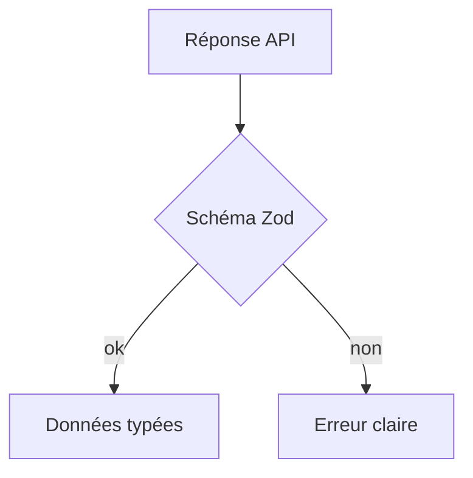

# Fiche - Zod, valider les données en TypeScript

> [!info] En deux phrases
> Les types TypeScript **disparaissent** à l'exécution : ils ne vérifient rien de ce qui arrive vraiment (réponse d'API, formulaire, fichier). Zod décrit la forme attendue dans un **schéma**, la vérifie pendant que le code tourne, et en déduit le type TypeScript.



## Le schéma, puis le type

```ts
import { z } from "zod";

const UserSchema = z.object({
  id: z.number(),
  name: z.string().min(1),
  email: z.string().email().optional(),   // peut manquer
  role: z.enum(["admin", "user"]).default("user"),
  tags: z.array(z.string()),
});

type User = z.infer<typeof UserSchema>;   // le type TS, déduit du schéma
```

Un seul endroit à maintenir : si le schéma change, le type change avec.

## Vérifier : `parse` ou `safeParse`

| Je veux… | Ça s'écrit | Si c'est faux |
|---|---|---|
| vérifier, et planter si faux | `UserSchema.parse(data)` | lève une `ZodError` |
| vérifier sans planter | `UserSchema.safeParse(data)` | `{ success: false, error }` |
| vérifier un tableau | `z.array(UserSchema).parse(data)` | — |

```ts
const r = UserSchema.safeParse(response.data);
if (!r.success) {
  console.error(r.error.issues);   // liste des champs faux
  return;
}
const user = r.data;               // propre et typé
```

## Les briques courantes

| Je veux… | Ça s'écrit |
|---|---|
| texte, nombre, booléen | `z.string()` `z.number()` `z.boolean()` |
| objet | `z.object({ … })` |
| liste | `z.array(z.string())` |
| peut manquer (`undefined`) | `.optional()` |
| peut valoir `null` | `.nullable()` |
| valeur si absent | `.default("x")` |
| liste de valeurs autorisées | `z.enum(["a", "b"])`, ou `z.nativeEnum(MonEnum)` pour un enum TS |
| objet avec des clés libres | `z.record(z.string(), z.number())` |
| contraintes | `.min(1)` `.max(100)` `.email()` `.url()` `.int()` `.positive()` |
| règle maison | `.refine(v => …, "message")` |
| transformer après vérification | `.transform(v => …)` |
| un schéma qui se contient lui-même (arbre) | `z.lazy(() => …)` |
| réutiliser un schéma | `.extend({ … })` `.pick({ id: true })` `.omit({ … })` `.partial()` |

## Dans un service d'API : il vérifie la réponse

![[Zod - valider la réponse.png]]

Dans beaucoup de projets, une classe de base (`AbstractService<T>`) envoie la requête puis fait `Schema.parse(response.data)`. Le schéma du service décrit donc **ce que le back renvoie**, pas ce que tu envoies.

```ts
// le corps envoyé est libre : pas d'id pour une création
await workflowService.PostWithData(`${buId}/${tagId}`, { WorkflowName: name });

// le schéma décrit la RÉPONSE (le workflow créé, avec son id)
export const WorkflowSchema = z.object({ id: z.string(), name: z.string() /* … */ });
```

| Erreur Zod | Cause probable |
|---|---|
| `id: Required, received undefined` | le back renvoie `Ok()` vide, ou un objet sans id |
| `fileName: Required` alors que le back l'a | le back l'appelle autrement (`message`) : renvoyer un DTO de réponse |
| tous les champs `undefined` | le schéma décrit le corps envoyé au lieu de la réponse |

Vérifier : F12 → Réseau → la requête → onglet **Réponse**, et comparer au schéma.

## Où on l'utilise dans un front

| Endroit | Pourquoi |
|---|---|
| **service d'API** : `Schema.parse(response.data)` | si le back change un champ, l'erreur apparaît ici, pas trois écrans plus loin |
| **formulaire** | mêmes règles affichées à l'utilisateur et envoyées au back |
| **configuration** (`config.js`, variables d'env) | une variable manquante est vue au démarrage |

Le même rôle côté .NET : les attributs `[Required]`, `[StringLength]` sur les DTO (voir [[Cours - .NET 10 - DTO et validation]]).

> [!warning] Pièges
> - `.optional()` accepte `undefined`, **pas** `null` : un back qui renvoie `null` fait échouer `parse`. Utiliser `.nullable()` (ou `.nullish()` pour les deux).
> - Valider côté front ne protège pas le back : n'importe qui peut appeler l'API sans passer par le front. Le back valide **aussi**.
> - `parse` dans un service sans `try/catch` : une réponse inattendue casse l'écran. Choisir : `safeParse`, ou attraper l'erreur.
> - Un champ en plus dans le JSON est **retiré** sans erreur (`.strict()` pour refuser).

## Liens
[[Validation des données]] · [[TypeScript]] · [[Type et interface TypeScript]] · [[Bonnes pratiques - JavaScript et TypeScript]]
