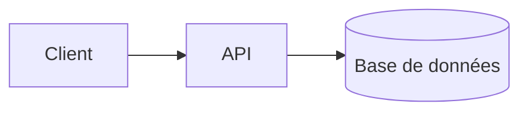

<%*
const safeName = (s) => s.replace(/[\\/:*?"<>|#^\[\]]/g, "-").replace(/\s+/g, " ").trim().slice(0, 90);
const title = (await tp.system.prompt("Titre")) || tp.file.title;
const projectFiles = app.vault.getMarkdownFiles()
  .filter(f => f.path.startsWith("01 - Projects/"))
  .filter(f => app.metadataCache.getFileCache(f)?.frontmatter?.type === "project")
  .map(f => f.basename).sort();
const project = (await tp.system.suggester(["— Aucun projet —", ...projectFiles], ["", ...projectFiles], false, "Projet")) || "";
await tp.file.move("05 - Engineering/Architecture/" + safeName(title));
-%>
---
type: engineering
kind: architecture
project: <% project ? `"[[${project}]]"` : "" %>
created: <% tp.date.now("YYYY-MM-DD") %>
tags:
  - tech
---
# <% title %>

> [!info] Vue d'ensemble
> Les composants, leurs responsabilités et les flux principaux.

## Schéma

## Composants
| Composant | Technologie | Rôle |
| --- | --- | --- |
|  |  |  |

## Décisions liées
-
