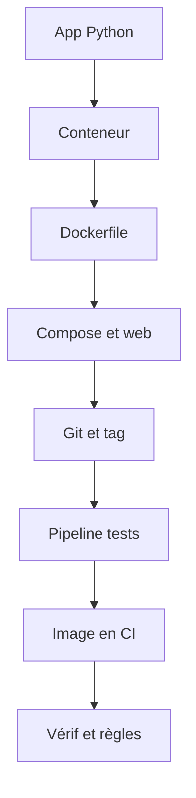

# Projet fil rouge - Rapport de dossier

> [!info] Le principe
> Un seul petit projet, qui grandit avec ton parcours [[Parcours - Python, Docker et CI]] : à chaque étape du parcours, tu ajoutes un morceau. À la fin, une application tourne dans Docker, s'affiche dans le navigateur, et GitLab la teste, la construit et la publie tout seul.
> Chaque étape du projet valide les notions qu'elle utilise, à la place des exercices.



## Les étapes
| # | Étape | Quand, dans le parcours | Notions validées |
| --- | --- | --- | --- |
| 1 | [[Fil rouge 01 - Lancer l'application dans un conteneur]] | 2 · Docker | Docker, Démon Docker, Image Docker, Conteneur, Volume Docker |
| 2 | [[Fil rouge 02 - Écrire le Dockerfile]] | 2 · Docker | Dockerfile, Python dans Docker, Variable de build Docker (ARG) |
| 3 | [[Fil rouge 03 - Une page web pour le rapport]] | 3 · Réseau | Docker Compose, Port |
| 4 | [[Fil rouge 04 - Ranger le projet dans Git]] | 4 · Git dans un vrai projet | Convention de commit, Tag Git |
| 5 | [[Fil rouge 05 - Première pipeline, les tests]] | 5 · GitLab CI | Pipeline GitLab CI, Runner GitLab, Variables CI-CD GitLab |
| 6 | [[Fil rouge 06 - Construire l'image dans la CI]] | 5 · GitLab CI | Construire une image dans la CI, Kaniko, Registre Docker, Nexus |
| 7 | [[Fil rouge 07 - Tester l'image et ranger la pipeline]] | 5 · GitLab CI | Tester l'image, pas le dépôt, Artefacts GitLab CI, Règles d'un job GitLab (rules), extends GitLab CI |

## Le code de départ
L'application est **déjà écrite** : le but n'est pas Python (tu le maîtriseras en fin de parcours), mais tout ce qui l'entoure. Elle compte les fichiers d'un dossier par extension et écrit un `rapport.json`. Tu peux la lire et la comprendre, tu n'as pas à l'écrire.

`app.py`
```python
"""Rapport de dossier : compte les fichiers d'un dossier par extension."""
import json
import os
import sys
from collections import Counter
from pathlib import Path


def compter(dossier: Path) -> dict[str, int]:
    """Renvoie {extension: nombre de fichiers}, sous-dossiers compris."""
    compteur = Counter()
    for chemin in dossier.rglob("*"):
        if chemin.is_file():
            compteur[chemin.suffix.lower() or "(sans extension)"] += 1
    return dict(sorted(compteur.items()))


def main() -> int:
    dossier = Path(sys.argv[1] if len(sys.argv) > 1 else os.environ.get("DOSSIER", "/data"))
    sortie = Path(os.environ.get("SORTIE", "/sortie"))
    if not dossier.is_dir():
        print(f"Dossier introuvable : {dossier}", file=sys.stderr)
        return 1
    rapport = {"dossier": str(dossier), "total": 0, "par_extension": compter(dossier)}
    rapport["total"] = sum(rapport["par_extension"].values())
    sortie.mkdir(parents=True, exist_ok=True)
    (sortie / "rapport.json").write_text(json.dumps(rapport, indent=2, ensure_ascii=False))
    print(f"{rapport['total']} fichiers dans {dossier} → {sortie / 'rapport.json'}")
    return 0


if __name__ == "__main__":
    sys.exit(main())
```

`test_app.py`
```python
from pathlib import Path

from app import compter


def test_compter_par_extension(tmp_path: Path):
    (tmp_path / "a.png").write_text("x")
    (tmp_path / "b.PNG").write_text("x")
    (tmp_path / "sous").mkdir()
    (tmp_path / "sous" / "notes.txt").write_text("x")
    assert compter(tmp_path) == {".png": 2, ".txt": 1}


def test_dossier_vide(tmp_path: Path):
    assert compter(tmp_path) == {}
```

Elle n'utilise que la bibliothèque standard de Python. `requirements.txt` ne contient que `pytest`, pour les tests.

## Les règles du projet
- Chaque étape donne le **but** et ce qu'il faut faire, pas les commandes : tu les cherches dans les cours et les fiches.
- « Ça marche si… » te dit comment vérifier toi-même.
- « Est-ce que j'ai compris ? » : tu réponds par écrit, puis tu demandes à Claude de vérifier. L'étape passe en `reussi` quand le projet marche **et** que tes réponses tiennent.
- Un commit (au moins) par étape, à partir de l'étape 4.
