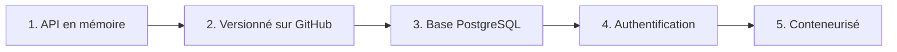

# Projet — API Notes

> [!info] Le projet
> Une API de prise de notes, construite par étapes. Chaque étape mobilise un module du [[Parcours]] : le projet grandit avec tes connaissances.

## Étape 1 — API en mémoire · [[Express]], [[API REST]]
- [ ] CRUD `/notes` (titre, contenu, `done`)
- [ ] Codes de statut corrects et erreurs en JSON

## Étape 2 — Versionner · [[Git]]
- [ ] Un commit par endpoint, une branche par fonctionnalité
- [ ] Dépôt publié ([[Fiche - Publier un dépôt sur GitHub]])

## Étape 3 — Persister · [[SQL]]
- [ ] Table `notes` dans PostgreSQL ([[Fiche - Lancer PostgreSQL avec Docker]])
- [ ] Les routes lisent et écrivent en base

## Étape 4 — Protéger · [[Middleware]], [[Authentification]]
- [ ] Middleware qui refuse les requêtes sans jeton (`401`)
- [ ] Bonus : vrais jetons [[JWT]]

## Étape 5 — Conteneuriser · [[Docker]]
- [ ] `Dockerfile` pour l'API
- [ ] L'API et la base se lancent avec Docker

## Journal du projet
-
