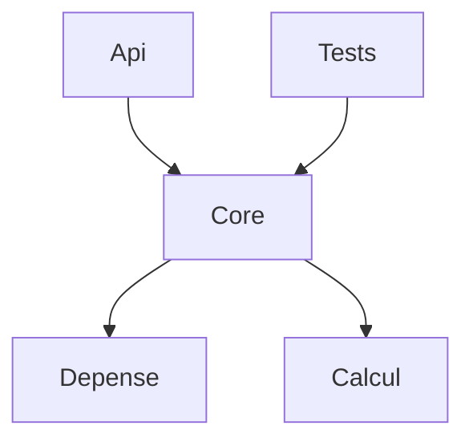

# Projet - Découvrir .NET

> [!info] Le principe
> Refaire en C#, en petit, ce que fait l'API Python de [[Projet - MesDépenses]] : une liste de dépenses, des totaux, une API, des tests. Tu connais déjà le **quoi** ; ici tu découvres seulement le **comment** en .NET.
> Ce projet n'est pas dans un niveau : il ne compte pas pour valider un niveau, mais chaque étape réussie coche la case `fil_rouge` des notions qu'elle utilise.
> Cours : [[Cours - .NET, premiers pas]] → [[Cours - Lire et écrire du code .NET]] → [[Cours - Une API web avec ASP.NET Core]] → [[Cours - Tester du code .NET]].

## Le but final
Une solution `MesDepenses` avec une bibliothèque, une API et des tests, qui se construit et se teste en deux commandes (`dotnet build`, `dotnet test`), et tourne dans Docker.

## L'architecture


```
mes-depenses-dotnet/
├── MesDepenses.sln
├── src/
│   ├── MesDepenses.Core/      les classes et les calculs
│   └── MesDepenses.Api/       l'API web
└── tests/
    └── MesDepenses.Core.Tests/
```

## Les étapes
1. [[Découvrir .NET 01 - Un premier programme console]]
2. [[Découvrir .NET 02 - Une solution en deux projets]]
3. [[Découvrir .NET 03 - Une API minimale]]
4. [[Découvrir .NET 04 - Tester avec xUnit]]
5. [[Découvrir .NET 05 - L'API dans Docker]] (après le niveau 2, Docker)

Règles à relire avant chaque étape : [[Bonnes pratiques - .NET]].
