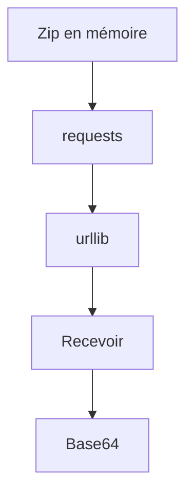

# Projet - Envoyer un zip ou une image en Python

> [!info] Le principe
> Un script qui échange des fichiers avec un serveur : il lui envoie un zip et une image, de trois façons, puis il en reçoit. C'est exactement ce que fera ta fonction Nuclio du POC CVAT.
> Le but n'est pas l'outil : c'est de **vérifier que tu as compris chaque notion** du [[Cours - Envoyer et recevoir des fichiers par HTTP]], en tombant sur les vraies erreurs et en les corrigeant. Le serveur est **fourni** : tu écris seulement `envoi.py`.



## Les étapes
| # | Étape | Notions validées |
| --- | --- | --- |
| 1 | [[Envoi 01 - Un zip sans toucher au disque]] | Fichier en mémoire (io.BytesIO) |
| 2 | [[Envoi 02 - Envoyer le zip avec requests]] | Envoyer et recevoir un fichier en HTTP |
| 3 | [[Envoi 03 - Le même envoi sans pip]] | Appeler une API sans pip (urllib.request) |
| 4 | [[Envoi 04 - Recevoir une image et un zip]] | Envoyer et recevoir un fichier en HTTP, Fichier en mémoire (io.BytesIO) |
| 5 | [[Envoi 05 - Une image dans du JSON]] | Base64 |

## Pour démarrer
Dans WSL :
```bash
mkdir -p ~/projets/envoi
cd ~/projets/envoi
```
Crée `serveur.py` et recopie-le **tel quel** (tu n'as pas à le comprendre ni à le modifier). Il n'utilise que la bibliothèque standard.

Dans un **premier terminal**, lance-le et laisse-le tourner :
```bash
python3 serveur.py
```
Il affiche chaque requête reçue, avec son `Content-Type` : regarde-le à chaque envoi, c'est ce que le serveur voit vraiment.

Dans un **deuxième terminal**, au même endroit, tu écris et lances ton script : `python3 envoi.py`.

| Route du serveur | Ce qu'elle attend | Ce qu'elle renvoie |
| --- | --- | --- |
| `POST /envoyer` | un formulaire multipart avec un champ `fichier` (et d'autres champs si tu veux) | du JSON qui décrit ce qu'il a reçu |
| `POST /brut` | le fichier seul dans le corps, avec son `Content-Type` | du JSON |
| `POST /json-image` | du JSON : `{"image": "<texte base64>"}` | du JSON |
| `GET /image.png` | rien | une image PNG |
| `GET /export.zip` | rien | un zip qui ressemble à un export CVAT |

> [!tip] Si une requête vers localhost renvoie 407 ou une page HTML du proxy
> Au travail, la variable `HTTP_PROXY` envoie aussi tes appels locaux au proxy. Fais `export NO_PROXY=localhost,127.0.0.1` dans le terminal du script. Voir [[Proxy]].

### serveur.py
```python
"""Petit serveur de test pour le projet « Envoyer un zip ou une image ».
Fourni : tu n'as pas à le modifier. Lance-le dans un terminal :  python3 serveur.py
Il affiche chaque requête reçue, pour que tu voies ce qui arrive vraiment."""
import base64
import io
import json
import struct
import zipfile
import zlib
from email import policy
from email.parser import BytesParser
from http.server import BaseHTTPRequestHandler, HTTPServer

PORT = 8000


def fabriquer_png(largeur=40, hauteur=20):
    """Un petit PNG rouge, fabriqué sans bibliothèque."""
    def bloc(nom, donnees):
        return struct.pack(">I", len(donnees)) + nom + donnees + struct.pack(">I", zlib.crc32(nom + donnees))
    lignes = b"".join(b"\x00" + b"\xd0\x30\x30" * largeur for _ in range(hauteur))
    return (b"\x89PNG\r\n\x1a\n"
            + bloc(b"IHDR", struct.pack(">IIBBBBB", largeur, hauteur, 8, 2, 0, 0, 0))
            + bloc(b"IDAT", zlib.compress(lignes))
            + bloc(b"IEND", b""))


def fabriquer_export_zip():
    """Un zip qui ressemble à un export CVAT : annotations.xml + une image."""
    tampon = io.BytesIO()
    with zipfile.ZipFile(tampon, "w", zipfile.ZIP_DEFLATED) as z:
        z.writestr("annotations.xml", '<annotations><image name="plan.png">'
                   '<polyline label="mur" points="0,0;40,0"/></image></annotations>')
        z.writestr("images/plan.png", fabriquer_png())
    return tampon.getvalue()


def reconnaitre(octets):
    if octets.startswith(b"PK\x03\x04"):
        return "zip"
    if octets.startswith(b"\x89PNG"):
        return "png"
    if octets.startswith(b"\xff\xd8"):
        return "jpeg"
    return "inconnu"


def details(octets):
    infos = {"taille_octets": len(octets), "reconnu_comme": reconnaitre(octets)}
    if infos["reconnu_comme"] == "zip":
        with zipfile.ZipFile(io.BytesIO(octets)) as z:
            infos["contenu_du_zip"] = z.namelist()
    if infos["reconnu_comme"] == "png" and len(octets) >= 24:
        infos["largeur"], infos["hauteur"] = struct.unpack(">II", octets[16:24])
    return infos


class Gestionnaire(BaseHTTPRequestHandler):
    def repondre(self, code, corps, type_contenu="application/json"):
        if type_contenu == "application/json":
            corps = json.dumps(corps, ensure_ascii=False, indent=2).encode("utf-8")
            type_contenu += "; charset=utf-8"
        self.send_response(code)
        self.send_header("Content-Type", type_contenu)
        self.send_header("Content-Length", str(len(corps)))
        self.end_headers()
        self.wfile.write(corps)

    def lire_corps(self):
        taille = int(self.headers.get("Content-Length") or 0)
        return self.rfile.read(taille)

    def log_message(self, format, *args):
        print(f"\n--> {self.command} {self.path}   (réponse {args[1] if len(args) > 1 else '?'})")
        print(f"    Content-Type   : {self.headers.get('Content-Type')}")
        print(f"    Content-Length : {self.headers.get('Content-Length')}")

    def do_GET(self):
        if self.path == "/image.png":
            self.repondre(200, fabriquer_png(), "image/png")
        elif self.path == "/export.zip":
            self.repondre(200, fabriquer_export_zip(), "application/zip")
        else:
            self.repondre(404, {"erreur": f"rien ici. Essaie GET /image.png ou GET /export.zip"})

    def do_POST(self):
        corps = self.lire_corps()
        type_recu = self.headers.get("Content-Type") or ""

        if self.path == "/envoyer":
            if not type_recu.startswith("multipart/form-data"):
                return self.repondre(400, {"erreur": "j'attends un formulaire multipart/form-data "
                                           "avec un champ 'fichier'",
                                           "content_type_recu": type_recu or "(aucun)"})
            message = BytesParser(policy=policy.HTTP).parsebytes(
                b"Content-Type: " + type_recu.encode() + b"\r\n\r\n" + corps)
            champs = {}
            for partie in message.iter_parts():
                nom = partie.get_param("name", header="content-disposition")
                champs[nom] = partie
            if "fichier" not in champs:
                return self.repondre(400, {"erreur": "il manque le champ 'fichier'",
                                           "champs_recus": list(champs)})
            fichier = champs["fichier"]
            octets = fichier.get_payload(decode=True) or b""
            reponse = {"recu": "ok", "nom_du_fichier": fichier.get_filename(),
                       "type_annonce": fichier.get_content_type(), **details(octets)}
            autres = {n: p.get_content() for n, p in champs.items()
                      if n != "fichier" and not p.get_filename()}
            if autres:
                reponse["autres_champs"] = autres
            return self.repondre(200, reponse)

        if self.path == "/brut":
            if not type_recu:
                return self.repondre(400, {"erreur": "aucun Content-Type : dis-moi ce que tu m'envoies "
                                           "(application/zip, image/png...)"})
            if type_recu.startswith("application/x-www-form-urlencoded"):
                return self.repondre(400, {"erreur": "Content-Type = application/x-www-form-urlencoded, "
                                           "le type d'un formulaire texte. Tu ne l'as sans doute pas choisi : "
                                           "dis ce que tu envoies vraiment (application/zip, image/png...)"})
            if not corps:
                return self.repondre(400, {"erreur": "le corps de la requête est vide"})
            return self.repondre(200, {"recu": "ok", "type_annonce": type_recu, **details(corps)})

        if self.path == "/json-image":
            try:
                donnees = json.loads(corps)
            except ValueError:
                return self.repondre(400, {"erreur": "le corps n'est pas du JSON valide",
                                           "content_type_recu": type_recu or "(aucun)"})
            image = donnees.get("image") if isinstance(donnees, dict) else None
            if not isinstance(image, str):
                return self.repondre(400, {"erreur": "j'attends {\"image\": \"<texte base64>\"}"})
            try:
                octets = base64.b64decode(image, validate=True)
            except ValueError:
                return self.repondre(400, {"erreur": "le champ 'image' n'est pas du base64 valide"})
            return self.repondre(200, {"recu": "ok", **details(octets)})

        self.repondre(404, {"erreur": "routes POST : /envoyer, /brut, /json-image"})


if __name__ == "__main__":
    print(f"Serveur de test sur http://localhost:{PORT}  (Ctrl+C pour arrêter)")
    HTTPServer(("localhost", PORT), Gestionnaire).serve_forever()
```

## Les règles du projet
- Chaque étape donne le **but**, pas le code : tu le cherches dans le cours et les fiches des notions.
- Tu vas tomber sur de vraies erreurs : c'est voulu. Lis le message (dans ton terminal **et** dans celui du serveur), cherche, corrige. Si tu bloques, l'**indice** donne l'idée, puis demande à Claude.
- « Ça marche si… » te dit comment vérifier toi-même.
- L'étape passe en `reussi` quand le projet marche **et** que tu sais répondre aux questions.
