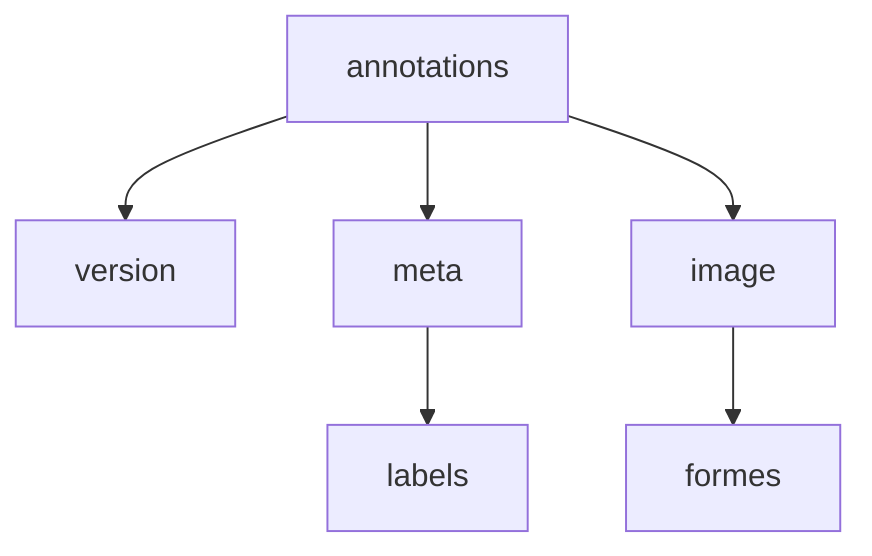
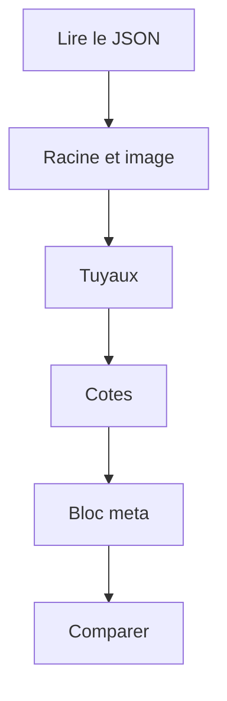

# Cours - Du JSON au XML, convertir le graphe en annotations CVAT

> [!abstract] Objectifs
> - Voir ce qui change vraiment entre le JSON du graphe et le XML de CVAT : la **syntaxe** et surtout le **sens**
> - Savoir, pour chaque forme du XML, de quelle partie du JSON elle vient
> - Connaître les 4 transformations à faire en chemin (points, nombres, rectangle, ordre)
> - Savoir lire du JSON et fabriquer du XML en Python, sans rien installer

**Prérequis :** [[Cours - Manipuler des fichiers et des archives]] · [[Liste et dictionnaire]] · [[Boucle (for, while)]]

## 1. Deux formats, deux questions différentes
La différence n'est pas seulement « accolades contre balises ». Les deux fichiers ne répondent pas à la même question.

**Le JSON du graphe répond à : « comment le réseau de tuyaux est-il construit ? »**
Il décrit un **graphe** : des **nœuds** (les points de jonction `PC_0`, `PC_1`…), des **arêtes** (`pipe_edges` : quel nœud est relié à quel nœud) et des **contraintes de cote** (`dimension_constraints` : telle cote mesure tel chemin). Il contient beaucoup d'informations de calcul : `pixel_length`, `label_distance`, `angular_error_degrees`, `path_nodes`…

**Le XML de CVAT répond à : « qu'est-ce qu'il faut dessiner sur l'image ? »**
CVAT ne connaît pas les graphes. Il ne connaît que des **formes** posées sur une image : des polylignes, des rectangles, chacune avec un **label** (son type) et éventuellement des **attributs**. Une forme ne sait pas qu'elle est reliée à une autre.

> [!tip] La conséquence
> Convertir, ici, c'est **aplatir** : on garde la géométrie et deux informations (le début du réseau, la longueur des cotes), et on **jette** tout le reste (ids des nœuds, liens entre arêtes et cotes, longueurs en pixels, diagnostics). Le chemin inverse (XML → graphe) est bien plus dur : il faut **recalculer** les liens, c'est le travail du module `replication`.

## 2. La syntaxe : comment chaque format range les données
| Idée | JSON | XML |
| --- | --- | --- |
| Un objet qui a des champs | `{"name": "iso_080.jpg", "width": 800}` | `<image name="iso_080.jpg" width="800"/>` (attributs) ou des balises enfants |
| Une liste | `[ ... , ... ]` | des balises **répétées** : plusieurs `<polyline>` à la suite |
| Un nombre | `800`, `284.53` (vrai nombre) | **toujours du texte** : `"800"`, `"284.53"` |
| Un booléen | `true` | du texte : `"true"`, `"0"`, `"False"`… selon ce que l'outil attend |
| Rien | `null` | balise vide `<values/>` ou attribut absent |

Point clé : en XML, **tout est texte**. Ce qui fait d'une valeur un nombre, c'est le programme qui la lit (ici CVAT). C'est pour ça qu'il faudra convertir chaque nombre en chaîne, avec le bon format.

Un élément XML a 3 endroits où ranger des choses :
```xml
<box label="etiquette de cote" xtl="210.00">   <!-- attributs : nom="valeur" -->
  <attribute name="nom">2000</attribute>       <!-- élément enfant, avec du texte dedans -->
</box>
```
- son **nom** (`box`) ;
- ses **attributs** (`label`, `xtl`…), toujours des chaînes ;
- son **contenu** : du texte et/ou des éléments enfants.

> [!warning] À ne pas confondre
> Le mot « attribut » a deux sens dans ce projet. Un **attribut XML** est un `nom="valeur"` dans une balise (`xtl="210.00"`). Un **attribut CVAT** est une donnée métier d'une forme (`debut`, `nom`), écrite dans le XML sous forme d'**élément** `<attribute name="debut">true</attribute>`.

## 3. Le plan du XML CVAT

- `<version>1.1</version>` : toujours la même.
- `<meta>` : la **déclaration** des labels (nom, type de forme, attributs possibles). Elle ne dépend **pas** du JSON : c'est un bloc fixe, le même pour tous les graphes.
- `<image>` : une par image, avec `id`, `name`, `width`, `height`, et **dedans** toutes les formes.

Détails du format : [[Format CVAT for images 1.1]].

## 4. Qui vient d'où : la table de correspondance
C'est le cœur du projet. Garde ce tableau sous les yeux en codant.

| Dans le XML | Vient du JSON | Remarque |
| --- | --- | --- |
| `<image id name width height>` | `image` | recopie directe, en texte |
| `<polyline label="tuyau">` | **une par** élément de `pipe_edges` | `points` ← `geometry` |
| son `<attribute name="debut">` | `pipe_edges[i]["attributes"]["debut"]` | déjà une chaîne `"true"` / `"false"` |
| `<polyline label="ligne de cote">` | **une par** élément de `dimension_constraints` | `points` ← `dimension_geometry` |
| `<box label="etiquette de cote">` | **une par** élément de `dimension_constraints` | rectangle ← `label_geometry` |
| son `<attribute name="nom">` | `dimension_constraints[i]["length"]` | `2000.0` doit devenir `2000` |
| partout | rien | `source="manual"`, `occluded="0"`, `z_order="0"` sont fixes |
| `<meta>` | rien | bloc fixe |

Ce qui **n'apparaît pas** dans le XML : `nodes` (les points sont déjà dans les `geometry`), `key`, `constraint_ids`, `pixel_length`, `label_distance`, `path_edges`, `diagnostics`… Ils ne servent pas au dessin.

## 5. Les 4 transformations en chemin
### a) Une liste de points devient une chaîne
JSON : `[[100.0, 400.0], [300.0, 284.53]]`
XML : `"100.00,400.00;300.00,284.53"`
Règle : `x,y` pour un point, `;` entre deux points. C'est une **jointure** de chaînes : regarde `str.join`.

### b) Un nombre devient un texte à 2 décimales
`str(100.0)` donne `"100.0"`, pas `"100.00"`. CVAT exporte toujours avec 2 décimales, donc pour obtenir **le même fichier** que l'exemple il faut formater :
```python
prix = 3.5
f"{prix:.2f}"     # '3.50'
"%.2f" % prix     # '3.50' (ancienne écriture, même résultat)
```
CVAT accepterait `100.0` à l'import ; le format compte surtout pour **comparer** ton résultat avec le fichier attendu.

### c) Un polygone devient un rectangle
`label_geometry` donne les **5 coins** d'un rectangle (le dernier = le premier, pour fermer le tracé). Une `box` CVAT, elle, se décrit par **2 coins** : en haut à gauche (`xtl`, `ytl`) et en bas à droite (`xbr`, `ybr`).
Sur une image, l'axe `y` **descend** : le haut, c'est le plus **petit** `y`. Donc :
- `xtl` = le plus petit des `x`, `xbr` = le plus grand ;
- `ytl` = le plus petit des `y`, `ybr` = le plus grand.

Ne compte pas sur l'ordre des coins dans le JSON (il commence en haut à **droite**) : prends le min et le max. Regarde `min()` et `max()` sur une liste.

### d) L'ordre des formes
Dans le JSON, l'arête `PC_1 → PC_4` (`segment_id` 3) arrive **avant** `PC_2 → PC_3` (`segment_id` 2). Dans le XML attendu, les tuyaux sont rangés par `segment_id` : 0, 1, 2, 3. Pour CVAT l'ordre ne change rien, mais pour obtenir exactement l'exemple il faut **trier**. Regarde `sorted(liste, key=...)`.

## 6. Les outils Python
Tout est dans la bibliothèque standard.

**Lire le JSON** : le module `json`. `json.load(f)` lit un **fichier ouvert**, `json.loads(texte)` lit une **chaîne**. Tu obtiens des dictionnaires et des listes Python ([[Liste et dictionnaire]]).

**Fabriquer le XML** : `xml.etree.ElementTree`, importé d'habitude sous le nom `ET`. Exemple sur un tout autre sujet, une bibliothèque :
```python
import xml.etree.ElementTree as ET

racine = ET.Element("bibliotheque")
livre = ET.SubElement(racine, "livre", {"isbn": "978-2", "pages": "320"})
ET.SubElement(livre, "titre").text = "Dune"

ET.indent(racine, space="  ")   # joli retrait (Python 3.9+)
ET.ElementTree(racine).write("biblio.xml", encoding="utf-8", xml_declaration=True)
```
Résultat :
```xml
<?xml version='1.0' encoding='utf-8'?>
<bibliotheque>
  <livre isbn="978-2" pages="320">
    <titre>Dune</titre>
  </livre>
</bibliotheque>
```
- `ET.Element(nom)` crée la racine, `ET.SubElement(parent, nom, attributs)` crée un enfant **et l'accroche** au parent.
- `.text` est le texte à l'intérieur de la balise.
- Les attributs et `.text` doivent être des **chaînes** : `{"pages": 320}` plante à l'écriture.

Détails : [[XML en Python (ElementTree)]].

## 7. La démarche conseillée

Avance **une forme à la fois** et vérifie le fichier produit à chaque étape. C'est exactement le découpage du projet : [[Projet - Convertir le graphe en XML CVAT]].

> [!warning] Erreurs fréquentes
> - Donner un `int` ou un `float` à ElementTree : `TypeError: cannot serialize 800 (type int)`.
> - `str(100.0)` → `"100.0"` au lieu de `"100.00"`.
> - `xtl`/`ytl` pris sur le premier coin de `label_geometry` au lieu du min.
> - `"2000.0"` au lieu de `"2000"` dans l'attribut `nom`.
> - `json.load("graph.json")` : `load` veut un fichier ouvert, pas un nom.
> - Oublier de trier les tuyaux : le fichier est valide mais différent de l'exemple.

## Résumé
> [!quote] Avec mes mots
> _À écrire après le projet : quelle est la différence de **sens** entre les deux fichiers, et comment je passe de l'un à l'autre._

## Concepts du cours
[[JSON]] · [[XML]] · [[XML en Python (ElementTree)]] · [[Format CVAT for images 1.1]] · [[Liste et dictionnaire]]
