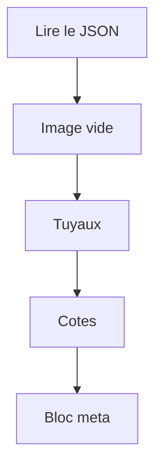

# Cours - Du JSON au XML, convertir le graphe en annotations CVAT

> [!abstract] Objectifs
> - Voir, morceau par morceau, ce que devient chaque donnée du JSON dans le XML
> - Avoir sous la main les outils Python pour faire chaque transformation soi-même

**Prérequis :** [[Liste et dictionnaire]] · [[Boucle (for, while)]]

## 0. La carte complète : je garde, j'enlève, j'ajoute
C'est **la** partie à avoir en tête. Les parties suivantes montrent chaque morceau en détail.

### Le chemin en un coup d'œil
```text
graph.json
├── image                         →  <image id name width height>
├── pipe_edges (4)                →  4 × <polyline label="tuyau">
├── dimension_constraints (3)
│   ├── dimension_geometry        →  3 × <polyline label="ligne de cote">
│   └── label_geometry + length   →  3 × <box label="etiquette de cote">
├── nodes                         →  jeté
└── graph_type, length_unit,
    diagnostics                   →  jetés

écrit en dur, sans le JSON        →  <version>, <meta>, source, occluded, z_order
```

### ✅ Je garde, et je convertis comme ça
| Dans le JSON | Devient dans le XML | Conversion | Outil Python |
| --- | --- | --- | --- |
| `image.id`, `image.name` | attributs `id`, `name` de `<image>` | recopiés en texte | `str()` |
| `image.width`, `image.height` | attributs `width`, `height` | `800` → `"800"` | `str()` |
| la liste `pipe_edges` | **une** `<polyline label="tuyau">` par élément | une boucle, dans l'ordre des `segment_id` | `for`, `sorted(key=...)` |
| `pipe_edges[i].geometry` | attribut `points` | `[[100.0, 400.0], [300.0, 284.53]]` → `"100.00,400.00;300.00,284.53"` | `f"{x:.2f}"`, `";".join` |
| `pipe_edges[i].attributes.debut` | `<attribute name="debut">true</attribute>` | recopié tel quel (c'est déjà `"true"` ou `"false"`) | `.get("debut", "false")` |
| `pipe_edges[i].segment_id` | rien d'écrit | sert **seulement** à trier | `sorted` |
| la liste `dimension_constraints` | **une** ligne de cote **et une** étiquette par élément | deux boucles (toutes les lignes, puis toutes les étiquettes) | `for` |
| `dimension_constraints[i].dimension_geometry` | `points` de la `<polyline label="ligne de cote">` | même conversion que `geometry` | la même fonction |
| `dimension_constraints[i].label_geometry` | `xtl ytl xbr ybr` de la `<box>` | 5 coins → 2 coins : le plus petit x et y, le plus grand x et y | `min`, `max`, `f"{x:.2f}"` |
| `dimension_constraints[i].length` | `<attribute name="nom">2000</attribute>` | `2000.0` → `"2000"` | `is_integer()` ou `f"{n:g}"` |

### ❌ J'enlève, et pourquoi
**La règle :** si une donnée ne sert ni à **dessiner** une forme sur l'image, ni à remplir un **attribut CVAT** (`debut`, `nom`), elle ne va pas dans le XML. CVAT ne connaît que des formes isolées : il n'a aucune place pour les liens entre elles, ni pour les résultats de calcul.

| Dans le JSON | Pourquoi je l'enlève |
| --- | --- |
| `graph_type`, `length_unit`, `diagnostics` | des infos sur le calcul, pas sur le dessin |
| `nodes` (toute la liste) | les coordonnées des nœuds sont **déjà** dans les `geometry` des tuyaux |
| `pipe_edges[i].source`, `target`, `key` | ils disent quel nœud est relié à quel nœud : CVAT ne connaît pas les liens |
| `pipe_edges[i].pixel_length` | un résultat de calcul |
| `pipe_edges[i].constraint_ids` | le lien tuyau ↔ cote : CVAT ne le connaît pas |
| `dimension_constraints[i].id`, `dimension_line_id`, `label_id` | des numéros internes au calcul |
| `dimension_constraints[i].start_node`, `end_node`, `path_nodes`, `path_edges` | le lien cote ↔ tuyaux |
| `dimension_constraints[i].label_distance`, `angular_error_degrees`, `forced_match` | la qualité du calcul |
| `dimension_constraints[i].unit` | vide (`null`) ici, et CVAT n'a pas de champ pour ça |

### ➕ J'ajoute, alors que ce n'est pas dans le JSON
| Dans le XML | D'où ça vient |
| --- | --- |
| `<version>1.1</version>` | toujours pareil |
| tout le bloc `<meta>` (les 3 labels, leur type, leurs attributs) | fixe pour ce projet : recopié depuis `attendu.xml` |
| le nom de la tâche (`iso_080_test`) | impossible à deviner : un **paramètre** de ta fonction |
| `label="tuyau"`, `"ligne de cote"`, `"etiquette de cote"` | dépend de la **liste** d'où vient la forme |
| `source="manual"`, `occluded="0"`, `z_order="0"` | toujours pareils, écrits en dur |
| les noms `debut` et `nom` dans `<attribute name="...">` | déclarés dans `<meta>` |

> [!tip] Pour vérifier que c'est clair
> Prends une clé au hasard dans `graph.json` et réponds sans regarder : je la garde ou je l'enlève ? Si je la garde, elle devient quoi, et avec quel outil ? Si tu sais répondre pour toutes, tu peux coder.

## 1. Les deux fichiers décrivent la même image
`graph.json` et `attendu.xml` parlent de la même image `iso_080.jpg` : 4 tuyaux, 3 cotes. Ils ne rangent pas les données de la même façon, et le JSON contient beaucoup de données **en plus** qui ne passent pas dans le XML.

On les compare ici en 4 morceaux : l'image, un tuyau, une cote, et ce qui n'a pas d'équivalent.

## 2. Morceau 1 : l'image
**JSON**
```json
"image": {
  "id": "0",
  "name": "iso_080.jpg",
  "width": 800,
  "height": 600
}
```
**XML**
```xml
<image id="0" name="iso_080.jpg" width="800" height="600">
  ... toutes les formes sont ici, à l'intérieur ...
</image>
```
**Ce qui change**
- Les 4 clés deviennent 4 **attributs** de la balise `<image>`, avec le même nom.
- `800` (un nombre en JSON) devient `"800"` (du texte) : en XML, **toutes les valeurs sont du texte**.
- La balise `<image>` est une **boîte** : toutes les formes (tuyaux, cotes) sont rangées dedans.

## 3. Morceau 2 : un tuyau
Prenons le premier élément de la liste `pipe_edges`.

**JSON**
```json
{
  "source": "PC_0",
  "target": "PC_1",
  "key": 0,
  "segment_id": 0,
  "geometry": [[100.0, 400.0], [300.0, 284.53]],
  "pixel_length": 230.94008075689246,
  "constraint_ids": ["DC_0"],
  "attributes": { "debut": "true" }
}
```
**XML**
```xml
<polyline label="tuyau" source="manual" occluded="0"
          points="100.00,400.00;300.00,284.53" z_order="0">
  <attribute name="debut">true</attribute>
</polyline>
```
**Clé par clé**

| Clé JSON | Dans le XML |
| --- | --- |
| `geometry` | ✅ devient `points="100.00,400.00;300.00,284.53"` |
| `attributes.debut` | ✅ devient `<attribute name="debut">true</attribute>` |
| `segment_id` | ⚠️ n'apparaît pas, mais sert à **ranger** les tuyaux dans l'ordre 0, 1, 2, 3 |
| `source`, `target`, `key` | ❌ ignorés |
| `pixel_length`, `constraint_ids` | ❌ ignorés |
| rien | ➕ `label="tuyau"`, `source="manual"`, `occluded="0"`, `z_order="0"` : **toujours les mêmes**, tu les écris en dur |

> [!warning] Attention au mot `source`
> Dans le JSON, `source` = le nœud de départ (`PC_0`). Dans le XML, `source="manual"` = « annotation faite à la main ». Même mot, rien à voir : on ne recopie pas l'un dans l'autre.

**Comment `geometry` devient `points`**
```text
[[100.0, 400.0], [300.0, 284.53]]      liste de points, chaque point = [x, y]
  [100.0, 400.0]  ->  "100.00,400.00"  un point : x et y à 2 décimales, séparés par ","
  [300.0, 284.53] ->  "300.00,284.53"
"100.00,400.00;300.00,284.53"          les points mis bout à bout, séparés par ";"
```

**Règle :** 1 élément de `pipe_edges` = 1 `<polyline label="tuyau">`. 4 tuyaux dans le JSON → 4 polylines dans le XML.

## 4. Morceau 3 : une cote
Une cote, sur le dessin, c'est **deux choses** : le trait avec ses flèches (la ligne de cote) et le petit cadre où est écrit le chiffre (l'étiquette). C'est pour ça qu'**un** élément du JSON donne **deux** formes dans le XML.

**JSON** (premier élément de `dimension_constraints`, sans les clés ignorées)
```json
{
  "id": "DC_0",
  "dimension_geometry": [[115.0, 425.98], [315.0, 310.51]],
  "label_geometry": [[240.0, 378.0], [240.0, 392.0], [210.0, 392.0], [210.0, 378.0], [240.0, 378.0]],
  "length": 2000.0
}
```
**XML : forme 1, la ligne de cote**
```xml
<polyline label="ligne de cote" source="manual" occluded="0"
          points="115.00,425.98;315.00,310.51" z_order="0">
</polyline>
```
**XML : forme 2, l'étiquette**
```xml
<box label="etiquette de cote" source="manual" occluded="0"
     xtl="210.00" ytl="378.00" xbr="240.00" ybr="392.00" z_order="0">
  <attribute name="nom">2000</attribute>
</box>
```
**Clé par clé**

| Clé JSON | Dans le XML |
| --- | --- |
| `dimension_geometry` | ✅ `points` de la ligne de cote (même transformation que les tuyaux) |
| `label_geometry` | ✅ les 4 valeurs `xtl ytl xbr ybr` de la box |
| `length` | ✅ `<attribute name="nom">2000</attribute>` : `2000.0` devient `2000` |
| `id`, `start_node`, `end_node`, `path_nodes`, `path_edges`, `label_distance`, `angular_error_degrees`, `forced_match`, `unit`, `label_id`, `dimension_line_id` | ❌ ignorés |

**Comment `label_geometry` devient une box**
Le JSON donne les **5 coins** d'un rectangle (le 5e = le 1er, pour refermer le tracé). Une box CVAT ne garde que **2 coins** : en haut à gauche (`xtl`, `ytl`) et en bas à droite (`xbr`, `ybr`).
```text
x des coins : 240, 240, 210, 210, 240   ->  plus petit = 210 (xtl), plus grand = 240 (xbr)
y des coins : 378, 392, 392, 378, 378   ->  plus petit = 378 (ytl), plus grand = 392 (ybr)
```
Sur une image, `y` **descend** : le haut, c'est le plus **petit** `y`. Le premier coin du JSON (`240, 378`) est en haut à **droite**, donc on ne peut pas le prendre tel quel.

**Règle :** 1 élément de `dimension_constraints` = 1 `<polyline label="ligne de cote">` + 1 `<box label="etiquette de cote">`. Dans le fichier attendu, toutes les lignes de cote viennent d'abord, puis toutes les étiquettes.

## 5. Morceau 4 : ce qui n'a pas d'équivalent
**Dans le JSON, mais pas dans le XML**
- `nodes` : les coordonnées des nœuds sont **déjà** dans les `geometry` des tuyaux, donc on n'en a pas besoin.
- `graph_type`, `length_unit`, `diagnostics` : des infos pour le calcul, pas pour le dessin.

**Dans le XML, mais pas dans le JSON**
- `<version>1.1</version>`
- tout le bloc `<meta>` : il **déclare** les 3 labels (`tuyau`, `ligne de cote`, `etiquette de cote`), leur type de forme et leurs attributs. Il ne dépend pas du JSON : tu le recopies depuis `attendu.xml` et tu le fabriques en dur. Seul le nom de la tâche (`iso_080_test`) pourrait changer.

**Le compte final**
```text
JSON : 4 pipe_edges + 3 dimension_constraints
XML  : 4 polylines tuyau + 3 polylines ligne de cote + 3 boxes etiquette de cote = 10 formes
```

## 6. La boîte à outils
Chaque outil est montré sur **d'autres** données que le projet : à toi de l'appliquer.

### Lire le JSON
```python
import json

with open("eleves.json", encoding="utf-8") as f:
    data = json.load(f)        # fichier ouvert -> dict / list Python
# json.loads(texte) fait pareil à partir d'une chaîne
```

### Aller chercher une valeur
```python
data = {"classe": "B2", "eleves": [{"nom": "Ana", "notes": [12, 15]}]}

data["classe"]                  # 'B2'          clé d'un dict
data["eleves"][0]               # {...}         numéro dans une liste
data["eleves"][0]["notes"][1]   # 15            on enchaîne
data.get("salle", "inconnue")   # 'inconnue'    clé absente -> valeur par défaut
```

### Parcourir une liste
```python
for eleve in data["eleves"]:
    nom = eleve["nom"]
```

### Écrire un nombre avec 2 décimales
```python
x = 7.5
str(x)          # '7.5'
f"{x:.2f}"      # '7.50'
"%.2f" % x      # '7.50'  (ancienne écriture, même résultat)
```

### Enlever le `.0` d'un nombre entier
```python
n = 42.0
int(n)          # 42      attention : int(42.7) donne 42, on perd le .7
n.is_integer()  # True    pour savoir si on peut enlever le .0 sans rien perdre
f"{n:g}"        # '42'    et f"{42.7:g}" donne '42.7'
```

### Coller des morceaux de texte
```python
mots = ["a", "b", "c"]
"-".join(mots)                       # 'a-b-c'
paires = [[1, 2], [3, 4]]
[f"{a}+{b}" for a, b in paires]      # ['1+2', '3+4']   compréhension de liste
```

### Plus petit, plus grand
```python
points = [[5, 9], [2, 7], [8, 1]]
xs = [p[0] for p in points]   # [5, 2, 8]
min(xs), max(xs)              # (2, 8)
```

### Trier une liste de dictionnaires
```python
eleves = [{"nom": "Léo", "rang": 3}, {"nom": "Ana", "rang": 1}]
sorted(eleves, key=lambda e: e["rang"])   # Ana puis Léo
```

### Fabriquer du XML : `xml.etree.ElementTree`
```python
import xml.etree.ElementTree as ET

racine = ET.Element("classe")                                  # la balise de départ
eleve = ET.SubElement(racine, "eleve", {"nom": "Ana", "age": "17"})  # enfant + attributs
ET.SubElement(eleve, "note", {"matiere": "maths"}).text = "15"      # enfant avec du texte
ET.SubElement(racine, "vide")                                  # balise sans contenu

ET.indent(racine, space="  ")                                  # retraits
ET.ElementTree(racine).write("classe.xml", encoding="utf-8", xml_declaration=True)
```
Donne :
```xml
<?xml version='1.0' encoding='utf-8'?>
<classe>
  <eleve nom="Ana" age="17">
    <note matiere="maths">15</note>
  </eleve>
  <vide />
</classe>
```
- `ET.SubElement(parent, "nom", {attributs})` crée la balise **dans** le parent et la renvoie : garde-la dans une variable si tu dois lui ajouter des enfants.
- `.text` = le texte entre `<note>` et `</note>`.
- Attributs et `.text` : **uniquement des chaînes**. `{"age": 17}` plante.
- `<vide />` et `<vide></vide>` veulent dire la même chose.
- `ET.tostring(racine, encoding="utf-8", xml_declaration=True)` donne les octets sans écrire de fichier (utile dans Nuclio).

### Récap : quel outil pour quoi
| Besoin dans le projet | Outil |
| --- | --- |
| Charger `graph.json` | `open` + `json.load` |
| Accéder à `image`, `pipe_edges`, `debut`… | `data["clé"]`, `liste[0]`, `.get()` |
| Une forme par tuyau / par cote | `for` |
| `geometry` → `"x,y;x,y"` | `f"{x:.2f}"`, compréhension de liste, `";".join` |
| Tuyaux dans l'ordre 0, 1, 2, 3 | `sorted(..., key=...)` |
| `label_geometry` → box | `min`, `max` |
| `2000.0` → `"2000"` | `is_integer()` ou `f"{n:g}"` |
| Écrire le XML | `ET.Element`, `ET.SubElement`, `.text`, `ET.indent`, `write` |

## 7. Par où commencer
Ne fais pas tout d'un coup. Une forme à la fois, et tu compares avec `attendu.xml` à chaque fois :

Les étapes détaillées : [[Projet - Convertir le graphe en XML CVAT]].

## 8. Et les autres formes de CVAT ?
Ton graphe ne donne que des `polyline` et des `box`. CVAT en connaît **9** : `box`, `polygon`, `polyline`, `points`, `ellipse`, `cuboid`, `mask`, `skeleton` et `tag`. Leur format, avec un exemple de chacune, est dans [[Format CVAT for images 1.1]].
L'idée pour toutes les couvrir sans tout mélanger : d'abord transformer le graphe en une **liste de formes simples** (un format à toi, le même pour tous les types), puis écrire chaque forme avec **une fonction par type**. C'est l'objet des étapes 07 à 09 du projet.

> [!warning] Erreurs fréquentes
> - Mettre un nombre dans un attribut XML : `TypeError: cannot serialize 800 (type int)`.
> - `str(100.0)` → `"100.0"` au lieu de `"100.00"`.
> - Prendre le premier coin de `label_geometry` pour `xtl`/`ytl` au lieu du min.
> - `"2000.0"` au lieu de `"2000"`.
> - `json.load("graph.json")` : `load` veut un fichier ouvert, pas un nom.
> - Recopier le `source` du JSON (`PC_0`) dans le `source` du XML.

## Résumé
> [!quote] Avec mes mots
> _À écrire après le projet : ce que contient chaque fichier, ce qui passe de l'un à l'autre, et ce qui est jeté._

## Concepts du cours
[[JSON]] · [[XML]] · [[XML en Python (ElementTree)]] · [[Format CVAT for images 1.1]] · [[Liste et dictionnaire]]
